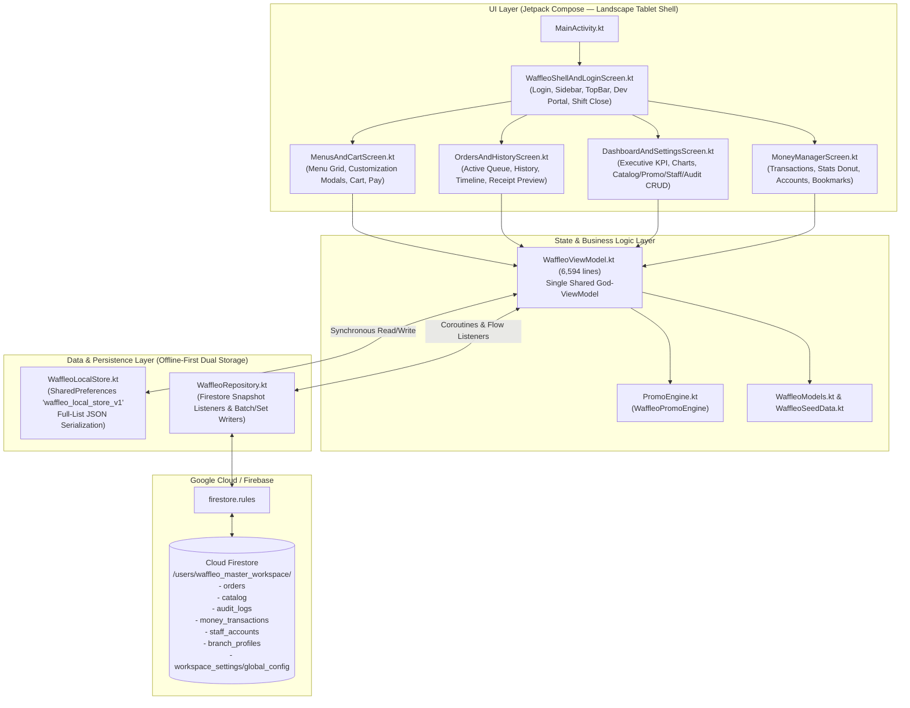
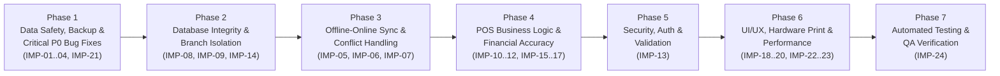

# WAFFLEO POS — COMPREHENSIVE SYSTEM AUDIT, QUALITY REVIEW & IMPROVEMENT ROADMAP

> [!IMPORTANT]
> **STATUS DOKUMEN: TAHAP 1–4 SELESAI (AUDIT & IMPLEMENTATION PLAN) — MENUNGGU ACC USER**  
> Sesuai instruksi mutlak pada **BAGIAN B**, **tidak ada satu baris pun kode sumber aplikasi, database, maupun konfigurasi yang diubah** selama proses audit ini. Seluruh temuan di bawah ini berbasis bukti nyata (*evidence-based*) dari pembacaan langsung kode sumber, skema Firestore Rules, dan pengujian unit pada repositori [`Waffleo-POS`](file:///c:/Users/USER/Documents/fdrmnn/WAFFLEO%20POS/Waffleo-POS). Implementasi hanya akan dimulai setelah Anda memberikan persetujuan (**ACC**).

---

## 1. Executive Summary

### 1.1 Gambaran Umum Kondisi Aplikasi Saat Ini
**Waffleo POS** adalah aplikasi Point of Sale berbasis **Android (Kotlin + Jetpack Compose + Material 3)** dengan arsitektur penyimpanan ganda (**Offline-First Local Store** via `SharedPreferences` JSON + **Online Cloud Sync** via **Google Cloud Firestore**). Secara fungsional dan visual, aplikasi ini sudah memiliki pondasi fitur operasional kafe/F&B yang sangat kaya:
- Katalog menu kustom (Egg Waffle dengan logika *Porsi 1/2-1/2*, *Double Topping*, *Flavour Adonan*, *Add-on*; Drinks dengan *Sweetness* & *Ice Level*; serta kategori menu/modifier dinamis).
- Mesin promosi otomatis & manual ([`WaffleoPromoEngine`](file:///c:/Users/USER/Documents/fdrmnn/WAFFLEO%20POS/Waffleo-POS/app/src/main/java/com/example/data/model/PromoEngine.kt#L291-L949)) yang mendukung *Bundle Fixed Price*, *Buy X Get Y*, *Qty Tier*, *Happy Hour*, *Order Media Promo*, dan *Minimum Purchase*.
- Antrean pesanan aktif (*Orders Queue*), riwayat pesanan (*Order History*) dengan pelacakan *Timeline Audit* dan *Payment Ledger*, serta fitur *Data Lampau* (*Backdated Order*).
- Rekapitulasi penutupan shift/toko otomatis ke modul **Money Manager** (*Income*, *Expense*, *Transfer*, perhitungan potongan komisi platform GrabFood/GoFood/ShopeeFood, serta *Donut/Line Chart* eksekutif).
- Dukungan multi-cabang (*Multi-Branch*) dengan 4 tingkatan akses ([`StaffRole`](file:///c:/Users/USER/Documents/fdrmnn/WAFFLEO%20POS/Waffleo-POS/app/src/main/java/com/example/data/model/WaffleoModels.kt#L22-L90): `DEVELOPER`, `OWNER`, `SUPERVISOR`, `KASIR`).

### 1.2 Penilaian Kesiapan Operasional Produksi (*Production Readiness Verdict*)
Meskipun secara antarmuka aplikasi terlihat matang, hasil audit menyeluruh menemukan **24 temuan utama** (terdiri dari **10 temuan kritis prioritas `P0`**, **9 temuan penting prioritas `P1`**, **4 temuan peningkatan `P2`**, dan **1 temuan opsional `P3`**) yang **wajib diselesaikan sebelum aplikasi digunakan secara penuh dalam operasional multi-perangkat dan multi-cabang sesungguhnya**.

### 1.3 Ringkasan Masalah Paling Kritis (`P0` — *Blocker Operasional*)
1. **Stok Bahan Baku (`INGREDIENT`) Terhapus Otomatis & Pemotongan Stok Lumpuh Total (`CONFIRMED`)**: Fungsi [`seedInitialCatalogToCloudIfNeeded()`](file:///c:/Users/USER/Documents/fdrmnn/WAFFLEO%20POS/Waffleo-POS/app/src/main/java/com/example/ui/viewmodel/WaffleoViewModel.kt#L1427-L1434) dan [`observeCatalog`](file:///c:/Users/USER/Documents/fdrmnn/WAFFLEO%20POS/Waffleo-POS/app/src/main/java/com/example/ui/viewmodel/WaffleoViewModel.kt#L368) secara eksplisit membuang dan menghapus semua record bertipe `"INGREDIENT"` dari Cloud Firestore dan Local Store, sehingga fitur pemotongan stok saat pesanan selesai (`completeOrderAndDeductStock`) tidak pernah bekerja.
2. **Infinite Coroutine Collector Loop & Ketergantungan Hardcoded `"waffle_polos"` (`CONFIRMED`)**: Pada [`seedInitialCatalogToCloudIfNeeded()`](file:///c:/Users/USER/Documents/fdrmnn/WAFFLEO%20POS/Waffleo-POS/app/src/main/java/com/example/ui/viewmodel/WaffleoViewModel.kt#L1426-L1445), penggunaan `return@collect` di dalam `observeCatalog(workspaceId).collect` tidak menghentikan listener Firestore, serta memeriksa keberadaan item hardcoded `id == "waffle_polos"`. Jika `"waffle_polos"` dihapus/diganti di cabang Global, seluruh katalog Cloud diabaikan oleh semua cabang!
3. **Kehilangan Data `imageUrl` Menu & Penolakan Firestore Rules (`CONFIRMED`)**: [`WaffleoRepository.saveCatalogItem()`](file:///c:/Users/USER/Documents/fdrmnn/WAFFLEO%20POS/Waffleo-POS/app/src/main/java/com/example/data/repository/WaffleoRepository.kt#L337-L361) tidak menyertakan field `imageUrl` saat upload ke Firestore, dan [`firestore.rules`](file:///c:/Users/USER/Documents/fdrmnn/WAFFLEO%20POS/Waffleo-POS/firestore.rules#L96-L107) menolak field `imageUrl`. Akibatnya, foto menu yang disimpan langsung hilang (tertindih string kosong `""`) saat sinkronisasi Cloud berjalan.
4. **Korupsi Nama Cabang Baru Menjadi `"Gabek"` (`CONFIRMED`)**: Fungsi [`formatCleanBranchName()`](file:///c:/Users/USER/Documents/fdrmnn/WAFFLEO%20POS/Waffleo-POS/app/src/main/java/com/example/data/model/WaffleoModels.kt#L897-L916) dan [`sanitizeBranchIdsInText()`](file:///c:/Users/USER/Documents/fdrmnn/WAFFLEO%20POS/Waffleo-POS/app/src/main/java/com/example/data/model/WaffleoModels.kt#L918-L929) mengganti setiap UUID cabang (`branch_<uuid>`) menjadi string hardcoded `"Gabek"`. Selain itu, [`isValidBranchProfileDoc()`](file:///c:/Users/USER/Documents/fdrmnn/WAFFLEO%20POS/Waffleo-POS/firestore.rules#L168-L179) di `firestore.rules` tidak memvalidasi field `name`.
5. **Race Condition Dokumen Tunggal `workspace_settings/global_config`, Batas 50KB, & Pemotongan ID Terlama (`.take(N)`) (`CONFIRMED`)**: Seluruh pengaturan, rekening bank, kategori, bookmark, `recappedOrderIds`, dan `deletedOrderIds` disatukan dalam satu string JSON `payloadJson` di satu dokumen Firestore. Perangkat yang baru online akan menimpa pengaturan perangkat lain, `.take(500)` / `.take(1000)` justru membuang ID pesanan **terbaru** ketika jumlahnya melewati batas, dan ketika ukuran string melebihi 50.000 karakter ([`firestore.rules:185`](file:///c:/Users/USER/Documents/fdrmnn/WAFFLEO%20POS/Waffleo-POS/firestore.rules#L185)), seluruh sinkronisasi pengaturan akan gagal permanen.
6. **Kebocoran Isolasi Data Antar-Cabang saat Rename/Delete Kategori & Subkategori (`CONFIRMED`)**: Fungsi [`renameCategory()`](file:///c:/Users/USER/Documents/fdrmnn/WAFFLEO%20POS/Waffleo-POS/app/src/main/java/com/example/ui/viewmodel/WaffleoViewModel.kt#L4543-L4599), [`editSubCategory()`](file:///c:/Users/USER/Documents/fdrmnn/WAFFLEO%20POS/Waffleo-POS/app/src/main/java/com/example/ui/viewmodel/WaffleoViewModel.kt#L4794), dan [`deleteSubCategory()`](file:///c:/Users/USER/Documents/fdrmnn/WAFFLEO%20POS/Waffleo-POS/app/src/main/java/com/example/ui/viewmodel/WaffleoViewModel.kt#L4830) mengubah `_localSeededCatalog` tanpa memfilter `rec.branchId == activeBranch`, sehingga perubahan di Cabang A ikut merusak katalog Cabang B dan Global.
7. **Kesalahan Rekapitulasi Uang Masuk Harian pada Pelunasan Kurang Bayar (*Shortfall*) Beda Metode (`CONFIRMED`)**: Jika pesanan awalnya dibayar `Tunai (Cash)` Rp 20.000 lalu diedit menjadi Rp 35.000 dan selisih Rp 15.000 dilunasi via `QRIS`, fungsi [`markOrderPaidInQueue()`](file:///c:/Users/USER/Documents/fdrmnn/WAFFLEO%20POS/Waffleo-POS/app/src/main/java/com/example/ui/viewmodel/WaffleoViewModel.kt#L3487-L3491) mengubah `paymentMethod` menjadi `"Tunai (Cash) + QRIS Waffleo (BCA)"` dengan `splitCashAmount = 0`. Saat tutup toko, [`computeStoreCloseDailyRecap()`](file:///c:/Users/USER/Documents/fdrmnn/WAFFLEO%20POS/Waffleo-POS/app/src/main/java/com/example/ui/viewmodel/WaffleoViewModel.kt#L5353-L5415) gagal mengenalinya sebagai Split Payment dan memasukkan **seluruh Rp 35.000 ke rekening Bank QRIS** serta **Rp 0 ke laci kasir (Cash)**!
8. **Selisih Rumus Harga Dasar *Double Topping* antara Keranjang Kasir dan Mesin Promo (`CONFIRMED`)**: [`WaffleoViewModel.calculateEggWafflePriceForMedia()`](file:///c:/Users/USER/Documents/fdrmnn/WAFFLEO%20POS/Waffleo-POS/app/src/main/java/com/example/ui/viewmodel/WaffleoViewModel.kt#L2092-L2102) menghitung harga dasar Double Topping sebagai `(p1 + p2 - polosPrice)`, sedangkan [`WaffleoPromoEngine.expandCartToUnits()`](file:///c:/Users/USER/Documents/fdrmnn/WAFFLEO%20POS/Waffleo-POS/app/src/main/java/com/example/data/model/PromoEngine.kt#L568-L574) menghitung `p1 + p2` tanpa dikurangi `polosPrice`, menyebabkan perhitungan diskon promo dengan add-on menjadi salah.
9. **Akses Publik Tanpa Autentikasi ke `waffleo_master_workspace` & Password Plaintext (`CONFIRMED`)**: [`firestore.rules:16-18`](file:///c:/Users/USER/Documents/fdrmnn/WAFFLEO%20POS/Waffleo-POS/firestore.rules#L16-L18) mengizinkan baca/tulis/hapus ke seluruh koleksi di `/users/waffleo_master_workspace/**` **tanpa `request.auth != null`**, sementara koleksi `staff_accounts` menyimpan password akun staf dan owner dalam bentuk **teks biasa (plaintext)**.
10. **Fitur Cetak Struk Thermal 100% Palsu/Simulasi (`CONFIRMED`)**: Tombol `"Cetak Struk Thermal"` pada [`ThermalReceiptDialog`](file:///c:/Users/USER/Documents/fdrmnn/WAFFLEO%20POS/Waffleo-POS/app/src/main/java/com/example/ui/components/WaffleoComponents.kt#L2868-L2886) hanya menutup dialog dan menampilkan banner sukses palsu tanpa mengirim data apa pun ke printer Bluetooth/USB maupun `PrintManager` Android.

---

## 2. System Architecture Overview

### 2.1 Diagram Arsitektur Sistem Saat Ini


### 2.2 Inventaris Modul & Pembagian Tanggung Jawab
| Layer | File Utama | Ukuran | Tanggung Jawab Saat Ini | Evaluasi Arsitektur |
| :--- | :--- | :---: | :--- | :--- |
| **Entrypoint** | [`MainActivity.kt`](file:///c:/Users/USER/Documents/fdrmnn/WAFFLEO%20POS/Waffleo-POS/app/src/main/java/com/example/MainActivity.kt) | 132 baris | Inisialisasi ViewModel, NetworkCallback, dan host Compose | Rapi, namun melewati `GoogleCloudAuthScreen` (`isCloudAuthenticated = true` secara default). |
| **Models & Engine** | [`WaffleoModels.kt`](file:///c:/Users/USER/Documents/fdrmnn/WAFFLEO%20POS/Waffleo-POS/app/src/main/java/com/example/data/model/WaffleoModels.kt), [`PromoEngine.kt`](file:///c:/Users/USER/Documents/fdrmnn/WAFFLEO%20POS/Waffleo-POS/app/src/main/java/com/example/data/model/PromoEngine.kt), [`WaffleoSeedData.kt`](file:///c:/Users/USER/Documents/fdrmnn/WAFFLEO%20POS/Waffleo-POS/app/src/main/java/com/example/data/model/WaffleoSeedData.kt) | 2.734 baris | Data class domain, serialisasi Cart/Ledger/Timeline, algoritma promo, data awal | Struktur model cukup bersih; `PromoEngine` terpisah dengan baik dari UI. |
| **Local Storage** | [`WaffleoLocalStore.kt`](file:///c:/Users/USER/Documents/fdrmnn/WAFFLEO%20POS/Waffleo-POS/app/src/main/java/com/example/data/local/WaffleoLocalStore.kt) | 1.041 baris | Penyimpanan lokal berbasis `SharedPreferences` (`JSONArray` string) | Rentan bottleneck performa (`O(N)` serialisasi JSON di Main Thread setiap mutasi). |
| **Cloud Repository** | [`WaffleoRepository.kt`](file:///c:/Users/USER/Documents/fdrmnn/WAFFLEO%20POS/Waffleo-POS/app/src/main/java/com/example/data/repository/WaffleoRepository.kt) | 773 baris | Wrapper operasi CRUD dan `callbackFlow` `addSnapshotListener` ke Firestore | Bersih, tetapi semua memakai `.set()` penuh (bukan atomic increment/field update) dan `observeOrders` tanpa batas waktu/jumlah. |
| **ViewModel** | [`WaffleoViewModel.kt`](file:///c:/Users/USER/Documents/fdrmnn/WAFFLEO%20POS/Waffleo-POS/app/src/main/java/com/example/ui/viewmodel/WaffleoViewModel.kt) | **6.594 baris** | Menangani Auth, Cabang, Katalog, Keranjang, Pesanan, Stok, Promo, Money Manager, Rekap Shift, dan Sinkronisasi Offline | **God-Object / Monolithic ViewModel**. Sangat besar sehingga perubahan di satu fitur rawan memicu regresi di fitur lain. |
| **UI Screens & Components** | [`DashboardAndSettingsScreen.kt`](file:///c:/Users/USER/Documents/fdrmnn/WAFFLEO%20POS/Waffleo-POS/app/src/main/java/com/example/ui/screens/DashboardAndSettingsScreen.kt) (7.684 baris), [`MoneyManagerScreen.kt`](file:///c:/Users/USER/Documents/fdrmnn/WAFFLEO%20POS/Waffleo-POS/app/src/main/java/com/example/ui/screens/MoneyManagerScreen.kt) (4.167 baris), [`WaffleoDashboardCharts.kt`](file:///c:/Users/USER/Documents/fdrmnn/WAFFLEO%20POS/Waffleo-POS/app/src/main/java/com/example/ui/components/WaffleoDashboardCharts.kt) (3.617 baris), dll. | ~26.500 baris total | Seluruh tampilan layar, grafik Canvas, dialog kustomisasi, dan form pengaturan | Desain visual konsisten dan mewah (*Luxury Warm Espresso & Gold*), tetapi terdapat beberapa *God-Files* (>3.500 baris) serta kebocoran logika perhitungan bisnis di dalam Composable UI. |

---

## 3. Complete Audit Findings (12 Cakupan Audit Menyeluruh)

### 3.1 System Architecture & Code Quality
1. **`WaffleoViewModel.kt` (6.594 baris) & `DashboardAndSettingsScreen.kt` (7.684 baris) sebagai *God-Files* (`CONFIRMED`)**:
   - Seluruh state aplikasi berada di satu kelas [`WaffleoViewModel`](file:///c:/Users/USER/Documents/fdrmnn/WAFFLEO%20POS/Waffleo-POS/app/src/main/java/com/example/ui/viewmodel/WaffleoViewModel.kt#L172-L6594). Tidak perlu dilakukan *rewrite* total (karena berisiko tinggi), namun fungsi-fungsi domain murni (seperti kalkulator rekap shift, kalkulator finansial pesanan, dan serializer pengaturan) sebaiknya diekstrak ke helper/domain class terpisah secara bertahap.
2. **Duplikasi Kode Kalkulator Matematika tanpa Operator Precedence (`CONFIRMED`)**:
   - Fungsi [`evaluateSimpleMathExpression()`](file:///c:/Users/USER/Documents/fdrmnn/WAFFLEO%20POS/Waffleo-POS/app/src/main/java/com/example/ui/components/WaffleoComponents.kt#L1427-L1466) di `WaffleoComponents.kt` diduplikasi secara identik di [`MoneyManagerScreen.kt:4064-4103`](file:///c:/Users/USER/Documents/fdrmnn/WAFFLEO%20POS/Waffleo-POS/app/src/main/java/com/example/ui/screens/MoneyManagerScreen.kt#L4064-L4103). Keduanya mengevaluasi ekspresi murni dari kiri ke kanan tanpa mendahulukan perkalian/pembagian (`10000 + 5000 * 2` menghasilkan `30000`, bukan `20000`).
3. **Kode Mati (*Dead Code*) yang Membingungkan Pemeliharaan (`CONFIRMED`)**:
   - Dialog `"Verifikasi 1x Akun Google Cabang"` sepanjang 200+ baris di [`WaffleoShellAndLoginScreen.kt:457-459, 691-894`](file:///c:/Users/USER/Documents/fdrmnn/WAFFLEO%20POS/Waffleo-POS/app/src/main/java/com/example/ui/screens/WaffleoShellAndLoginScreen.kt#L691-L894) tidak pernah dipanggil (`showOneTimeBranchGoogleDialog` selalu `false`).
   - Komponen [`PromoSettingsGridCard`](file:///c:/Users/USER/Documents/fdrmnn/WAFFLEO%20POS/Waffleo-POS/app/src/main/java/com/example/ui/screens/DashboardAndSettingsScreen.kt#L4068-L4179) di `DashboardAndSettingsScreen.kt` adalah kode lama yang sudah digantikan oleh `PromoManagementComponents.kt`.
   - Parameter `netBcaAmount` dan `platformFeeAmount` di [`OrdersAndHistoryScreen.kt:257-258, 325-326`](file:///c:/Users/USER/Documents/fdrmnn/WAFFLEO%20POS/Waffleo-POS/app/src/main/java/com/example/ui/screens/OrdersAndHistoryScreen.kt#L257-L258) serta `platformDeduction` dan `netBcaAmount` di [`MenusAndCartScreen.kt:1059-1060`](file:///c:/Users/USER/Documents/fdrmnn/WAFFLEO%20POS/Waffleo-POS/app/src/main/java/com/example/ui/screens/MenusAndCartScreen.kt#L1059-L1060) dihitung terus-menerus tetapi **tidak pernah dipakai**.

---

### 3.2 Database & Data Integrity
1. **Penghapusan Otomatis Seluruh Data Bahan Baku (`INGREDIENT`) dari Database (`CONFIRMED` — `P0`)**:
   - Pada [`WaffleoViewModel.kt:368`](file:///c:/Users/USER/Documents/fdrmnn/WAFFLEO%20POS/Waffleo-POS/app/src/main/java/com/example/ui/viewmodel/WaffleoViewModel.kt#L368) dan [`1177`](file:///c:/Users/USER/Documents/fdrmnn/WAFFLEO%20POS/Waffleo-POS/app/src/main/java/com/example/ui/viewmodel/WaffleoViewModel.kt#L1177), semua item katalog difilter dengan `rec.recordType != "INGREDIENT"`.
   - Lebih parah lagi, pada [`seedInitialCatalogToCloudIfNeeded()` (baris 1427–1434)](file:///c:/Users/USER/Documents/fdrmnn/WAFFLEO%20POS/Waffleo-POS/app/src/main/java/com/example/ui/viewmodel/WaffleoViewModel.kt#L1427-L1434):
     ```kotlin
     val obsoleteIngredients = existing.filter { it.recordType == "INGREDIENT" }
     for (oldItem in obsoleteIngredients) {
         repository.deleteCatalogItem(workspaceId, oldItem.id)
     }
     ```
     Dan pada [`WaffleoLocalStore.performOneTimeProductionCleanIfNeeded()` (baris 64)](file:///c:/Users/USER/Documents/fdrmnn/WAFFLEO%20POS/Waffleo-POS/app/src/main/java/com/example/data/local/WaffleoLocalStore.kt#L64), seluruh record `INGREDIENT` dan `PROMO` dibersihkan saat migrasi awal.
   - Padahal fungsi [`completeOrderAndDeductStock()` (baris 3692)](file:///c:/Users/USER/Documents/fdrmnn/WAFFLEO%20POS/Waffleo-POS/app/src/main/java/com/example/ui/viewmodel/WaffleoViewModel.kt#L3692), [`eraseOrderAndRevertMetrics()` (baris 3879)](file:///c:/Users/USER/Documents/fdrmnn/WAFFLEO%20POS/Waffleo-POS/app/src/main/java/com/example/ui/viewmodel/WaffleoViewModel.kt#L3879), dan [`deleteOrderRecord()` (baris 3948)](file:///c:/Users/USER/Documents/fdrmnn/WAFFLEO%20POS/Waffleo-POS/app/src/main/java/com/example/ui/viewmodel/WaffleoViewModel.kt#L3948) masih mencari `catalogRecords.value.filter { it.recordType == "INGREDIENT" }` untuk memotong dan mengembalikan stok!
2. **Kehilangan Field `imageUrl` saat Sinkronisasi Katalog ke Cloud (`CONFIRMED` — `P0`)**:
   - [`CatalogRecord`](file:///c:/Users/USER/Documents/fdrmnn/WAFFLEO%20POS/Waffleo-POS/app/src/main/java/com/example/data/model/WaffleoModels.kt#L193) dan [`WaffleoLocalStore`](file:///c:/Users/USER/Documents/fdrmnn/WAFFLEO%20POS/Waffleo-POS/app/src/main/java/com/example/data/local/WaffleoLocalStore.kt#L364-L395) menyimpan `imageUrl`.
   - Namun [`WaffleoRepository.saveCatalogItem()` (baris 337–361)](file:///c:/Users/USER/Documents/fdrmnn/WAFFLEO%20POS/Waffleo-POS/app/src/main/java/com/example/data/repository/WaffleoRepository.kt#L337-L361) **tidak menulis key `"imageUrl"`** ke map payload Firestore, dan [`isValidCatalogRecord` di `firestore.rules:96-107`](file:///c:/Users/USER/Documents/fdrmnn/WAFFLEO%20POS/Waffleo-POS/firestore.rules#L96-L107) menggunakan `.hasOnly([...])` yang **tidak mengizinkan key `"imageUrl"`**.
3. **Ketidaksesuaian Skema `BranchProfileDoc` antara Kode Aplikasi, `firestore.rules`, dan `firebase-blueprint.json` (`CONFIRMED` — `P1`)**:
   - [`WaffleoRepository.saveBranchProfile()` (baris 552)](file:///c:/Users/USER/Documents/fdrmnn/WAFFLEO%20POS/Waffleo-POS/app/src/main/java/com/example/data/repository/WaffleoRepository.kt#L552) mengirimkan field `"name": profile.name`.
   - Namun [`firestore.rules:168-179`](file:///c:/Users/USER/Documents/fdrmnn/WAFFLEO%20POS/Waffleo-POS/firestore.rules#L168-L179) dan [`firebase-blueprint.json:366-383`](file:///c:/Users/USER/Documents/fdrmnn/WAFFLEO%20POS/Waffleo-POS/firebase-blueprint.json#L366-L383) tidak mencantumkan `"name"` dalam validasi skema `branch_profiles`, serta tidak menggunakan `data.keys().hasOnly(...)` pada `money_transactions`, `staff_accounts`, `branch_profiles`, dan `workspace_settings`.
4. **Kontradiksi Aturan Hapus Pesanan (`orders` delete) antara `firestore.rules` dan `firestore.test.js` (`CONFIRMED` — `P1`)**:
   - [`firestore.rules:197`](file:///c:/Users/USER/Documents/fdrmnn/WAFFLEO%20POS/Waffleo-POS/firestore.rules#L197) mengizinkan hapus dokumen pesanan (`allow delete: if isOwnerOrSharedWorkspace(userId) && isValidId(orderId);`), sedangkan pengujian keamanan [`firestore.test.js:128`](file:///c:/Users/USER/Documents/fdrmnn/WAFFLEO%20POS/Waffleo-POS/firestore.test.js#L128) mengharapkan `await assertFails(orderDoc.delete())`. Selain itu, [`isOrderImmutableFieldsUnchanged()` di `firestore.rules:88-91`](file:///c:/Users/USER/Documents/fdrmnn/WAFFLEO%20POS/Waffleo-POS/firestore.rules#L88-L91) melarang perubahan `isPrepared` dari `true` ke `false` kecuali statusnya `CANCELLED` atau `ERASED`.

---

### 3.3 Offline-Online Synchronization (Prioritas Audit Tertinggi)

#### A. Temuan Mekanisme Sinkronisasi
1. **Infinite Collector Loop & Coupling pada Item `"waffle_polos"` (`CONFIRMED` — `P0`)**:
   - Di [`WaffleoViewModel.seedInitialCatalogToCloudIfNeeded()` (baris 1426–1445)](file:///c:/Users/USER/Documents/fdrmnn/WAFFLEO%20POS/Waffleo-POS/app/src/main/java/com/example/ui/viewmodel/WaffleoViewModel.kt#L1426-L1445):
     ```kotlin
     repository.observeCatalog(workspaceId).collect { existing ->
         ...
         val hasCoreMenu = existing.any { it.id == "waffle_polos" }
         if (existing.isEmpty() || !hasCoreMenu) {
             ...
         }
         return@collect
     }
     ```
     `return@collect` **tidak menghentikan** `Flow.collect`! Listener ini terus hidup sepanjang umur ViewModel dan dieksekusi ulang setiap kali katalog berubah di Cloud.
   - Di [`allCatalogRecords` (baris 372)](file:///c:/Users/USER/Documents/fdrmnn/WAFFLEO%20POS/Waffleo-POS/app/src/main/java/com/example/ui/viewmodel/WaffleoViewModel.kt#L372), tertulis: `if (cleanedCloud.isEmpty() || cleanedCloud.none { it.id == "waffle_polos" }) localList else { ... }`. Jika Owner/Developer menghapus atau mengganti ID `"waffle_polos"`, maka **seluruh data katalog Cloud diabaikan oleh aplikasi** dan aplikasi terus-menerus melakukan *re-seeding* ke Cloud!
2. **Monolithic `workspace_settings/global_config` — Konflik *Last-Write-Wins*, Limit 50KB, & Pemotongan `.take(N)` Terbalik (`CONFIRMED` — `P0`)**:
   - Fungsi [`pushWorkspaceSettingsNow()` (baris 6106–6195)](file:///c:/Users/USER/Documents/fdrmnn/WAFFLEO%20POS/Waffleo-POS/app/src/main/java/com/example/ui/viewmodel/WaffleoViewModel.kt#L6106-L6195) membungkus 10 state berbeda (`deletedBranchIds`, `bankAccounts`, `digitalWallets`, `moneyBookmarks`, `customMenuCategories`, `customModifierCategories`, `customSubCategories`, `transferFeeAccountChoice`, `recappedOrderIds`, `deletedOrderIds`) menjadi 1 JSON string di `workspace_settings/global_config`.
   - Di [`applyCloudWorkspaceSettingsJson()` (baris 6223)](file:///c:/Users/USER/Documents/fdrmnn/WAFFLEO%20POS/Waffleo-POS/app/src/main/java/com/example/ui/viewmodel/WaffleoViewModel.kt#L6223): `if ("workspace_settings:all" in _pendingSyncKeys.value) return`. Jika Perangkat A offline dan hanya mengubah 1 bookmark, Perangkat A akan menolak semua update `global_config` dari Cloud, lalu saat kembali online menimpa seluruh perubahan kategori/rekening/rekap yang dibuat Perangkat B!
   - Di baris [`6183`](file:///c:/Users/USER/Documents/fdrmnn/WAFFLEO%20POS/Waffleo-POS/app/src/main/java/com/example/ui/viewmodel/WaffleoViewModel.kt#L6183) dan [`6187`](file:///c:/Users/USER/Documents/fdrmnn/WAFFLEO%20POS/Waffleo-POS/app/src/main/java/com/example/ui/viewmodel/WaffleoViewModel.kt#L6187), digunakan `_recappedOrderIds.value.take(500)` dan `_deletedOrderIds.value.take(1000)`. Karena ID baru ditambahkan ke bagian **akhir** `LinkedHashSet` (`set + newId`), `.take(500)` mengambil **500 ID paling lama** dan **membuang ID pesanan yang baru saja direkap atau dihapus**! Seharusnya menggunakan `.toList().takeLast(N)`.
3. **Tidak Ada *Conflict Resolution* Berbasis Timestamp (`updatedAt`) pada Merge Lokal vs Cloud (`CONFIRMED` — `P1`)**:
   - Pada [`allOrders` (`WaffleoViewModel.kt:345-363`)](file:///c:/Users/USER/Documents/fdrmnn/WAFFLEO%20POS/Waffleo-POS/app/src/main/java/com/example/ui/viewmodel/WaffleoViewModel.kt#L345-L363) dan [`allCatalogRecords` (baris 375–385)](file:///c:/Users/USER/Documents/fdrmnn/WAFFLEO%20POS/Waffleo-POS/app/src/main/java/com/example/ui/viewmodel/WaffleoViewModel.kt#L375-L385), penggabungan antara data lokal dan Cloud hanya memeriksa `if ("order:${cloudItem.id}" in pendingKeys) localMap[cloudItem.id] else cloudItem`. Begitu `pendingKeys` dihapus setelah upload selesai, atau jika dua perangkat mengedit entitas yang sama, tidak ada perbandingan `updatedAt` atau penggabungan *ledger* secara aditif.

#### B. Hasil Simulasi 8 Skenario Sinkronisasi Kritis (Sesuai BAGIAN C.3)
| # | Skenario Simulasi | Perilaku Sistem Saat Ini (Berdasarkan Kode) | Status & Risiko |
| :-: | :--- | :--- | :--- |
| **1** | **Dua perangkat mengubah data yang sama hampir bersamaan** | Keduanya memanggil `docRef.set(payload)` penuh ([`WaffleoRepository.kt:238`](file:///c:/Users/USER/Documents/fdrmnn/WAFFLEO%20POS/Waffleo-POS/app/src/main/java/com/example/data/repository/WaffleoRepository.kt#L238)). Untuk kuota promo (`usedCount`) dan stok (`stockQty`), masing-masing membaca angka lokal lalu menulis ulang sehingga kenaikan dari salah satu perangkat hilang (*Lost Update*). | **`CONFIRMED` BUG (`P0`/`P1`)** |
| **2** | **Perangkat A offline beberapa jam, Perangkat B tetap aktif** | Saat Perangkat A membuat pesanan baru di cabang yang sama, [`submitCartToOrders` (baris 2833–2846)](file:///c:/Users/USER/Documents/fdrmnn/WAFFLEO%20POS/Waffleo-POS/app/src/main/java/com/example/ui/viewmodel/WaffleoViewModel.kt#L2833-L2846) menghitung `nextSeq = maxSeqToday + 1` hanya dari pesanan yang diketahui Perangkat A. Akibatnya Perangkat A dan Perangkat B menghasilkan **`orderNumber` yang sama persis** (mis. `WFL-GABEK-20261109-005`) dengan `id` berbeda. | **`CONFIRMED` BUG (`P0`)** |
| **3** | **Data berubah di Cloud sebelum Perangkat A kembali online** | Jika Perangkat A memiliki `"workspace_settings:all"` di `_pendingSyncKeys`, [`retryPendingCloudSyncs()` (baris 1338)](file:///c:/Users/USER/Documents/fdrmnn/WAFFLEO%20POS/Waffleo-POS/app/src/main/java/com/example/ui/viewmodel/WaffleoViewModel.kt#L1338) langsung memanggil `pushWorkspaceSettingsNow()` ketika online dan **menimpa** seluruh perubahan pengaturan/rekap di Cloud yang dibuat Perangkat B selama Perangkat A offline. | **`CONFIRMED` BUG (`P0`)** |
| **4** | **Sinkronisasi terputus ketika baru sebagian data terkirim** | [`retryPendingCloudSyncs()` (baris 1244–1356)](file:///c:/Users/USER/Documents/fdrmnn/WAFFLEO%20POS/Waffleo-POS/app/src/main/java/com/example/ui/viewmodel/WaffleoViewModel.kt#L1244-L1356) memproses setiap key satu per satu dan hanya memanggil `markSyncCompleted(key)` jika `res.isSuccess`. Jika koneksi putus di tengah jalan, sisa key tetap berada di `_pendingSyncKeys` dan dicoba lagi pada siklus 20 detik berikutnya. | **SUDAH BAIK (`ALREADY GOOD`)** |
| **5** | **Satu pesanan terkirim berkali-kali karena retry** | ID dokumen pesanan (`ord_<epochMillis>`) dibuat satu kali saat order disubmit ([`WaffleoViewModel.kt:2847`](file:///c:/Users/USER/Documents/fdrmnn/WAFFLEO%20POS/Waffleo-POS/app/src/main/java/com/example/ui/viewmodel/WaffleoViewModel.kt#L2847)) dan disimpan dengan `collection("orders").document(order.id).set(payload)`. Retry berulang bersifat *idempotent* terhadap dokumen tersebut (tidak menduplikasi dokumen order). | **SUDAH BAIK (`ALREADY GOOD`)** |
| **6** | **Data yang sudah dihapus muncul kembali (*Zombie Data*) karena perangkat lama upload** | Untuk `orders` yang dihapus permanen setelah jumlah `_deletedOrderIds` > 1.000, pemotongan `.take(1000)` di [`baris 6187`](file:///c:/Users/USER/Documents/fdrmnn/WAFFLEO%20POS/Waffleo-POS/app/src/main/java/com/example/ui/viewmodel/WaffleoViewModel.kt#L6187) membuang tombstone terbaru sehingga order yang baru dihapus **hidup kembali**! Sebaliknya, karena `deleteOrderRecord` ([`baris 3968`](file:///c:/Users/USER/Documents/fdrmnn/WAFFLEO%20POS/Waffleo-POS/app/src/main/java/com/example/ui/viewmodel/WaffleoViewModel.kt#L3968)) juga memasukkan `orderNumber` ke `_deletedOrderIds`, jika terjadi tabrakan `orderNumber` (Skenario 2) dan salah satu dihapus, pesanan sah milik perangkat lain ikut tersembunyi/terhapus! | **`CONFIRMED` BUG (`P0`)** |
| **7** | **Cache menampilkan data yang sebenarnya sudah berubah** | Untuk `catalog` dan `money_transactions` yang dihapus oleh Perangkat B di Cloud, [`allCatalogRecords` (baris 378–383)](file:///c:/Users/USER/Documents/fdrmnn/WAFFLEO%20POS/Waffleo-POS/app/src/main/java/com/example/ui/viewmodel/WaffleoViewModel.kt#L378-L383) sudah memfilter `if (!cloudIds.contains(localItem.id))` dan membersihkan `_localSeededCatalog` di [`observeCatalog` (baris 1184–1193)](file:///c:/Users/USER/Documents/fdrmnn/WAFFLEO%20POS/Waffleo-POS/app/src/main/java/com/example/ui/viewmodel/WaffleoViewModel.kt#L1184-L1193). Namun untuk `_allOrders`, jika dokumen dihapus langsung di Cloud tanpa masuk ke `_deletedOrderIds`, item lokal di `_localOrders` masih bertahan sampai aplikasi melakukan refresh penuh. | **`CONFIRMED` RISK (`P1`)** |
| **8** | **Satu perangkat belum memperoleh pembaruan terbaru dari server** | Karena Firestore SDK menjalankan `addSnapshotListener` real-time pada 6 koleksi utama, pembaruan diterima otomatis saat online. Namun indikator status Cloud di Sidebar kiri ([`WaffleoShellAndLoginScreen.kt:1071`](file:///c:/Users/USER/Documents/fdrmnn/WAFFLEO%20POS/Waffleo-POS/app/src/main/java/com/example/ui/screens/WaffleoShellAndLoginScreen.kt#L1071)) menampilkan warna kuning (`isCloudSignedIn == false`) meskipun jaringan online. | **`CONFIRMED` UI BUG (`P2`)** |

---

### 3.4 Branch Management & Data Isolation
1. **Hardcoded `"Gabek"` Fallback Merusak Nama Cabang & Log Audit (`CONFIRMED` — `P0`)**:
   - Di [`WaffleoModels.kt:897-916`](file:///c:/Users/USER/Documents/fdrmnn/WAFFLEO%20POS/Waffleo-POS/app/src/main/java/com/example/data/model/WaffleoModels.kt#L897-L916), fungsi `formatCleanBranchName(rawName, fallbackBranchId)` mengembalikan `"Gabek"` setiap kali `rawName` dan `fallbackBranchId` berformat UUID (`branch_<uuid>`).
   - Di [`WaffleoModels.kt:918-929`](file:///c:/Users/USER/Documents/fdrmnn/WAFFLEO%20POS/Waffleo-POS/app/src/main/java/com/example/data/model/WaffleoModels.kt#L918-L929), `sanitizeBranchIdsInText(text)` mengganti semua kecocokan regex `branch_[0-9a-f-]{6,}` dengan `"Gabek"`. Akibatnya, saat Developer membuat cabang baru (yang memakai ID `branch_<uuid>` di [`WaffleoViewModel.kt:1792`](file:///c:/Users/USER/Documents/fdrmnn/WAFFLEO%20POS/Waffleo-POS/app/src/main/java/com/example/ui/viewmodel/WaffleoViewModel.kt#L1792)), teks inisialisasi atau log yang memuat ID cabang otomatis berubah menjadi `"Gabek"`!
2. **Kebocoran Isolasi Data Antar-Cabang pada Rename/Delete Kategori & Subkategori (`CONFIRMED` — `P0`)**:
   - Di [`WaffleoViewModel.kt`](file:///c:/Users/USER/Documents/fdrmnn/WAFFLEO%20POS/Waffleo-POS/app/src/main/java/com/example/ui/viewmodel/WaffleoViewModel.kt):
     - `renameCategory()` (baris [`4543–4556`](file:///c:/Users/USER/Documents/fdrmnn/WAFFLEO%20POS/Waffleo-POS/app/src/main/java/com/example/ui/viewmodel/WaffleoViewModel.kt#L4543-L4556) dan [`4594–4603`](file:///c:/Users/USER/Documents/fdrmnn/WAFFLEO%20POS/Waffleo-POS/app/src/main/java/com/example/ui/viewmodel/WaffleoViewModel.kt#L4594-L4603))
     - `editSubCategory()` (baris [`4794–4808`](file:///c:/Users/USER/Documents/fdrmnn/WAFFLEO%20POS/Waffleo-POS/app/src/main/java/com/example/ui/viewmodel/WaffleoViewModel.kt#L4794-L4808))
     - `deleteSubCategory()` (baris [`4830–4843`](file:///c:/Users/USER/Documents/fdrmnn/WAFFLEO%20POS/Waffleo-POS/app/src/main/java/com/example/ui/viewmodel/WaffleoViewModel.kt#L4830-L4843))
     semuanya memodifikasi `_localSeededCatalog.value.map { rec -> ... }` dan mengunggahnya ke Cloud **tanpa memeriksa `rec.branchId.equals(activeBranch, ignoreCase = true)`**! Berbeda dengan `deleteCategory()` (baris [`4650`](file:///c:/Users/USER/Documents/fdrmnn/WAFFLEO%20POS/Waffleo-POS/app/src/main/java/com/example/ui/viewmodel/WaffleoViewModel.kt#L4650)) yang sudah benar memfilter `activeBranch`.
   - Selain itu, `_customMenuCategories`, `_customModifierCategories`, `_customSubCategories`, `_bankAccounts`, dan `_digitalWallets` disimpan secara global tanpa kunci `branchId`.
3. **Tombstone Penghapusan Cabang Menyimpan Nama Cabang (Bukan Hanya UUID) & Residu Data Cabang Lama (`CONFIRMED` — `P0`)**:
   - Pada [`deleteBranchPermanently()` (`WaffleoViewModel.kt:1625-1634`)](file:///c:/Users/USER/Documents/fdrmnn/WAFFLEO%20POS/Waffleo-POS/app/src/main/java/com/example/ui/viewmodel/WaffleoViewModel.kt#L1625-L1634), aplikasi memasukkan `resolvedName.lowercase()`, `baseSlug`, dan `"cabang $baseSlug"` ke dalam `_deletedBranchIds`.
   - Pada [`WaffleoRepository.deleteBranchCascadeInCloud()` (baris 610–622)](file:///c:/Users/USER/Documents/fdrmnn/WAFFLEO%20POS/Waffleo-POS/app/src/main/java/com/example/data/repository/WaffleoRepository.kt#L610-L622), penghapusan mencocokkan `low.removePrefix("cabang ").trim() == baseSlug`. Jika sebuah cabang dihapus lalu dibuat ulang dengan **nama yang sama**, pencocokan berbasis nama (`baseSlug`) berisiko menghapus atau memblokir data cabang baru jika ada komponen yang mengirim nama cabang ke [`isBranchDeleted()`](file:///c:/Users/USER/Documents/fdrmnn/WAFFLEO%20POS/Waffleo-POS/app/src/main/java/com/example/ui/viewmodel/WaffleoViewModel.kt#L323-L328).
   - Selain itu, `deleteBranchPermanently()` lupa menghapus `_allMoneyBookmarks` dan `_localAuditLogs` milik cabang yang dihapus dari penyimpanan lokal.

---

### 3.5 POS Business Logic & Transaction Accuracy
1. **Pelunasan Kurang Bayar (*Shortfall*) dengan Metode Berbeda Merusak Rekap Harian Tutup Toko (`CONFIRMED` — `P0`)**:
   - Di [`markOrderPaidInQueue()` (`WaffleoViewModel.kt:3487-3491`)](file:///c:/Users/USER/Documents/fdrmnn/WAFFLEO%20POS/Waffleo-POS/app/src/main/java/com/example/ui/viewmodel/WaffleoViewModel.kt#L3487-L3491):
     ```kotlin
     val finalPaymentMethod = if (isSettlingShortfall && order.paymentMethod.isNotBlank() && !order.paymentMethod.contains(resolvedMethod, ignoreCase = true)) {
         "${order.paymentMethod} + $resolvedMethod"
     } else {
         resolvedMethod
     }
     ```
     Saat pesanan `Tunai (Cash)` diedit sehingga kurang bayar dan dilunasi via `QRIS Waffleo (BCA)`, `finalPaymentMethod` menjadi `"Tunai (Cash) + QRIS Waffleo (BCA)"`, sedangkan `splitCashAmount` dan `splitQrisAmount` tetap `0L`!
   - Di [`computeStoreCloseDailyRecap()` (baris 5353)](file:///c:/Users/USER/Documents/fdrmnn/WAFFLEO%20POS/Waffleo-POS/app/src/main/java/com/example/ui/viewmodel/WaffleoViewModel.kt#L5353), pengecekan `isSplitCashQris` hanya memeriksa `ord.paymentMethod.contains("Cash + QRIS", ignoreCase = true) || (ord.splitQrisAmount > 0L && ord.splitCashAmount > 0L)`. Karena string-nya adalah `"Tunai (Cash) + QRIS..."`, `isSplitCashQris` bernilai `false`, lalu jatuh ke `else if (ord.paymentMethod.contains("QRIS"))` (baris 5411) dan membukukan **100% nilai pesanan ke QRIS**!
2. **Rumus Harga Dasar *Double Topping* di `PromoEngine.kt` Berbeda dari `WaffleoViewModel.kt` (`CONFIRMED` — `P0`)**:
   - Di [`WaffleoViewModel.calculateEggWafflePriceForMedia()` (baris 2092–2102)](file:///c:/Users/USER/Documents/fdrmnn/WAFFLEO%20POS/Waffleo-POS/app/src/main/java/com/example/ui/viewmodel/WaffleoViewModel.kt#L2092-L2102):
     ```kotlin
     val p1 = primary1.priceForMedia(media)
     val p2 = primary2.priceForMedia(media)
     (p1 + p2 - polosPrice).coerceAtLeast(p1)
     ```
   - Di [`WaffleoPromoEngine.expandCartToUnits()` (`PromoEngine.kt:568-574`)](file:///c:/Users/USER/Documents/fdrmnn/WAFFLEO%20POS/Waffleo-POS/app/src/main/java/com/example/data/model/PromoEngine.kt#L568-L574):
     ```kotlin
     line.isDoubleTopping && p2 != null -> {
         p1.priceForMedia(media) + p2.priceForMedia(media)
     }
     ```
     Karena lupa dikurangi `polosPrice`, ketika waffle Double Topping memiliki add-on/flavour berbayar dan promo diatur `includeModifiersInDiscount = false`, `PromoEngine` menganggap harga dasar menu lebih mahal sebesar `polosPrice` (Rp 13.000–Rp 17.500), sehingga diskon persentase atau paket dihitung terlalu besar!
3. **Kuota Promo (`usedCount`) Tidak Diperbarui Saat Pesanan Diedit & Hanya Bertambah `+1` Walau Multi-Paket (`CONFIRMED` — `P1`)**:
   - Di [`submitCartToOrders()` (`WaffleoViewModel.kt:3050-3054`)](file:///c:/Users/USER/Documents/fdrmnn/WAFFLEO%20POS/Waffleo-POS/app/src/main/java/com/example/ui/viewmodel/WaffleoViewModel.kt#L3050-L3054), `incrementPromoUsageCount(applied.promoId, 1)` hanya dipanggil pada pembuatan pesanan baru (`currentEditing == null`) dan selalu menambah `1` (bukan `applied.packetsOrUnitsApplied.coerceAtLeast(1)`). Jika pesanan diedit (`currentEditing != null`, baris 3093–3323) untuk menambah/mengganti/menghapus promo, kuota promo tidak disesuaikan.
4. **Transfer Refund untuk Pesanan Non-Cash yang Dibatalkan Hanya Jalan Saat `triggeredByStoreClose` & Tidak Dihapus Saat `ERASED` (`CONFIRMED` — `P1`)**:
   - Di [`syncPosSalesForDateKey()` (`WaffleoViewModel.kt:5889-5931`)](file:///c:/Users/USER/Documents/fdrmnn/WAFFLEO%20POS/Waffleo-POS/app/src/main/java/com/example/ui/viewmodel/WaffleoViewModel.kt#L5889-L5931), transaksi refund otomatis `v1_refund_transfer_${cOrd.orderNumber}_${targetDateKey}` hanya dibuat jika `triggeredByStoreClose == true`. Jika pesanan QRIS/Platform dibatalkan setelah toko tutup, transaksi refund tidak dibuat. Sebaliknya, jika pesanan batal tersebut dihapus (`ERASED`), [`eraseOrderAndRevertMetrics()` (baris 3868)](file:///c:/Users/USER/Documents/fdrmnn/WAFFLEO%20POS/Waffleo-POS/app/src/main/java/com/example/ui/viewmodel/WaffleoViewModel.kt#L3868) dan [`deleteOrderRecord()` (baris 3937)](file:///c:/Users/USER/Documents/fdrmnn/WAFFLEO%20POS/Waffleo-POS/app/src/main/java/com/example/ui/viewmodel/WaffleoViewModel.kt#L3937) tidak menghapus `v1_refund_transfer_...` dari Money Manager.
5. **Pilihan Akun Biaya Transfer (`From` vs `To`) di Money Manager Diabaikan Saat Simpan (`CONFIRMED` — `P1`)**:
   - Di [`MoneyManagerScreen.kt:2669-2720`](file:///c:/Users/USER/Documents/fdrmnn/WAFFLEO%20POS/Waffleo-POS/app/src/main/java/com/example/ui/screens/MoneyManagerScreen.kt#L2669-L2720), user dapat memilih apakah biaya admin transfer (`Fee`) dipotong dari akun asal (`FROM`) atau akun tujuan (`TO`). Namun fungsi [`buildTransactionRecord()` (baris 4023–4062)](file:///c:/Users/USER/Documents/fdrmnn/WAFFLEO%20POS/Waffleo-POS/app/src/main/java/com/example/ui/screens/MoneyManagerScreen.kt#L4023-L4062) sama sekali tidak menerima maupun menyimpan pilihan tersebut!
6. **Ketidakakuratan Perhitungan Laporan & Grafik Dashboard (`CONFIRMED` — `P1`)**:
   - **Dialog Laba Kotor (`DashboardKpiDetailDialogs.kt:348-371`)**: Menampilkan `omzetGross` (yang sudah dikurangi diskon) lalu di bawahnya menampilkan baris pengurang `-Potongan Diskon & Promo`, padahal `labaKotor = omzetGross - potonganPlatform`. Angka di tabel rincian tidak cocok jika dijumlahkan secara vertikal, dan HPP (`costPerUnit`) belum diperhitungkan.
   - **Split Payment Double-Counting di Donut Chart & Modal Channel (`WaffleoDashboardCharts.kt:2387-2402` & `DashboardAnalyticsModals.kt:111-114`)**: Satu transaksi Split (`Cash + QRIS`) menambah jumlah transaksi di kedua channel (`cashCount++` dan `qrisCount++`), serta di dalam modal rincian channel (`DashboardChannelTransactionsDialog`) menjumlahkan `ord.totalAmount` penuh (bukan `splitCashAmount` / `splitQrisAmount`), sehingga total kontribusi antar-channel melebihi 100%.
   - **Leaderboard Menu (`TopMenuPerformanceBarCard` di `WaffleoDashboardCharts.kt:2995-2998`)**: Mengabaikan `secondaryItemId` pada waffle *Half-Half* dan *Double Topping*, sehingga jumlah terjual di kartu grafik berbeda dengan jumlah terjual saat diklik masuk ke modal rincian variasi (`analyzeProductOrderConfigurations` di [`DashboardAnalyticsModals.kt:646-652`](file:///c:/Users/USER/Documents/fdrmnn/WAFFLEO%20POS/Waffleo-POS/app/src/main/java/com/example/ui/components/DashboardAnalyticsModals.kt#L646-L652)).
   - **Statistik Jam Ramai (`buildHourlySalesSeries` di `WaffleoDashboardCharts.kt:320, 341, 365`)**: Memakai `.coerceAtLeast(1)` pada rata-rata (`MEAN`), sehingga jam yang hanya punya 1 pesanan dalam 30 hari (`0,03` pesanan/hari) dipaksa menjadi `1` pesanan/hari.
7. **Bug Kehilangan Data Pengaturan Bank Pencairan & Kalkulator Platform Online (`BRANCH_CONFIG`) (`CONFIRMED` — `P1`)**:
   - Di [`CatalogEditorDialog` (`DashboardAndSettingsScreen.kt:5616-5642`)](file:///c:/Users/USER/Documents/fdrmnn/WAFFLEO%20POS/Waffleo-POS/app/src/main/java/com/example/ui/screens/DashboardAndSettingsScreen.kt#L5616-L5642), saat menyimpan `BRANCH_CONFIG`, `metadataJson` ditimpa ulang dengan string hardcoded `"bankAccount":"Rekening Bank BCA..."` yang menghapus pilihan `subCategory` (`"Bank Mandiri"`).
   - Di [`baris 5063 & 5764`](file:///c:/Users/USER/Documents/fdrmnn/WAFFLEO%20POS/Waffleo-POS/app/src/main/java/com/example/ui/screens/DashboardAndSettingsScreen.kt#L5063), kalkulator untuk `"Potongan By Order (Rp)"` menulis hasil ke `platformPricesMap["GRABFOOD"]`, sedangkan field input dan tombol Save membaca variabel `grab` / `platformPricesMap["GrabFood"]`, sehingga hasil kalkulator hilang begitu saja.

---

### 3.6 UI/UX, Layout & Responsiveness
1. **Ukuran Tombol Sentuh (*Touch Target*) di Bawah Standar Aksesibilitas Kasir (`< 48.dp`) (`CONFIRMED` — `P2`)**:
   - Tombol `-` dan `+` kuantitas item di keranjang ([`MenusAndCartScreen.kt:1526, 1553`](file:///c:/Users/USER/Documents/fdrmnn/WAFFLEO%20POS/Waffleo-POS/app/src/main/java/com/example/ui/screens/MenusAndCartScreen.kt#L1526)): hanya **`24.dp`**, dan jika `qty == 1`, tersentuh `-` langsung menghapus item kustomisasi dari keranjang tanpa konfirmasi. Tidak ada pula tombol `"Kosongkan Keranjang"`.
   - Tombol aksi pesanan aktif (`Batal`, `Edit`, `Print`, `Bayar`, `Proses`, `Selesai!`) di [`OrdersAndHistoryScreen.kt:726-885`](file:///c:/Users/USER/Documents/fdrmnn/WAFFLEO%20POS/Waffleo-POS/app/src/main/java/com/example/ui/screens/OrdersAndHistoryScreen.kt#L726-L885): tinggi `36.dp` dan sangat sempit saat mode `2 Kolom` aktif.
2. **Kegagalan Hapus Cabang Tidak Menampilkan Pesan Error di Dalam Dialog (`CONFIRMED` — `P2`)**:
   - Di [`DeleteBranchConfirmationDialog` (`WaffleoShellAndLoginScreen.kt:2922-2926`)](file:///c:/Users/USER/Documents/fdrmnn/WAFFLEO%20POS/Waffleo-POS/app/src/main/java/com/example/ui/screens/WaffleoShellAndLoginScreen.kt#L2922-L2926), jika username/password developer salah saat menggeser tombol hapus cabang, slider hanya kembali ke kiri tanpa menampilkan pesan error di dalam dialog (karena banner tampil di layer belakang tertutup dialog).
3. **Indikator Cloud Sync Kontradiktif antara Sidebar dan Profil (`CONFIRMED` — `P2`)**:
   - Sidebar kiri ([`WaffleoShellAndLoginScreen.kt:1071`](file:///c:/Users/USER/Documents/fdrmnn/WAFFLEO%20POS/Waffleo-POS/app/src/main/java/com/example/ui/screens/WaffleoShellAndLoginScreen.kt#L1071)) memeriksa `isCloudSignedIn` (selalu `false`), sedangkan modal Profil ([`baris 1819`](file:///c:/Users/USER/Documents/fdrmnn/WAFFLEO%20POS/Waffleo-POS/app/src/main/java/com/example/ui/screens/WaffleoShellAndLoginScreen.kt#L1819)) memeriksa `isNetworkOnline`.
4. **Tidak Ada Tombol Cetak Ulang Struk di Riwayat Pesanan (`OrderHistoryScreen`) (`CONFIRMED` — `P2`)**:
   - Pesanan yang sudah `DONE` di [`OrderHistoryScreen`](file:///c:/Users/USER/Documents/fdrmnn/WAFFLEO%20POS/Waffleo-POS/app/src/main/java/com/example/ui/screens/OrdersAndHistoryScreen.kt#L1588-L2092) tidak memiliki tombol untuk membuka kembali `ThermalReceiptDialog` apabila pelanggan meminta cetak ulang struk.

---

### 3.7 Performance & Scalability
1. **Serialisasi JSON Seluruh Tabel di Main Thread (`WaffleoLocalStore.kt`) (`CONFIRMED` — `P1`)**:
   - Setiap kali 1 pesanan dibuat/diubah, [`WaffleoLocalStore.saveOrders()` (`baris 201-249`)](file:///c:/Users/USER/Documents/fdrmnn/WAFFLEO%20POS/Waffleo-POS/app/src/main/java/com/example/data/local/WaffleoLocalStore.kt#L201-L249) membangun ulang `JSONArray` dari seluruh riwayat pesanan secara sinkron di thread pemanggil (Main Thread) lalu menyimpannya ke `SharedPreferences`. Saat jumlah pesanan mencapai ribuan, UI akan mengalami *frame drop / freeze* setiap klik tombol.
2. **Listener Firestore `observeOrders` Tanpa Batas Kuota/Waktu (`CONFIRMED` — `P1`)**:
   - [`WaffleoRepository.observeOrders()` (`baris 59-80`)](file:///c:/Users/USER/Documents/fdrmnn/WAFFLEO%20POS/Waffleo-POS/app/src/main/java/com/example/data/repository/WaffleoRepository.kt#L59-L80) mendengarkan seluruh koleksi `orders` dari awal toko berdiri tanpa filter atau limit. Setiap 1 perubahan status pesanan memicu deserialisasi seluruh dokumen `orders` di memori.
3. **Perhitungan Ulang Tanpa `remember` di Composable UI (`CONFIRMED` — `P2`)**:
   - [`MenusAndCartScreen.kt:1049-1060`](file:///c:/Users/USER/Documents/fdrmnn/WAFFLEO%20POS/Waffleo-POS/app/src/main/java/com/example/ui/screens/MenusAndCartScreen.kt#L1049-L1060) memanggil `evaluateCartPromoDetails()` tanpa `remember` setiap kali kasir mengetik 1 huruf di kolom Nama Pelanggan atau Catatan.
   - [`OrderHistoryScreen` (`OrdersAndHistoryScreen.kt:2252`)](file:///c:/Users/USER/Documents/fdrmnn/WAFFLEO%20POS/Waffleo-POS/app/src/main/java/com/example/ui/screens/OrdersAndHistoryScreen.kt#L2252) memanggil `CartLineItem.deserializeList(itemsPayload)` untuk setiap pesanan pada setiap ketikan huruf di kotak pencarian.
   - [`DashboardScreen` (`DashboardAndSettingsScreen.kt:310-319, 498`)](file:///c:/Users/USER/Documents/fdrmnn/WAFFLEO%20POS/Waffleo-POS/app/src/main/java/com/example/ui/screens/DashboardAndSettingsScreen.kt#L310-L319) menghitung `buildHourlySalesSeries` dua kali karena mengirim inline lambda `calculateNet` yang tidak di-`remember`.

---

### 3.8 Security & Access Control
1. **Akses Publik Tanpa Autentikasi pada `firestore.rules` (`CONFIRMED` — `P0`)**:
   - Pada [`firestore.rules:16-18`](file:///c:/Users/USER/Documents/fdrmnn/WAFFLEO%20POS/Waffleo-POS/firestore.rules#L16-L18):
     ```javascript
     function isOwnerOrSharedWorkspace(userId) {
       return isOwner(userId) || userId == 'waffleo_master_workspace';
     }
     ```
     Siapa pun di internet yang mengekstrak `google-services.json` dari APK dapat membaca, mengubah, atau menghapus seluruh koleksi di `/users/waffleo_master_workspace/**` tanpa perlu login Firebase Auth sama sekali!
   - Mengapa aturan ini dibuat demikian? Karena [`MainActivity.kt:42`](file:///c:/Users/USER/Documents/fdrmnn/WAFFLEO%20POS/Waffleo-POS/app/src/main/java/com/example/MainActivity.kt#L42) menginisialisasi `isCloudAuthenticated = true` tanpa memanggil `Firebase.auth.signInAnonymously()` atau Google Sign-In, sehingga klien Android terhubung ke Firestore dengan `request.auth == null`.
2. **Penyimpanan Password Plaintext di Cloud Firestore & Hardcoded Developer Backdoor (`CONFIRMED` — `P0`)**:
   - [`WaffleoRepository.saveStaffAccount()` (`baris 499`)](file:///c:/Users/USER/Documents/fdrmnn/WAFFLEO%20POS/Waffleo-POS/app/src/main/java/com/example/data/repository/WaffleoRepository.kt#L499) menyimpan password asli (`account.password`) dalam bentuk teks biasa di koleksi `staff_accounts`.
   - [`WaffleoViewModel.kt:1502, 1526, 1613`](file:///c:/Users/USER/Documents/fdrmnn/WAFFLEO%20POS/Waffleo-POS/app/src/main/java/com/example/ui/viewmodel/WaffleoViewModel.kt#L1502) memiliki kredensial developer dan default staf dalam bentuk plaintext.
3. **Celah Pilihan Role pada `AddStaffAccountDialog` (`CONFIRMED` — `P1`)**:
   - Di [`DashboardAndSettingsScreen.kt:5900`](file:///c:/Users/USER/Documents/fdrmnn/WAFFLEO%20POS/Waffleo-POS/app/src/main/java/com/example/ui/screens/DashboardAndSettingsScreen.kt#L5900), `AddStaffAccountDialog` menampilkan `listOf(StaffRole.OWNER, StaffRole.SUPERVISOR, StaffRole.KASIR)` untuk semua pengguna yang membuka dialog tersebut, bukannya memfilter dengan `session.role.assignableRoles()` seperti pada `EditStaffAccountDialog` (baris 6067).

---

### 3.9 Error Handling, Crash Recovery & Resilience
1. **Unsafe Cast `context as Activity` pada Google Sign-In (`CONFIRMED` — `P1`)**:
   - Di [`WaffleoShellAndLoginScreen.kt:235`](file:///c:/Users/USER/Documents/fdrmnn/WAFFLEO%20POS/Waffleo-POS/app/src/main/java/com/example/ui/screens/WaffleoShellAndLoginScreen.kt#L235), `credentialManager.getCredential(context as Activity, request)` berisiko memicu `ClassCastException` jika `Context` dibungkus oleh `ContextWrapper`.
2. **Tidak Ada Validasi Format Jam `HH:mm` pada Input Happy Hour Promo (`CONFIRMED` — `P2`)**:
   - Di [`PromoManagementComponents.kt:2035-2100`](file:///c:/Users/USER/Documents/fdrmnn/WAFFLEO%20POS/Waffleo-POS/app/src/main/java/com/example/ui/components/PromoManagementComponents.kt#L2035-L2100), input jam Happy Hour menerima teks bebas tanpa validasi `00:00`–`23:59`.
3. **Validasi Form Transaksi Money Manager Mengizinkan Kategori/Akun Kosong (`CONFIRMED` — `P1`)**:
   - Di [`MoneyManagerScreen.kt:3230`](file:///c:/Users/USER/Documents/fdrmnn/WAFFLEO%20POS/Waffleo-POS/app/src/main/java/com/example/ui/screens/MoneyManagerScreen.kt#L3230), tombol `Save` hanya memeriksa `evaluatedAmount > 0L` tanpa memastikan kategori dan akun sudah dipilih.

---

### 3.10 Hardware & Printing Integration
1. **Integrasi Printer Thermal Belum Ada (100% Simulasi UI) (`CONFIRMED` — `P1`)**:
   - [`ThermalReceiptDialog` (`WaffleoComponents.kt:2495-2888`)](file:///c:/Users/USER/Documents/fdrmnn/WAFFLEO%20POS/Waffleo-POS/app/src/main/java/com/example/ui/components/WaffleoComponents.kt#L2495-L2888) sudah memiliki tampilan pratinjau struk 58mm/80mm yang sangat rapi, tetapi tombol `"Cetak Struk Thermal"` (baris 2868) hanya memanggil `onPrinted()` -> `viewModel.showBanner("Struk ... berhasil dikirim ke printer thermal.")` tanpa koneksi Bluetooth ESC/POS ataupun `Android PrintManager`.

---

### 3.11 Backup, Export & Data Recovery
1. **Aturan Android Auto-Backup Kosong Berisiko Memulihkan Antrean Sync Lama (`CONFIRMED` — `P1`)**:
   - [`AndroidManifest.xml:9-11`](file:///c:/Users/USER/Documents/fdrmnn/WAFFLEO%20POS/Waffleo-POS/app/src/main/AndroidManifest.xml#L9-L11) mengaktifkan `android:allowBackup="true"`, namun [`backup_rules.xml`](file:///c:/Users/USER/Documents/fdrmnn/WAFFLEO%20POS/Waffleo-POS/app/src/main/res/xml/backup_rules.xml) dan [`data_extraction_rules.xml`](file:///c:/Users/USER/Documents/fdrmnn/WAFFLEO%20POS/Waffleo-POS/app/src/main/res/xml/data_extraction_rules.xml) kosong (hanya berisi komentar). Jika aplikasi diinstal ulang atau dipindah ke tablet baru, Android memulihkan `waffleo_local_store_v1.xml` lama beserta `KEY_PENDING_SYNC_KEYS` usang yang langsung menimpa data Cloud terbaru!
2. **Belum Ada Fitur Ekspor/Backup Manual (JSON/CSV) (`CONFIRMED` — `P2`)**:
   - Owner/Developer belum memiliki tombol untuk mengekspor laporan transaksi/pesanan/katalog ke file lokal (CSV/JSON) sebagai cadangan independen di luar Firestore.

---

### 3.12 Testing & Quality Assurance
1. **Sebagian Unit Test di `ExampleUnitTest.kt` Menguji Fungsi Lokal Buatan Sendiri (*Self-Testing Mocks*) (`CONFIRMED` — `P2`)**:
   - Sementara [`PromoEngineTest.kt`](file:///c:/Users/USER/Documents/fdrmnn/WAFFLEO%20POS/Waffleo-POS/app/src/test/java/com/example/PromoEngineTest.kt) (16 test) sudah sangat bagus dan menguji `WaffleoPromoEngine` asli, beberapa test di [`ExampleUnitTest.kt` (baris 213–562)](file:///c:/Users/USER/Documents/fdrmnn/WAFFLEO%20POS/Waffleo-POS/app/src/test/java/com/example/ExampleUnitTest.kt#L213-L562) mendefinisikan lambda/fungsi tiruan di dalam fungsi test itu sendiri (bukan memanggil fungsi produksi).
2. **`firestore.test.js` Gagal pada Test Delete Order & Belum Menguji 4 Koleksi Baru (`CONFIRMED` — `P1`)**:
   - [`firestore.test.js:128`](file:///c:/Users/USER/Documents/fdrmnn/WAFFLEO%20POS/Waffleo-POS/firestore.test.js#L128) bertabrakan dengan [`firestore.rules:197`](file:///c:/Users/USER/Documents/fdrmnn/WAFFLEO%20POS/Waffleo-POS/firestore.rules#L197), dan belum ada test rules untuk `money_transactions`, `staff_accounts`, `branch_profiles`, serta `workspace_settings`.

---

## 4. Klasifikasi Temuan & Rekomendasi (BAGIAN D)

### 4.1 `MUST HAVE` (Wajib Diperbaiki Sebelum Operasional Penuh)
1. **Perbaikan Sistem Stok Bahan Baku (`INGREDIENT`)**: Hentikan penghapusan otomatis `INGREDIENT` di `seedInitialCatalogToCloudIfNeeded`, `observeCatalog`, dan `WaffleoLocalStore`, serta aktifkan kembali tab & form manajemen Stok/HPP (`IMP-01`).
2. **Perbaikan Infinite Loop `seedInitialCatalogToCloudIfNeeded` & Penghapusan Syarat Hardcoded `"waffle_polos"`**: Gunakan `.first()` (one-shot check) dan flag inisialisasi workspace, bukan mengecek `id == "waffle_polos"` terus-menerus (`IMP-02`).
3. **Sinkronisasi Field `imageUrl` Katalog di `WaffleoRepository` & `firestore.rules`**: Tambahkan `imageUrl` ke payload Firestore dan daftar field yang diizinkan di `firestore.rules` (`IMP-03`).
4. **Penghapusan Hardcoded Fallback `"Gabek"` & Validasi `name` pada `branch_profiles`**: Resolusi nama cabang melalui peta `branchId -> BranchProfile.name` dan izinkan field `name` di `firestore.rules` (`IMP-04`).
5. **Perbaikan Sinkronisasi `workspace_settings` (Granular Merge, `.takeLast(N)`, & Pemisahan Tombstone)**: Ubah `.take(500)`/`.take(1000)` menjadi `.takeLast(...)`, lakukan penggabungan per-field (*field-level merge*) sebelum push agar tidak saling menimpa antar-perangkat, dan hindari pembengkakan `payloadJson` > 50KB (`IMP-05`).
6. **Pencegahan Tabrakan `orderNumber` Multi-Perangkat & Penghapusan Tombstone Berbasis `orderNumber`**: Tambahkan disambiguator perangkat pada `orderNumber` (atau pisahkan `order.id` sebagai satu-satunya kunci tombstone di `_deletedOrderIds`) agar penghapusan 1 pesanan tidak menyembunyikan pesanan perangkat lain (`IMP-06`).
7. **Isolasi `branchId` pada Rename/Delete Kategori, Subkategori, Rekening Bank & Dompet Digital**: Filter mutasi katalog dengan `rec.branchId == activeBranch` (`IMP-08`).
8. **Isolasi Penghapusan Cabang Berbasis UUID `branchId` & Pembersihan Residu Lokal**: Jangan masukkan nama cabang umum ke `_deletedBranchIds` untuk cabang ber-UUID agar cabang baru dengan nama sama tidak terblokir (`IMP-09`).
9. **Perbaikan Rekap Harian Tutup Toko pada Pelunasan Kurang Bayar (*Shortfall*) Beda Metode**: Hitung kontribusi per metode pembayaran dari `paymentLedgerJson` (`OrderPaymentLedgerEntry`) sehingga pembayaran campuran `Cash` lalu `QRIS` tercatat akurat di masing-masing akun (`IMP-10`).
10. **Penyelarasan Rumus Harga Dasar *Double Topping* di `PromoEngine.kt` & Update Kuota Promo Saat Edit Pesanan**: Kurangi `polosPrice` pada perhitungan `baseMenuUnitPrice` Double Topping di `PromoEngine.kt` (`IMP-11`).
11. **Pengamanan `firestore.rules` dengan Firebase Anonymous/Google Auth Handshake & Hashing Password (`SHA-256` + Salt)**: Pastikan aplikasi melakukan `Firebase.auth.signInAnonymously()` otomatis di latar belakang sehingga `firestore.rules` dapat mewajibkan `request.auth != null`, serta hash password staf secara kompatibel mundur (*backward-compatible*) (`IMP-13`).

### 4.2 `SHOULD HAVE` (Sangat Disarankan untuk Stabilitas & Akurasi Bisnis)
1. **Update Stok & Kuota Promo secara Atomik (`FieldValue.increment`)** (`IMP-07`).
2. **Konsistensi Transaksi Refund Pesanan Batal Non-Cash & Reversal saat `ERASED`** (`IMP-12`).
3. **Sinkronisasi Aturan `firestore.rules` vs `firestore.test.js` & Relaksasi `isPrepared` saat Edit Pesanan** (`IMP-14`).
4. **Perbaikan Akurasi Laporan Dashboard (Tabel Laba Kotor + HPP, Split Payment di Donut/Modal Channel, Atribusi Half-Half/Double di Top Menu, & Rata-rata Jam Ramai)** (`IMP-15`).
5. **Perbaikan Bug Simpan Bank Pencairan & Kalkulator `BRANCH_CONFIG` serta Filter Role di `AddStaffAccountDialog`** (`IMP-16`).
6. **Penyimpanan Pilihan Akun Biaya Transfer (`FROM` vs `TO`), Konsistensi Statistik Fee, & Validasi Input di Money Manager** (`IMP-17`).
7. **Optimasi Serialisasi `WaffleoLocalStore` ke Background Dispatcher (`Dispatchers.IO`) & Optimasi `remember` di UI** (`IMP-18`).
8. **Implementasi Cetak Struk Nyata via `Android PrintManager` & Bluetooth ESC/POS** (`IMP-20`).
9. **Konfigurasi `backup_rules.xml` & `data_extraction_rules.xml` agar Tidak Memulihkan Antrean Sync Usang** (`IMP-21`).

### 4.3 `NICE TO HAVE` (Opsional / Pengembangan Lanjutan)
1. **Peningkatan UX Kasir**: Perbesar tombol `+`/`-` keranjang ke minimal `36.dp–40.dp`, konfirmasi saat `qty == 1` dikurangi, tombol `"Kosongkan Keranjang"`, tombol `"Cetak Ulang Struk"` di Riwayat Pesanan, pesan error inline di `DeleteBranchConfirmationDialog`, dan penyelarasan indikator Cloud di Sidebar (`IMP-19`).
2. **Fitur Ekspor Data Manual (CSV / JSON Backup)** di halaman Pengaturan untuk Owner/Developer (`IMP-22`).
3. **Ekstraksi Bertahap Helper Domain dari `WaffleoViewModel` & Penambahan Unit Test Produksi Nyata** (`IMP-23`, `IMP-24`).

### 4.4 `DO NOT DO` (Sebaiknya TIDAK Dilakukan)
> [!CAUTION]
> **Daftar Perubahan yang DILARANG / Sebaiknya Tidak Dilakukan:**
> 1. **JANGAN melakukan *Rewrite* Total dari `SharedPreferences` ke Room SQLite atau mengganti Arsitektur UI secara menyeluruh saat ini**: Mengubah seluruh penyimpanan lokal ke Room sekaligus akan memutus kompatibilitas data lokal yang sudah ada di perangkat kasir dan berisiko tinggi menimbulkan regresi. Cukup pindahkan serialisasi JSON `WaffleoLocalStore` ke background coroutine (`Dispatchers.IO`) dengan *debouncing*.
> 2. **JANGAN merombak struktur koleksi utama Firestore (`/users/waffleo_master_workspace/{collection}`)**: Struktur 7 sub-koleksi saat ini sudah berjalan baik dengan listener real-time. Merombak struktur path dokumen akan mengharuskan migrasi besar-besaran dan memutus perangkat versi lama.
> 3. **JANGAN mengubah Desain Visual / Tema Warna (*Warm Alabaster, Rich Espresso, Champagne Gold*)**: Sistem desain visual aplikasi saat ini sudah sangat konsisten, modern, dan sesuai karakter brand Waffleo.
> 4. **JANGAN mengganti `WaffleoPromoEngine`**: Mesin evaluasi promo yang ada sudah memiliki algoritma yang matang dan teruji oleh 16 unit test; cukup perbaiki 1 baris rumus `baseMenuUnitPrice` untuk Double Topping.

### 4.5 `ALREADY GOOD` (Pertahankan!)
1. **Mesin Evaluasi Promo ([`PromoEngine.kt`](file:///c:/Users/USER/Documents/fdrmnn/WAFFLEO%20POS/Waffleo-POS/app/src/main/java/com/example/data/model/PromoEngine.kt)) & Pengujian [`PromoEngineTest.kt`](file:///c:/Users/USER/Documents/fdrmnn/WAFFLEO%20POS/Waffleo-POS/app/src/test/java/com/example/PromoEngineTest.kt)**: Mendukung kombinasi promo kompleks, prioritas non-stackable, batas kuota, dan proteksi harga negatif.
2. **Penghapusan Promo yang Aman (*Safe Archive vs Hard Delete*) ([`PromoManagementComponents.kt:349-406`](file:///c:/Users/USER/Documents/fdrmnn/WAFFLEO%20POS/Waffleo-POS/app/src/main/java/com/example/ui/components/PromoManagementComponents.kt#L349-L406))**: Promo yang pernah dipakai transaksi otomatis diarsipkan (bukan dihapus paksa) demi menjaga integritas histori laporan keuangan.
3. **Mekanisme Antrean Retry Sinkronisasi per-Entitas (`_pendingSyncKeys`) & `NetworkCallback` ([`MainActivity.kt:44-68`](file:///c:/Users/USER/Documents/fdrmnn/WAFFLEO%20POS/Waffleo-POS/app/src/main/java/com/example/MainActivity.kt#L44-L68))**: Otomatis mendeteksi pulihnya jaringan dan mengirim ulang item yang tertunda.
4. **Pengaman Aksi Destruktif dengan Gestur Geser (*Slide-to-Confirm*)**: Digunakan pada pembatalan pesanan (`CancelOrderDialog`) dan penghapusan cabang (`DeleteBranchConfirmationDialog`).
5. **Sistem Audit Log Append-Only & Jejak Timeline Pesanan (`OrderTimelineEvent` & `OrderPaymentLedgerEntry`)**: Mencatat setiap perubahan item, harga, status masak, dan pembayaran secara kronologis.

---

## 5. Risk Assessment Matrix

| Kategori Risiko | Tingkat Risiko Saat Ini | Dampak Bisnis Jika Dibiarkan | Mitigasi dalam Rencana Ini |
| :--- | :---: | :--- | :--- |
| **Kehilangan Data (*Data Loss*)** | **TINGGI (HIGH)** | Stok bahan baku (`INGREDIENT`) terhapus otomatis saat startup; `imageUrl` menu hilang saat sync; ID pesanan yang sudah direkap/dihapus hilang setelah >500/1.000 pesanan; pilihan bank Mandiri di `BRANCH_CONFIG` hilang saat disimpan. | `IMP-01`, `IMP-02`, `IMP-03`, `IMP-05`, `IMP-16` |
| **Duplikasi / Tabrakan Data (*Collision*)** | **TINGGI (HIGH)** | Dua tablet di cabang yang sama membuat `orderNumber` kembar saat offline; menghapus satu pesanan kembar ikut menghilangkan pesanan tablet lain. | `IMP-06`, `IMP-07` |
| **Kesalahan Laporan Keuangan (*Financial Inaccuracy*)** | **TINGGI (HIGH)** | Pelunasan kurang bayar beda metode salah masuk 100% ke rekening QRIS saat tutup toko; diskon Double Topping ber-addon kelebihan potong; Split Payment dihitung ganda di grafik channel Dashboard; Laba Kotor di modal tidak konsisten. | `IMP-10`, `IMP-11`, `IMP-12`, `IMP-15`, `IMP-17` |
| **Kebocoran Data Antar-Cabang (*Cross-Branch Leak*)** | **TINGGI (HIGH)** | Mengubah/menghapus nama kategori atau subkategori di 1 cabang mengubah item katalog milik cabang lain; cabang baru bernama sama dengan cabang lama yang dihapus berisiko terblokir. | `IMP-04`, `IMP-08`, `IMP-09` |
| **Keamanan & Privasi (*Security Breach*)** | **KRITIS (CRITICAL)** | Database Firestore `waffleo_master_workspace` terbuka tanpa autentikasi (`request.auth == null`); password staf/owner tersimpan plaintext. | `IMP-13`, `IMP-14`, `IMP-16` |
| **Penurunan Performa Jangka Panjang (*Scalability*)** | **SEDANG–TINGGI (MEDIUM-HIGH)** | Serialisasi seluruh history pesanan ke `SharedPreferences` di Main Thread dan listener `orders` tanpa batas waktu akan memperlambat tablet setelah beberapa bulan operasional. | `IMP-18` |
| **Kendala Operasional Kasir (*UX / Hardware*)** | **SEDANG (MEDIUM)** | Struk tidak benar-benar tercetak ke printer thermal; tombol `-` keranjang terlalu kecil (`24.dp`) dan rawan hapus tidak sengaja. | `IMP-19`, `IMP-20`, `IMP-21` |


---

## 6. Comprehensive Implementation Plan (BAGIAN E)

> [!NOTE]
> Sesuai **BAGIAN E**, setiap item pekerjaan di bawah ini dilengkapi dengan **10 struktur wajib**, termasuk **5. Penjelasan teknis** (menggunakan terminologi *software engineering*) dan **6. Penjelasan bahasa bayi** (menggunakan bahasa sederhana dan perumpamaan sehari-hari agar mudah dipahami oleh pemilik bisnis non-teknis).

---

### `IMP-01` — Pemulihan Sistem Inventaris Bahan Baku (`INGREDIENT`), Pemotongan Stok Resep, & Input HPP/Stok Desimal
1. **Nama pekerjaan**: Pemulihan Penyimpanan `INGREDIENT`, Penghentian Auto-Purge Bahan Baku, & Pengaktifan Manajemen Stok/HPP
2. **Priority**: `P0` (`MUST HAVE`)
3. **Kategori**: `Bug Fix` | `Database` | `POS Business Logic`
4. **Masalah yang ditemukan**:
   - **Status**: `CONFIRMED`
   - **Lokasi File & Baris**:
     - [`WaffleoViewModel.kt:368`](file:///c:/Users/USER/Documents/fdrmnn/WAFFLEO%20POS/Waffleo-POS/app/src/main/java/com/example/ui/viewmodel/WaffleoViewModel.kt#L368) & [`1177`](file:///c:/Users/USER/Documents/fdrmnn/WAFFLEO%20POS/Waffleo-POS/app/src/main/java/com/example/ui/viewmodel/WaffleoViewModel.kt#L1177): Memfilter `rec.recordType != "INGREDIENT"`, sehingga semua bahan baku disembunyikan dari state aplikasi.
     - [`WaffleoViewModel.kt:1427-1434`](file:///c:/Users/USER/Documents/fdrmnn/WAFFLEO%20POS/Waffleo-POS/app/src/main/java/com/example/ui/viewmodel/WaffleoViewModel.kt#L1427-L1434) (`seedInitialCatalogToCloudIfNeeded`): Memfilter `existing.filter { it.recordType == "INGREDIENT" }` lalu memanggil `repository.deleteCatalogItem(workspaceId, oldItem.id)` yang menghapus semua bahan baku dari Cloud Firestore!
     - [`WaffleoLocalStore.kt:64`](file:///c:/Users/USER/Documents/fdrmnn/WAFFLEO%20POS/Waffleo-POS/app/src/main/java/com/example/data/local/WaffleoLocalStore.kt#L64) (`performOneTimeProductionCleanIfNeeded`): Menghapus semua item `INGREDIENT` dari penyimpanan lokal.
     - [`DashboardAndSettingsScreen.kt:887`](file:///c:/Users/USER/Documents/fdrmnn/WAFFLEO%20POS/Waffleo-POS/app/src/main/java/com/example/ui/screens/DashboardAndSettingsScreen.kt#L887) & [`5021-5038`](file:///c:/Users/USER/Documents/fdrmnn/WAFFLEO%20POS/Waffleo-POS/app/src/main/java/com/example/ui/screens/DashboardAndSettingsScreen.kt#L5021-L5038): Tab `"Stok"` di-comment out, input `stockQty` membuang tanda titik desimal (`it.filter { ch -> ch.isDigit() }`), dan field `costPerUnit` (HPP) serta `minStock` tidak ditampilkan di form editor.
5. **Penjelasan teknis**:
   Pipeline reaktif `allCatalogRecords` dan `observeCatalog` di `WaffleoViewModel` memiliki predikat filter negatif `rec.recordType != "INGREDIENT"`, serta rutinitas *seeding* awal secara aktif memanggil `deleteCatalogItem` terhadap setiap dokumen `CatalogRecord` dengan `recordType == "INGREDIENT"`. Akibatnya, saat `completeOrderAndDeductStock()`, `eraseOrderAndRevertMetrics()`, atau `syncPosSalesToMoneyManager()` mengeksekusi query in-memory `catalogRecords.value.filter { it.recordType == "INGREDIENT" }`, koleksi yang dikembalikan selalu kosong (`emptyList()`). Selain itu, di `CatalogEditorDialog`, nilai `stockQty: Double` dikonversi ke `Int` (`initialRecord.stockQty.toInt().toString()`) dan difilter hanya karakter digit sehingga kuantitas pecahan (mis. `2.5` liter susu) mengalami *precision loss*.
6. **Penjelasan bahasa bayi**:
   Bayangkan Anda punya buku catatan stok gudang (tepung, telur, susu, coklat) dan sudah menulis aturan: *"Setiap 1 waffle terjual, kurangistok tepung dan telur di gudang"*. Tapi tanpa sadar, ada perintah otomatis di pintu masuk aplikasi yang setiap pagi **merobek dan membuang semua halaman catatan gudang tersebut ke tempat sampah**. Akibatnya, saat kasir menekan tombol `"Selesai!"` pada pesanan, aplikasi ingin mengurangi stok tepung, tapi karena halaman catatannya sudah dibuang, aplikasi tidak mengurangi apa-apa. Kita harus menghentikan perintah yang membuang catatan gudang itu dan membuka kembali halaman pengaturan stoknya.
7. **Rencana pengerjaan teknis**:
   - Hapus filter `rec.recordType != "INGREDIENT"` pada [`WaffleoViewModel.kt:368`](file:///c:/Users/USER/Documents/fdrmnn/WAFFLEO%20POS/Waffleo-POS/app/src/main/java/com/example/ui/viewmodel/WaffleoViewModel.kt#L368) dan [`1177`](file:///c:/Users/USER/Documents/fdrmnn/WAFFLEO%20POS/Waffleo-POS/app/src/main/java/com/example/ui/viewmodel/WaffleoViewModel.kt#L1177).
   - Hapus blok penghapusan `obsoleteIngredients` pada [`WaffleoViewModel.kt:1427-1434`](file:///c:/Users/USER/Documents/fdrmnn/WAFFLEO%20POS/Waffleo-POS/app/src/main/java/com/example/ui/viewmodel/WaffleoViewModel.kt#L1427-L1434) dan [`WaffleoLocalStore.kt:64`](file:///c:/Users/USER/Documents/fdrmnn/WAFFLEO%20POS/Waffleo-POS/app/src/main/java/com/example/data/local/WaffleoLocalStore.kt#L64).
   - Aktifkan kembali tab `"Stok"` di [`DashboardAndSettingsScreen.kt:887`](file:///c:/Users/USER/Documents/fdrmnn/WAFFLEO%20POS/Waffleo-POS/app/src/main/java/com/example/ui/screens/DashboardAndSettingsScreen.kt#L887) dan lengkapi input `stockQty` (mendukung angka desimal), `minStock`, serta `costPerUnit` (HPP per satuan) pada `CatalogEditorDialog` (baris 5021–5038).
8. **Risiko dan dampak**:
   - **Risiko**: Rendah. Item `INGREDIENT` sudah memiliki `recordType == "INGREDIENT"` yang terpisah dari `"MENU_ITEM"` dan `"MODIFIER"`, sehingga tidak akan bocor ke tampilan menu kasir (yang memfilter `recordType == "MENU_ITEM"`).
   - **Dampak**: Pemotongan stok otomatis saat pesanan selesai (`DONE`) dan pengembalian stok saat pesanan dihapus (`ERASED`) langsung berfungsi kembali.
9. **Testing dan Acceptance Criteria**:
   - Tambahkan bahan baku di tab Pengaturan -> Stok dengan kuantitas desimal (mis. `10.5` kg) dan HPP.
   - Selesaikan 1 pesanan Egg Waffle -> pastikan `stockQty` bahan baku terkait berkurang sesuai resep dan tercatat di Audit Log (`STOCK_DEDUCTED_ON_ORDER`).
   - Hapus (`ERASE`) pesanan tersebut -> pastikan `stockQty` kembali ke angka semula.
10. **Rollback Plan**:
    - Kembalikan perubahan pada filter `recordType != "INGREDIENT"` di `WaffleoViewModel.kt` dan sembunyikan tab `"Stok"` di `DashboardAndSettingsScreen.kt` melalui `git revert`.

---

### `IMP-02` — Perbaikan Infinite Coroutine Loop pada `seedInitialCatalogToCloudIfNeeded()` & Penghapusan Ketergantungan Hardcoded `"waffle_polos"`
1. **Nama pekerjaan**: Pengubahan `seedInitialCatalogToCloudIfNeeded()` Menjadi *One-Shot Check* & Penghapusan Syarat Hardcoded `id == "waffle_polos"`
2. **Priority**: `P0` (`MUST HAVE`)
3. **Kategori**: `Bug Fix` | `Synchronization` | `Architecture`
4. **Masalah yang ditemukan**:
   - **Status**: `CONFIRMED`
   - **Lokasi File & Baris**:
     - [`WaffleoViewModel.kt:1426-1445`](file:///c:/Users/USER/Documents/fdrmnn/WAFFLEO%20POS/Waffleo-POS/app/src/main/java/com/example/ui/viewmodel/WaffleoViewModel.kt#L1426-L1445): Memanggil `repository.observeCatalog(workspaceId).collect { existing -> ... return@collect }`. Di Kotlin Coroutines, `return@collect` hanya keluar dari blok lambda saat itu, **bukan** menghentikan `Flow.collect`!
     - [`WaffleoViewModel.kt:372`](file:///c:/Users/USER/Documents/fdrmnn/WAFFLEO%20POS/Waffleo-POS/app/src/main/java/com/example/ui/viewmodel/WaffleoViewModel.kt#L372) & [`1435`](file:///c:/Users/USER/Documents/fdrmnn/WAFFLEO%20POS/Waffleo-POS/app/src/main/java/com/example/ui/viewmodel/WaffleoViewModel.kt#L1435): Menggunakan `cleanedCloud.none { it.id == "waffle_polos" }` sebagai syarat apakah database Cloud dianggap kosong atau tidak.
5. **Penjelasan teknis**:
   1. `repository.observeCatalog(workspaceId)` adalah *infinite hot/cold callbackFlow* yang membungkus Firestore `addSnapshotListener`. Memanggil `.collect { ... return@collect }` di dalam `seedInitialCatalogToCloudIfNeeded()` menciptakan *dangling listener* kedua yang hidup selamanya di `viewModelScope` (menduplikasi listener utama di `observeCatalog` baris 1173).
   2. Lebih berbahaya lagi, `allCatalogRecords` (baris 372) mengecek `if (cleanedCloud.isEmpty() || cleanedCloud.none { it.id == "waffle_polos" }) localList else ...`. Apabila item `"waffle_polos"` dihapus oleh Owner/Developer, aplikasi menganggap seluruh katalog Cloud tidak valid, membuang semua item Cloud dari tampilan semua cabang, dan `seedInitialCatalogToCloudIfNeeded` langsung meng-upload ulang data awal (`WaffleoSeedData`) ke Cloud!
6. **Penjelasan bahasa bayi**:
   Saat ini aplikasi punya kebiasaan aneh: untuk mengecek apakah toko sudah punya daftar menu di internet (Cloud), aplikasi hanya mencari satu menu bernama **"Waffle Polos"**. Kalau suatu hari Anda menghapus menu "Waffle Polos" atau menggantinya dengan menu baru, aplikasi langsung panik dan mengira **seluruh toko belum punya menu sama sekali**, lalu mengabaikan semua menu cabang lain dan mengisi ulang menu bawaan pabrik! Selain itu, petugas pengecek awal ini tidak pernah pulang setelah mengecek, melainkan terus berdiri di pintu sambil mengecek berulang-ulang setiap detik. Kita akan memperbaikinya agar pengecekan awal cukup dilakukan **satu kali saja** saat aplikasi dibuka dan tidak bergantung pada satu menu tertentu.
7. **Rencana pengerjaan teknis**:
   - Di [`WaffleoViewModel.kt:1426`](file:///c:/Users/USER/Documents/fdrmnn/WAFFLEO%20POS/Waffleo-POS/app/src/main/java/com/example/ui/viewmodel/WaffleoViewModel.kt#L1426), ganti `repository.observeCatalog(workspaceId).collect { ... }` menjadi pengambilan satu kali (*one-shot*) menggunakan `val existing = repository.observeCatalog(workspaceId).first()`.
   - Ganti pengecekan `existing.none { it.id == "waffle_polos" }` pada baris [`372`](file:///c:/Users/USER/Documents/fdrmnn/WAFFLEO%20POS/Waffleo-POS/app/src/main/java/com/example/ui/viewmodel/WaffleoViewModel.kt#L372) dan [`1435`](file:///c:/Users/USER/Documents/fdrmnn/WAFFLEO%20POS/Waffleo-POS/app/src/main/java/com/example/ui/viewmodel/WaffleoViewModel.kt#L1435) menjadi pengecekan apakah koleksi katalog benar-benar kosong (`existing.isEmpty()`) DAN belum pernah di-seed sebelumnya (`!localStore.isCatalogSeeded()`).
8. **Risiko dan dampak**:
   - **Risiko**: Sangat rendah.
   - **Dampak**: Menghemat pemakaian memori & kuota baca Firestore (menghilangkan 1 listener duplikat permanen) serta membebaskan Owner/Developer untuk mengelola/menghapus item menu apa pun tanpa takut seluruh katalog kereset.
9. **Testing dan Acceptance Criteria**:
   - Hapus atau nonaktifkan item `"waffle_polos"` -> pastikan katalog menu lain tetap tampil normal dan tidak melakukan re-upload data seed.
   - Pastikan saat aplikasi dijalankan pertama kali pada workspace kosong, seed awal tetap berjalan tepat 1 kali.
10. **Rollback Plan**:
    - Revert perubahan pada fungsi `seedInitialCatalogToCloudIfNeeded()` dan `allCatalogRecords` di `WaffleoViewModel.kt`.

---

### `IMP-03` — Perbaikan Kehilangan Data Foto Menu (`imageUrl`) pada `WaffleoRepository` & `firestore.rules`
1. **Nama pekerjaan**: Penambahan Field `imageUrl` ke Payload Sinkronisasi Katalog Firestore & Validasi Skema `firestore.rules`
2. **Priority**: `P0` (`MUST HAVE`)
3. **Kategori**: `Bug Fix` | `Database` | `Synchronization`
4. **Masalah yang ditemukan**:
   - **Status**: `CONFIRMED`
   - **Lokasi File & Baris**:
     - [`WaffleoRepository.kt:337-361`](file:///c:/Users/USER/Documents/fdrmnn/WAFFLEO%20POS/Waffleo-POS/app/src/main/java/com/example/data/repository/WaffleoRepository.kt#L337-L361) (`saveCatalogItem`): Map `payload` yang dikirim ke Firestore tidak menyertakan `"imageUrl" to item.imageUrl`.
     - [`firestore.rules:96-107`](file:///c:/Users/USER/Documents/fdrmnn/WAFFLEO%20POS/Waffleo-POS/firestore.rules#L96-L107) (`isValidCatalogRecord`): Daftar `data.keys().hasOnly([...])` tidak mencantumkan `"imageUrl"`.
     - [`MenusAndCartScreen.kt:1478-1484`](file:///c:/Users/USER/Documents/fdrmnn/WAFFLEO%20POS/Waffleo-POS/app/src/main/java/com/example/ui/screens/MenusAndCartScreen.kt#L1478-L1484) (`CartItemRow`): Komponen `WaffleoProductIllustration` di baris keranjang tidak meneruskan parameter `imageUrl`.
5. **Penjelasan teknis**:
   Model [`CatalogRecord`](file:///c:/Users/USER/Documents/fdrmnn/WAFFLEO%20POS/Waffleo-POS/app/src/main/java/com/example/data/model/WaffleoModels.kt#L193) dan serializer lokal [`WaffleoLocalStore`](file:///c:/Users/USER/Documents/fdrmnn/WAFFLEO%20POS/Waffleo-POS/app/src/main/java/com/example/data/local/WaffleoLocalStore.kt#L364-L395) sudah memiliki properti `imageUrl: String`. Namun fungsi `WaffleoRepository.saveCatalogItem()` lupa menyertakan `"imageUrl" to item.imageUrl` dalam `hashMapOf(...)`. Akibatnya, dokumen di Firestore tidak pernah memiliki field `imageUrl`. Begitu snapshot listener `observeCatalog` menerima emisi balik dari Firestore, `doc.toObject(CatalogRecord::class.java)` menginisialisasi `imageUrl = ""`, yang kemudian menimpa data lokal di `_localSeededCatalog`. Selain itu, jika `"imageUrl"` ditambahkan ke `WaffleoRepository` tanpa memperbarui `isValidCatalogRecord` di `firestore.rules`, operasi write akan ditolak dengan `PERMISSION_DENIED` karena aturan `data.keys().hasOnly(...)`.
6. **Penjelasan bahasa bayi**:
   Saat Anda memasang foto produk pada menu, aplikasi menyimpannya di memori tablet. Tapi saat aplikasi mengirim data menu itu ke penyimpanan awan (Cloud), kurir pengirimnya **lupa membawa foto tersebut**. Lalu beberapa detik kemudian, Cloud mengirim balik data menu tanpa foto ke tablet Anda, sehingga foto yang baru saja Anda pasang langsung hilang terhapus! Selain itu, satpam di Cloud (`firestore.rules`) belum diberitahu bahwa data menu boleh membawa lampiran foto. Kita akan menyuruh kurir membawa data foto tersebut dan memberi izin pada satpam Cloud.
7. **Rencana pengerjaan teknis**:
   - Tambahkan `"imageUrl" to item.imageUrl` pada [`WaffleoRepository.saveCatalogItem()` (baris 355)](file:///c:/Users/USER/Documents/fdrmnn/WAFFLEO%20POS/Waffleo-POS/app/src/main/java/com/example/data/repository/WaffleoRepository.kt#L355).
   - Perbarui [`isValidCatalogRecord(data, itemId)` di `firestore.rules:96-107`](file:///c:/Users/USER/Documents/fdrmnn/WAFFLEO%20POS/Waffleo-POS/firestore.rules#L96-L107): tambahkan `'imageUrl'` ke dalam list `data.keys().hasOnly([...])` dan tambahkan validasi opsional `&& (!('imageUrl' in data) || isOptionalString(data.imageUrl, 2000))`.
   - Perbarui [`firebase-blueprint.json`](file:///c:/Users/USER/Documents/fdrmnn/WAFFLEO%20POS/Waffleo-POS/firebase-blueprint.json) agar mendokumentasikan field `imageUrl`.
   - Teruskan `imageUrl` (jika ada dari katalog) ke `WaffleoProductIllustration` pada `CartItemRow` di [`MenusAndCartScreen.kt:1478`](file:///c:/Users/USER/Documents/fdrmnn/WAFFLEO%20POS/Waffleo-POS/app/src/main/java/com/example/ui/screens/MenusAndCartScreen.kt#L1478).
   - **Kompatibilitas data lama**: Menggunakan `!('imageUrl' in data) || ...` di `firestore.rules` memastikan dokumen katalog lama yang belum memiliki field `imageUrl` tetap valid 100%.
8. **Risiko dan dampak**:
   - **Risiko**: Sangat rendah (harus men-deploy `firestore.rules` bersamaan atau sebelum update kode aplikasi).
   - **Dampak**: Gambar menu kustom tersimpan permanen dan tersinkronisasi antar-perangkat.
9. **Testing dan Acceptance Criteria**:
   - Simpan item menu dengan `imageUrl` -> pastikan dokumen di Firestore memiliki field `imageUrl` dan gambar tidak hilang setelah sinkronisasi Cloud.
   - Tambahkan unit test di `firestore.test.js` untuk memvalidasi penyimpanan katalog dengan dan tanpa `imageUrl`.
10. **Rollback Plan**:
    - Revert perubahan pada `WaffleoRepository.kt` dan `firestore.rules`.

---

### `IMP-04` — Penghapusan Hardcoded Fallback `"Gabek"` pada Resolusi Nama Cabang & Validasi Skema `BranchProfileDoc`
1. **Nama pekerjaan**: Perbaikan `formatCleanBranchName` & `sanitizeBranchIdsInText` agar Menggunakan Resolusi Nama Cabang Dinamis (Bukan Hardcoded `"Gabek"`) serta Penambahan Field `name` di `firestore.rules`
2. **Priority**: `P0` (`MUST HAVE`)
3. **Kategori**: `Bug Fix` | `Database` | `POS Business Logic`
4. **Masalah yang ditemukan**:
   - **Status**: `CONFIRMED`
   - **Lokasi File & Baris**:
     - [`WaffleoModels.kt:897-916`](file:///c:/Users/USER/Documents/fdrmnn/WAFFLEO%20POS/Waffleo-POS/app/src/main/java/com/example/data/model/WaffleoModels.kt#L897-L916) (`formatCleanBranchName`): Mengembalikan `"Gabek"` jika `rawName` dan `fallbackBranchId` berformat UUID (`branch_<uuid>`).
     - [`WaffleoModels.kt:918-929`](file:///c:/Users/USER/Documents/fdrmnn/WAFFLEO%20POS/Waffleo-POS/app/src/main/java/com/example/data/model/WaffleoModels.kt#L918-L929) (`sanitizeBranchIdsInText`): Mengganti setiap teks `branch_[0-9a-f-]{6,}` menjadi `"Gabek"`.
     - [`DashboardAndSettingsScreen.kt:5624`](file:///c:/Users/USER/Documents/fdrmnn/WAFFLEO%20POS/Waffleo-POS/app/src/main/java/com/example/ui/screens/DashboardAndSettingsScreen.kt#L5624): Memanggil `formatCleanBranchName(initialRecord.branchId, initialRecord.branchId)` dengan kedua argumen berupa UUID `branchId`, sehingga untuk semua cabang baru (yang ID-nya `branch_<uuid>`), nama rekening di `BRANCH_CONFIG` selalu berubah menjadi `"Rekening Bank BCA (Cabang Gabek)"`!
     - [`firestore.rules:168-179`](file:///c:/Users/USER/Documents/fdrmnn/WAFFLEO%20POS/Waffleo-POS/firestore.rules#L168-L179) (`isValidBranchProfileDoc`): Tidak memvalidasi keberadaan field `name`.
5. **Penjelasan teknis**:
   Cabang baru yang dibuat melalui [`createNewBranchByDeveloper()` (`WaffleoViewModel.kt:1792`)](file:///c:/Users/USER/Documents/fdrmnn/WAFFLEO%20POS/Waffleo-POS/app/src/main/java/com/example/ui/viewmodel/WaffleoViewModel.kt#L1792) menggunakan identitas unik `branchId = "branch_${UUID.randomUUID()}"` dan menyimpan nama asli cabang di `BranchProfile.name` (mis. `"Pangkalpinang"`). Namun fungsi statis `formatCleanBranchName(rawName, fallbackBranchId)` dan `sanitizeBranchIdsInText(text)` tidak memiliki akses ke daftar `branchProfiles`, sehingga ketika diberikan `branchId` berformat UUID, fungsi tersebut langsung melakukan *fallback* ke string hardcoded `"Gabek"`.
6. **Penjelasan bahasa bayi**:
   Setiap cabang baru diberi "Nomor KTP" acak oleh sistem (contohnya: `branch_9f8a7b...`) agar tidak tertukar, sedangkan nama panggilannya disimpan terpisah (misalnya `"Cabang Sudirman"`). Masalahnya, ada fungsi penerjemah di aplikasi yang malas mengecek buku daftar nama cabang: setiap kali dia melihat Nomor KTP cabang yang tidak dia kenal, dia langsung menebak dan menulis namanya sebagai **"Cabang Gabek"**! Akibatnya, laporan, log aktivitas, dan rekening cabang baru seperti "Cabang Sudirman" malah tertulis sebagai "Cabang Gabek". Kita akan memperbaiki fungsi penerjemah ini agar selalu membaca nama asli cabang dari buku daftar cabang.
7. **Rencana pengerjaan teknis**:
   - Tambahkan parameter opsional `branchNameLookup: ((String) -> String?)? = null` (atau registri map in-memory `branchId -> displayName` yang diperbarui oleh `WaffleoViewModel`) pada [`formatCleanBranchName()`](file:///c:/Users/USER/Documents/fdrmnn/WAFFLEO%20POS/Waffleo-POS/app/src/main/java/com/example/data/model/WaffleoModels.kt#L897-L916) dan [`sanitizeBranchIdsInText()`](file:///c:/Users/USER/Documents/fdrmnn/WAFFLEO%20POS/Waffleo-POS/app/src/main/java/com/example/data/model/WaffleoModels.kt#L918-L929).
   - Jika `branchId` tidak ditemukan di registri dan bukan `"gabek"`, gunakan fallback netral (seperti `"Cabang"` atau kode pendek) dan hanya kembalikan `"Gabek"` jika `branchId` memang `"gabek"` atau cabang default awal.
   - Di [`DashboardAndSettingsScreen.kt:5624`](file:///c:/Users/USER/Documents/fdrmnn/WAFFLEO%20POS/Waffleo-POS/app/src/main/java/com/example/ui/screens/DashboardAndSettingsScreen.kt#L5624), gunakan `viewModel.getBranchDisplayName(initialRecord.branchId)`.
   - Di [`firestore.rules:168-179`](file:///c:/Users/USER/Documents/fdrmnn/WAFFLEO%20POS/Waffleo-POS/firestore.rules#L168-L179) dan [`firebase-blueprint.json:366-383`](file:///c:/Users/USER/Documents/fdrmnn/WAFFLEO%20POS/Waffleo-POS/firebase-blueprint.json#L366-L383), tambahkan validasi untuk field `name` pada `BranchProfileDoc`.
8. **Risiko dan dampak**:
   - **Risiko**: Rendah. Cabang `"Gabek"` asli tetap bernama `"Gabek"`.
   - **Dampak**: Seluruh cabang baru akan menampilkan nama aslinya secara akurat di seluruh layar, struk, pengaturan bank, dan Audit Log.
9. **Testing dan Acceptance Criteria**:
   - Buat cabang baru bernama `"Sudirman"` dari Portal Developer -> pastikan di kartu cabang, Audit Log, dan pengaturan Platform Online tertulis `"Cabang Sudirman"`, bukan `"Cabang Gabek"`.
10. **Rollback Plan**:
    - Revert perubahan pada `WaffleoModels.kt`, `DashboardAndSettingsScreen.kt`, dan `firestore.rules`.

---

### `IMP-05` — Refactor Sinkronisasi `workspace_settings/global_config`: Perbaikan Pemotongan `.takeLast(N)`, *Field-Level Merge*, & Pencegahan Limit 50KB
1. **Nama pekerjaan**: Perbaikan Pemotongan ID Terbaru (`.takeLast(N)`) & Penggabungan Aditif (*Additive Merge*) pada `workspace_settings`
2. **Priority**: `P0` (`MUST HAVE`)
3. **Kategori**: `Synchronization` | `Database` | `Bug Fix`
4. **Masalah yang ditemukan**:
   - **Status**: `CONFIRMED`
   - **Lokasi File & Baris**:
     - [`WaffleoViewModel.kt:6183`](file:///c:/Users/USER/Documents/fdrmnn/WAFFLEO%20POS/Waffleo-POS/app/src/main/java/com/example/ui/viewmodel/WaffleoViewModel.kt#L6183) & [`6187`](file:///c:/Users/USER/Documents/fdrmnn/WAFFLEO%20POS/Waffleo-POS/app/src/main/java/com/example/ui/viewmodel/WaffleoViewModel.kt#L6187) (`pushWorkspaceSettingsNow`):
       ```kotlin
       val recappedArr = JSONArray().apply { _recappedOrderIds.value.take(500).forEach { put(it) } }
       val deletedOrdArr = JSONArray().apply { _deletedOrderIds.value.take(1000).forEach { put(it) } }
       ```
       Karena elemen baru ditambahkan ke urutan belakang `Set` (`set + id`), `.take(500)` mengambil **500 elemen paling kuno** dan **membuang semua ID pesanan terbaru**!
     - [`WaffleoViewModel.kt:6223`](file:///c:/Users/USER/Documents/fdrmnn/WAFFLEO%20POS/Waffleo-POS/app/src/main/java/com/example/ui/viewmodel/WaffleoViewModel.kt#L6223) (`applyCloudWorkspaceSettingsJson`): `if ("workspace_settings:all" in _pendingSyncKeys.value) return` menolak seluruh update Cloud saat perangkat memiliki perubahan lokal tertunda, lalu saat online menimpa seluruh dokumen `global_config`.
     - [`firestore.rules:185`](file:///c:/Users/USER/Documents/fdrmnn/WAFFLEO%20POS/Waffleo-POS/firestore.rules#L185): Membatasi `data.payloadJson.size() <= 50000`.
5. **Penjelasan teknis**:
   1. Di Kotlin, operator `Set + element` mempertahankan urutan penyisipan (`LinkedHashSet`), di mana elemen terbaru berada di indeks terakhir (`size - 1`). Memanggil `.take(500)` saat `size > 500` memotong elemen indeks `500..size-1` (yakni transaksi yang baru saja direkap atau dihapus hari ini!). Akibatnya, setelah toko memiliki 500 pesanan yang direkap, setiap kali toko tutup, `recappedOrderIds` untuk shift hari ini langsung terbuang saat disinkronkan ke Cloud, menyebabkan pesanan hari ini muncul sebagai "belum direkap" lagi!
   2. Karena `workspace_settings/global_config` bersifat monolitik, kebijakan *all-or-nothing* pada `_pendingSyncKeys` (`"workspace_settings:all"`) menyebabkan *Last-Write-Wins* destruktif antar-perangkat.
6. **Penjelasan bahasa bayi**:
   Bayangkan Anda punya map berisi daftar nomor nota yang sudah direkap ke pembukuan, maksimal muat 500 lembar. Setiap ada nota baru, Anda menaruhnya di tumpukan **paling bawah**. Saat map sudah penuh 501 lembar, bukannya membuang nota nomor 1 yang paling kuno (tumpukan paling atas), aplikasi saat ini justru **membuang nota nomor 501 yang baru saja Anda tulis hari ini**! Akibatnya, setelah toko Anda mencapai 500 pesanan, aplikasi selalu "lupa" bahwa pesanan hari ini sudah direkap atau dihapus. Selain itu, karena semua pengaturan (rekening bank, kategori menu, daftar cabang hapus, daftar nota rekap) dimasukkan ke dalam satu amplop besar yang sama, jika Tablet A mengubah kategori saat internet mati lalu nyala lagi, amplop Tablet A akan menggantikan amplop Tablet B dan menghapus catatan rekap yang baru dibuat Tablet B.
7. **Rencana pengerjaan teknis**:
   - Di [`WaffleoViewModel.kt:6183`](file:///c:/Users/USER/Documents/fdrmnn/WAFFLEO%20POS/Waffleo-POS/app/src/main/java/com/example/ui/viewmodel/WaffleoViewModel.kt#L6183) dan [`6187`](file:///c:/Users/USER/Documents/fdrmnn/WAFFLEO%20POS/Waffleo-POS/app/src/main/java/com/example/ui/viewmodel/WaffleoViewModel.kt#L6187), ubah `.take(500)` dan `.take(1000)` menjadi `.toList().takeLast(500)` dan `.toList().takeLast(1000)`.
   - Pada [`applyCloudWorkspaceSettingsJson()` (baris 6222–6365)](file:///c:/Users/USER/Documents/fdrmnn/WAFFLEO%20POS/Waffleo-POS/app/src/main/java/com/example/ui/viewmodel/WaffleoViewModel.kt#L6222-L6365) dan [`pushWorkspaceSettingsNow()` (baris 6106–6195)](file:///c:/Users/USER/Documents/fdrmnn/WAFFLEO%20POS/Waffleo-POS/app/src/main/java/com/example/ui/viewmodel/WaffleoViewModel.kt#L6106-L6195):
     - Untuk himpunan tombstone/rekap (`_deletedBranchIds`, `_recappedOrderIds`, `_deletedOrderIds`), selalu lakukan **Union (gabungan)** antara himpunan lokal dan himpunan Cloud (`(cloudSet + localSet).toList().takeLast(N).toSet()`), bahkan ketika `"workspace_settings:all"` sedang pending!
     - Gunakan flag dirty per-bagian (mis. `workspace_settings:categories`, `workspace_settings:accounts`, `workspace_settings:bookmarks`) sehingga saat perangkat kembali online, ia mengambil snapshot `global_config` terbaru dari Cloud terlebih dahulu, menggabungkan hanya bagian yang diubah secara lokal + union himpunan ID, baru mengunggahnya ke Cloud.
8. **Risiko dan dampak**:
   - **Risiko**: Rendah; format dokumen Firestore `workspace_settings/global_config` tetap sama (100% *backward-compatible*).
   - **Dampak**: Mencegah pesanan yang sudah direkap terhitung dua kali setelah >500 pesanan, mencegah pesanan yang sudah dihapus hidup kembali setelah >1.000 pesanan, dan mencegah pengaturan antar-tablet saling menimpa.
9. **Testing dan Acceptance Criteria**:
   - Buat unit test dengan 600 ID di `_recappedOrderIds` -> pastikan ID ke-501 s/d ke-600 tetap tersimpan dan ID ke-1 s/d ke-100 yang terbuang.
   - Simulasikan Tablet A offline mengubah bookmark dan Tablet B online merekap pesanan -> saat Tablet A online, pastikan bookmark baru DAN `recappedOrderIds` Tablet B sama-sama tersimpan.
10. **Rollback Plan**:
    - Revert perubahan pada `pushWorkspaceSettingsNow` dan `applyCloudWorkspaceSettingsJson` di `WaffleoViewModel.kt`.

---

### `IMP-06` — Pencegahan Tabrakan `orderNumber` Multi-Perangkat & Pembatasan Tombstone Hapus Pesanan Hanya pada `order.id`
1. **Nama pekerjaan**: Disambiguasi Nomor Pesanan Multi-Perangkat & Isolasi Tombstone `_deletedOrderIds` Berbasis `order.id` Unik
2. **Priority**: `P0` (`MUST HAVE`)
3. **Kategori**: `Synchronization` | `Database` | `POS Business Logic`
4. **Masalah yang ditemukan**:
   - **Status**: `CONFIRMED`
   - **Lokasi File & Baris**:
     - [`WaffleoViewModel.kt:2833-2848`](file:///c:/Users/USER/Documents/fdrmnn/WAFFLEO%20POS/Waffleo-POS/app/src/main/java/com/example/ui/viewmodel/WaffleoViewModel.kt#L2833-L2848) (`submitCartToOrders`): Menghitung `nextSeq = maxSeqToday + 1` dan membentuk `orderNumber = "WFL-$branchSlug-$dateStr-$seqFormatted"` dari state lokal.
     - [`WaffleoViewModel.kt:330-338`](file:///c:/Users/USER/Documents/fdrmnn/WAFFLEO%20POS/Waffleo-POS/app/src/main/java/com/example/ui/viewmodel/WaffleoViewModel.kt#L330-L338) (`isOrderPermanentlyDeleted`) & [`3966-3970`](file:///c:/Users/USER/Documents/fdrmnn/WAFFLEO%20POS/Waffleo-POS/app/src/main/java/com/example/ui/viewmodel/WaffleoViewModel.kt#L3966-L3970) (`deleteOrderRecord`): Memasukkan `order.orderNumber` ke dalam `_deletedOrderIds` dan menyembunyikan semua pesanan yang memiliki `ord.orderNumber.lowercase() in deletedSet`.
     - [`WaffleoViewModel.kt:2847`](file:///c:/Users/USER/Documents/fdrmnn/WAFFLEO%20POS/Waffleo-POS/app/src/main/java/com/example/ui/viewmodel/WaffleoViewModel.kt#L2847): `id = "ord_${System.currentTimeMillis()}"` berisiko bentrok jika dua perangkat menekan submit pada milidetik yang sama.
5. **Penjelasan teknis**:
   1. Saat dua perangkat di cabang yang sama membuat pesanan secara bersamaan atau saat salah satu perangkat offline, keduanya melihat `maxSeqToday` yang sama (misal `4`) dan menghasilkan `orderNumber` yang identik (`WFL-GABEK-20261109-005`).
   2. Karena `deleteOrderRecord()` (baris 3968) menambahkan `target.orderNumber.trim()` ke dalam `_deletedOrderIds`, dan `isOrderPermanentlyDeleted(ord)` (baris 335) mengembalikan `true` jika `ord.orderNumber.trim().lowercase() in deletedSet`, maka menghapus salah satu dari pesanan yang memiliki `orderNumber` kembar tersebut akan **ikut menghapus/menyembunyikan pesanan sah milik perangkat kedua**!
   3. Selain itu, di [`syncPosSalesForDateKey` (baris 5900)](file:///c:/Users/USER/Documents/fdrmnn/WAFFLEO%20POS/Waffleo-POS/app/src/main/java/com/example/ui/viewmodel/WaffleoViewModel.kt#L5900), ID transaksi refund memakai `cOrd.orderNumber` bukan `cOrd.id`.
6. **Penjelasan bahasa bayi**:
   Bayangkan ada 2 kasir di cabang yang sama memegang buku nota sendiri-sendiri saat internet sedang putus. Keduanya sama-sama menulis **"Nota Nomor 005"** untuk dua pembeli yang berbeda. Saat internet nyala lagi, ada dua "Nota Nomor 005" di sistem. Parahnya, ketika Owner menghapus salah satu "Nota Nomor 005" karena salah ketik, sistem memberi perintah: *"Buang semua nota yang bernomor 005!"* — sehingga nota nomor 005 yang asli dan sudah dibayar milik kasir sebelahnya ikut lenyap! Kita harus memastikan setiap nota dihapus berdasarkan **Kode Unik Rahasia (`order.id`)** masing-masing, bukan berdasarkan nomor urut tampilannya.
7. **Rencana pengerjaan teknis**:
   - Perkaya pembuatan `order.id` di [`WaffleoViewModel.kt:2847`](file:///c:/Users/USER/Documents/fdrmnn/WAFFLEO%20POS/Waffleo-POS/app/src/main/java/com/example/ui/viewmodel/WaffleoViewModel.kt#L2847) dengan sufiks acak 4 karakter (`"ord_${System.currentTimeMillis()}_${UUID.randomUUID().toString().take(4)}"`) agar 100% bebas tabrakan namun tetap kompatibel dengan regex ekstraksi waktu `removePrefix("ord_").takeWhile { it.isDigit() }`.
   - Di [`isOrderPermanentlyDeleted()` (baris 330–338)](file:///c:/Users/USER/Documents/fdrmnn/WAFFLEO%20POS/Waffleo-POS/app/src/main/java/com/example/ui/viewmodel/WaffleoViewModel.kt#L330-L338) dan [`deleteOrderRecord()` (baris 3966–3987)](file:///c:/Users/USER/Documents/fdrmnn/WAFFLEO%20POS/Waffleo-POS/app/src/main/java/com/example/ui/viewmodel/WaffleoViewModel.kt#L3966-L3987), gunakan **hanya `order.id`** sebagai kunci tombstone di `_deletedOrderIds` (jangan masukkan `order.orderNumber`).
   - Saat semua pesanan dari Cloud digabungkan di `allOrders`, jika terdeteksi dua pesanan berbeda (`id` berbeda) pada cabang dan tanggal yang sama memiliki `sequenceIndex` / `orderNumber` yang sama, tampilkan disambiguator pendek (mis. `#5A` / `#5B`) atau sesuaikan tampilan tanpa menghilangkan salah satu pesanan.
8. **Risiko dan dampak**:
   - **Risiko**: Sangat rendah; format `ord_<timestamp>_<rand>` tetap lolos validasi `isValidId` di `firestore.rules` (`^[a-zA-Z0-9_-]{1,100}$`).
   - **Dampak**: Menghilangkan risiko kehilangan pesanan akibat tabrakan nomor urut saat multi-device/offline.
9. **Testing dan Acceptance Criteria**:
   - Buat 2 `OrderRecord` dengan `id` berbeda tetapi `orderNumber` sama (`WFL-GABEK-20261109-005`).
   - Hapus permanen pesanan pertama -> pastikan pesanan kedua tetap tampil dan tidak ikut terhapus.
10. **Rollback Plan**:
    - Revert perubahan pada `isOrderPermanentlyDeleted`, `deleteOrderRecord`, dan generator `order.id` di `WaffleoViewModel.kt`.

---

### `IMP-07` — Operasi Atomik Firestore (`FieldValue.increment`) pada Pemotongan Stok & Kuota Promo
1. **Nama pekerjaan**: Penggunaan Atomic Increment pada Update `stockQty` Katalog dan `usedCount` Promo di Cloud Firestore
2. **Priority**: `P1` (`SHOULD HAVE`)
3. **Kategori**: `Synchronization` | `Database` | `POS Business Logic`
4. **Masalah yang ditemukan**:
   - **Status**: `CONFIRMED`
   - **Lokasi File & Baris**:
     - [`WaffleoViewModel.kt:3701-3709`](file:///c:/Users/USER/Documents/fdrmnn/WAFFLEO%20POS/Waffleo-POS/app/src/main/java/com/example/ui/viewmodel/WaffleoViewModel.kt#L3701-L3709) (`completeOrderAndDeductStock`): Membaca `ing.stockQty` dari memori lokal, mengurangi `usedQty`, lalu memanggil `repository.saveCatalogItem(workspaceId, updatedIng)` yang melakukan `.set(payload)` penuh.
     - [`WaffleoViewModel.kt:4183-4202`](file:///c:/Users/USER/Documents/fdrmnn/WAFFLEO%20POS/Waffleo-POS/app/src/main/java/com/example/ui/viewmodel/WaffleoViewModel.kt#L4183-L4202) (`incrementPromoUsageCount`): Membaca `cfg.usedCount` dari JSON lokal, menambah `delta`, lalu memanggil `.set(payload)`.
5. **Penjelasan teknis**:
   Operasi *Read-Modify-Write* yang dilakukan di sisi klien tanpa transaksi atau `FieldValue.increment` rentan terhadap *Lost Update Anomaly* saat dua kasir menyelesaikan pesanan pada waktu yang berdekatan. Jika Kasir 1 dan Kasir 2 sama-sama membaca `stockQty = 100` dan masing-masing memotong `5`, keduanya menulis `stockQty = 95` ke Firestore (padahal seharusnya `90`).
6. **Penjelasan bahasa bayi**:
   Bayangkan ada 100 butir telur di gudang. Kasir A dan Kasir B sama-sama melihat catatan "100 butir" di layar masing-masing. Kasir A memakai 5 telur, lalu menulis di papan pengumuman: *"Sisa telur sekarang 95"*. Detik berikutnya, Kasir B juga memakai 5 telur, dan karena tadi dia melihat angka 100, dia juga menulis: *"Sisa telur sekarang 95"*. Padahal telur yang dipakai sudah 10 dan sisanya harusnya 90! Solusinya, kasir tidak boleh menulis angka akhir, melainkan mengirim pesan ke Cloud: *"Kurangi 5 dari angka berapa pun yang ada sekarang"*.
7. **Rencana pengerjaan teknis**:
   - Tambahkan fungsi `adjustCatalogStockAtomic(userId: String, itemId: String, deltaQty: Double)` di [`WaffleoRepository.kt`](file:///c:/Users/USER/Documents/fdrmnn/WAFFLEO%20POS/Waffleo-POS/app/src/main/java/com/example/data/repository/WaffleoRepository.kt) yang menggunakan `FieldValue.increment(deltaQty)` (dengan fallback ke `saveCatalogItem` jika dokumen belum ada di Cloud).
   - Untuk perhitungan kuota promo, selain menyimpan `usedCount` di `PromoConfig`, utamakan perhitungan dinamis [`getPromoUsageCount()`](file:///c:/Users/USER/Documents/fdrmnn/WAFFLEO%20POS/Waffleo-POS/app/src/main/java/com/example/ui/viewmodel/WaffleoViewModel.kt#L4204-L4227) yang menghitung langsung dari transaksi pesanan aktif/selesai (`orders`) di cabang terkait sehingga selalu konsisten tanpa race condition.
8. **Risiko dan dampak**:
   - **Risiko**: Rendah; `firestore.rules` untuk `catalog` perlu memastikan `request.resource.data.stockQty >= 0` (atau mengizinkan `stockQty == 0`).
   - **Dampak**: Stok bahan baku dan kuota promo selalu akurat walaupun beberapa tablet kasir dipakai bersamaan di jam sibuk.
9. **Testing dan Acceptance Criteria**:
   - Simulasikan 2 pemotongan stok berurutan secara cepat -> pastikan nilai akhir di Firestore terakumulasi dari kedua pemotongan.
10. **Rollback Plan**:
    - Kembalikan pemanggilan `adjustCatalogStockAtomic` ke `saveCatalogItem` di `WaffleoViewModel.kt`.

---

### `IMP-08` — Isolasi Data Antar-Cabang (`branchId`) pada Rename/Delete Kategori, Subkategori, & Pengaturan Cabang
1. **Nama pekerjaan**: Penambahan Filter `branchId` pada Mutasi Kategori/Subkategori Katalog & Isolasi Kategori per Cabang
2. **Priority**: `P0` (`MUST HAVE`)
3. **Kategori**: `Database` | `POS Business Logic` | `Bug Fix`
4. **Masalah yang ditemukan**:
   - **Status**: `CONFIRMED`
   - **Lokasi File & Baris**:
     - [`WaffleoViewModel.kt:4543-4556`](file:///c:/Users/USER/Documents/fdrmnn/WAFFLEO%20POS/Waffleo-POS/app/src/main/java/com/example/ui/viewmodel/WaffleoViewModel.kt#L4543-L4556) & [`4594-4603`](file:///c:/Users/USER/Documents/fdrmnn/WAFFLEO%20POS/Waffleo-POS/app/src/main/java/com/example/ui/viewmodel/WaffleoViewModel.kt#L4594-L4603) (`renameCategory`): Mengiterasi seluruh `_localSeededCatalog.value.map { rec -> ... }` **tanpa** memeriksa `rec.branchId.equals(activeBranch, ignoreCase = true)`.
     - [`WaffleoViewModel.kt:4794-4808`](file:///c:/Users/USER/Documents/fdrmnn/WAFFLEO%20POS/Waffleo-POS/app/src/main/java/com/example/ui/viewmodel/WaffleoViewModel.kt#L4794-L4808) (`editSubCategory`): Mengubah `subCategory` pada semua item di `_localSeededCatalog` **tanpa** filter `branchId`.
     - [`WaffleoViewModel.kt:4830-4843`](file:///c:/Users/USER/Documents/fdrmnn/WAFFLEO%20POS/Waffleo-POS/app/src/main/java/com/example/ui/viewmodel/WaffleoViewModel.kt#L4830-L4843) (`deleteSubCategory`): Menghapus `subCategory` pada semua item di `_localSeededCatalog` **tanpa** filter `branchId`.
     - [`DashboardAndSettingsScreen.kt:1309-1324`](file:///c:/Users/USER/Documents/fdrmnn/WAFFLEO%20POS/Waffleo-POS/app/src/main/java/com/example/ui/screens/DashboardAndSettingsScreen.kt#L1309-L1324): `getUsageCount` dan `isPromoUsedInTx` pada manajemen Promo memakai `allOrdersList` (seluruh cabang) sedangkan `perfStats` memakai `branchOrders` (cabang aktif).
5. **Penjelasan teknis**:
   `_localSeededCatalog` menyimpan seluruh `CatalogRecord` dari semua cabang (`branchId = "Global"`, `"Gabek"`, `"branch_<uuid>"`, dst.). Saat pengguna di Cabang A memanggil `renameCategory`, `editSubCategory`, atau `deleteSubCategory`, fungsi tersebut memutasi setiap record di `_localSeededCatalog` yang memiliki nama kategori tersebut tanpa memfilter `rec.branchId.equals(activeBranch, ignoreCase = true)`, lalu memanggil `syncCatalogItemToCloud(item)` untuk setiap item yang berubah. Akibatnya, katalog milik Cabang B dan Global ikut berubah di Cloud Firestore!
6. **Penjelasan bahasa bayi**:
   Bayangkan Anda punya Cabang A dan Cabang B. Di dalam lemari arsip aplikasi, buku menu Cabang A dan Cabang B disimpan di rak yang sama. Saat manajer Cabang A mengganti nama kategori `"Minuman"` menjadi `"Minuman Dingin"`, aplikasi lupa mengecek label cabang di sampul buku, sehingga **buku menu milik Cabang B juga ikut dicoret dan diganti namanya**! Kita harus memasang aturan tegas: perubahan kategori atau subkategori di Cabang A hanya boleh menyentuh menu milik Cabang A saja.
7. **Rencana pengerjaan teknis**:
   - Tambahkan syarat `val activeBranch = _session.value.branchId` dan `rec.branchId.equals(activeBranch, ignoreCase = true)` pada [`renameCategory()` (baris 4543 & 4594)](file:///c:/Users/USER/Documents/fdrmnn/WAFFLEO%20POS/Waffleo-POS/app/src/main/java/com/example/ui/viewmodel/WaffleoViewModel.kt#L4543), [`editSubCategory()` (baris 4794)](file:///c:/Users/USER/Documents/fdrmnn/WAFFLEO%20POS/Waffleo-POS/app/src/main/java/com/example/ui/viewmodel/WaffleoViewModel.kt#L4794), dan [`deleteSubCategory()` (baris 4830)](file:///c:/Users/USER/Documents/fdrmnn/WAFFLEO%20POS/Waffleo-POS/app/src/main/java/com/example/ui/viewmodel/WaffleoViewModel.kt#L4830), persis seperti yang sudah ada pada `deleteCategory()` (baris 4650).
   - Pada [`DashboardAndSettingsScreen.kt:1318-1324`](file:///c:/Users/USER/Documents/fdrmnn/WAFFLEO%20POS/Waffleo-POS/app/src/main/java/com/example/ui/screens/DashboardAndSettingsScreen.kt#L1318-L1324), gunakan `branchOrders` secara konsisten untuk `getUsageCount` dan `isPromoUsedInTx` pada promo khusus cabang (atau `allOrdersList` hanya jika promo berlaku `GLOBAL`).
8. **Risiko dan dampak**:
   - **Risiko**: Sangat rendah.
   - **Dampak**: Menjamin isolasi penuh katalog antar-cabang.
9. **Testing dan Acceptance Criteria**:
   - Ubah nama kategori atau subkategori saat login di Cabang A -> pastikan item menu di Cabang B tidak berubah sama sekali.
10. **Rollback Plan**:
    - Revert perubahan pada `renameCategory`, `editSubCategory`, dan `deleteSubCategory` di `WaffleoViewModel.kt`.

---

### `IMP-09` — Pembersihan Menyeluruh Saat Hapus Cabang & Pencegahan Konflik Nama Saat Cabang Dibuat Ulang
1. **Nama pekerjaan**: Isolasi Tombstone Penghapusan Cabang Berbasis UUID `branchId` & Pembersihan Residu Bookmark/Audit Log Lokal
2. **Priority**: `P0` (`MUST HAVE`)
3. **Kategori**: `Database` | `Synchronization` | `POS Business Logic`
4. **Masalah yang ditemukan**:
   - **Status**: `CONFIRMED`
   - **Lokasi File & Baris**:
     - [`WaffleoViewModel.kt:1625-1634`](file:///c:/Users/USER/Documents/fdrmnn/WAFFLEO%20POS/Waffleo-POS/app/src/main/java/com/example/ui/viewmodel/WaffleoViewModel.kt#L1625-L1634) (`deleteBranchPermanently`): Memasukkan nama manusia (`resolvedName.lowercase()`, `baseSlug`, `"cabang $baseSlug"`) ke dalam `_deletedBranchIds`.
     - [`WaffleoViewModel.kt:1693-1731`](file:///c:/Users/USER/Documents/fdrmnn/WAFFLEO%20POS/Waffleo-POS/app/src/main/java/com/example/ui/viewmodel/WaffleoViewModel.kt#L1693-L1731): Saat cabang dihapus, `_allMoneyBookmarks` dan `_localAuditLogs` milik cabang tersebut tidak ikut dibersihkan dari memori/local store.
     - [`WaffleoViewModel.kt:1808-1812`](file:///c:/Users/USER/Documents/fdrmnn/WAFFLEO%20POS/Waffleo-POS/app/src/main/java/com/example/ui/viewmodel/WaffleoViewModel.kt#L1808-L1812) (`createNewBranchByDeveloper`): Hanya menghapus `cleanName.lowercase()` dari `_deletedBranchIds`, tetapi lupa menghapus `"cabang ${cleanName.lowercase()}"` yang sebelumnya dimasukkan oleh `deleteBranchPermanently` (baris 1629)!
     - [`WaffleoRepository.kt:610-622`](file:///c:/Users/USER/Documents/fdrmnn/WAFFLEO%20POS/Waffleo-POS/app/src/main/java/com/example/data/repository/WaffleoRepository.kt#L610-L622) (`deleteBranchCascadeInCloud`): Menghapus dokumen berdasarkan pencocokan nama `baseSlug` selain `cleanId`.
5. **Penjelasan teknis**:
   Ketika sebuah cabang dihapus di `deleteBranchPermanently()`, sistem menambahkan 4 variasi string ke `_deletedBranchIds`: `cleanTargetId.lowercase()`, `resolvedName.lowercase()`, `baseSlug`, dan `"cabang $baseSlug"`. Ketika kemudian Developer membuat cabang baru dengan **nama yang sama** di `createNewBranchByDeveloper()` (baris 1808–1812), sistem hanya menghapus `cleanName.lowercase()` dari `_deletedBranchIds`, sementara `"cabang $baseSlug"` **tetap tertinggal di `_deletedBranchIds`**! Selain itu, jika cabang yang dihapus memiliki `branchId` berformat UUID (`branch_<uuid>`), menyimpan nama cabang di `_deletedBranchIds` dan mencocokkan `baseSlug` di `deleteBranchCascadeInCloud` melanggar prinsip bahwa identitas cabang adalah `branchId` unik, bukan nama cabang.
6. **Penjelasan bahasa bayi**:
   Misalkan Anda pernah membuat **"Cabang Sudirman"**, lalu karena satu hal Anda menghapus cabang tersebut. Saat dihapus, aplikasi menulis di daftar hitam: *"Jangan tampilkan apa pun yang bernama Sudirman atau Cabang Sudirman"*. Beberapa hari kemudian, Anda membuat ulang **"Cabang Sudirman"** yang baru dari nol. Saat dibuat ulang, aplikasi menghapus tulisan *"Sudirman"* dari daftar hitam, tapi **lupa menghapus tulisan *"Cabang Sudirman"***! Selain itu, catatan bookmark keuangan dan log lama dari Cabang Sudirman yang lama masih tertinggal di memori tablet. Kita akan memperbaikinya agar daftar hitam hanya mencatat **Nomor KTP unik (`branchId`)** cabang lama yang dihapus, dan benar-benar menyapu bersih semua sisa datanya.
7. **Rencana pengerjaan teknis**:
   - Pada [`deleteBranchPermanently()` (`WaffleoViewModel.kt:1625-1634`)](file:///c:/Users/USER/Documents/fdrmnn/WAFFLEO%20POS/Waffleo-POS/app/src/main/java/com/example/ui/viewmodel/WaffleoViewModel.kt#L1625-L1634):
     - Jika `cleanTargetId.startsWith("branch_", ignoreCase = true)`, hanya masukkan `cleanTargetId.lowercase()` ke dalam `_deletedBranchIds` (jangan masukkan nama tampilannya ke daftar hitam).
     - Jika cabang legacy non-UUID, saat `createNewBranchByDeveloper()` dipanggil (baris 1808–1812), bersihkan baik `baseSlug` maupun `"cabang $baseSlug"` dari `_deletedBranchIds`.
   - Tambahkan pembersihan `_allMoneyBookmarks` (`!it.branchId.equals(cleanTargetId, ignoreCase = true)`) dan `_localAuditLogs` milik cabang yang dihapus di `deleteBranchPermanently()`.
   - Pada [`WaffleoRepository.deleteBranchCascadeInCloud()` (`baris 610-622`)](file:///c:/Users/USER/Documents/fdrmnn/WAFFLEO%20POS/Waffleo-POS/app/src/main/java/com/example/data/repository/WaffleoRepository.kt#L610-L622), jika `cleanId.startsWith("branch_")`, cocokkan `branchId` secara eksak (`low == cleanId`) agar tidak pernah menyentuh cabang lain yang kebetulan memiliki nama tampilan serupa.
8. **Risiko dan dampak**:
   - **Risiko**: Rendah.
   - **Dampak**: Cabang lama yang dihapus bersih total (online, offline, cache, antrean sync, bookmark, log), dan cabang baru dengan nama yang sama menjadi entitas baru yang 100% independen.
9. **Testing dan Acceptance Criteria**:
   - Buat cabang `"Bandung"`, tambahkan pesanan dan bookmark keuangan, lalu hapus cabang `"Bandung"`.
   - Buat ulang cabang `"Bandung"` baru -> pastikan cabang baru benar-benar bersih (0 pesanan, 0 bookmark lama) dan tidak terblokir oleh `_deletedBranchIds`.
10. **Rollback Plan**:
    - Revert perubahan pada `deleteBranchPermanently`, `createNewBranchByDeveloper`, dan `deleteBranchCascadeInCloud`.

---

### `IMP-10` — Perbaikan Akurasi Rekap Harian Tutup Toko pada Pelunasan Kurang Bayar (*Shortfall*) Beda Metode Pembayaran
1. **Nama pekerjaan**: Perhitungan Rekapitulasi Kas & Bank Berbasis `OrderPaymentLedgerEntry` untuk Transaksi Multi-Tahap / Beda Metode
2. **Priority**: `P0` (`MUST HAVE`)
3. **Kategori**: `POS Business Logic` | `Bug Fix`
4. **Masalah yang ditemukan**:
   - **Status**: `CONFIRMED`
   - **Lokasi File & Baris**:
     - [`WaffleoViewModel.kt:3487-3504`](file:///c:/Users/USER/Documents/fdrmnn/WAFFLEO%20POS/Waffleo-POS/app/src/main/java/com/example/ui/viewmodel/WaffleoViewModel.kt#L3487-L3504) (`markOrderPaidInQueue`): Saat melunasi kurang bayar (`isSettlingShortfall == true`) dengan metode berbeda (mis. awalnya `Tunai (Cash)` Rp 20.000, lalu kurang bayar Rp 15.000 dilunasi dengan `QRIS Waffleo (BCA)`), `paymentMethod` digabung menjadi `"Tunai (Cash) + QRIS Waffleo (BCA)"`, tetapi `splitCashAmount` dan `splitQrisAmount` dibiarkan `0L`!
     - [`WaffleoViewModel.kt:3204-3220`](file:///c:/Users/USER/Documents/fdrmnn/WAFFLEO%20POS/Waffleo-POS/app/src/main/java/com/example/ui/viewmodel/WaffleoViewModel.kt#L3204-L3220) (`submitCartToOrders` saat edit): Saat melunasi kurang bayar langsung di keranjang (`paidRightNowInCart`), `paymentMethod` ditimpa menjadi `_cartPaymentMethod.value` (kehilangan metode pembayaran pertama) dan `splitCashAmount`/`splitQrisAmount` juga tidak mengakumulasi pembayaran tahap pertama.
     - [`WaffleoViewModel.kt:5353-5415`](file:///c:/Users/USER/Documents/fdrmnn/WAFFLEO%20POS/Waffleo-POS/app/src/main/java/com/example/ui/viewmodel/WaffleoViewModel.kt#L5353-L5415) (`computeStoreCloseDailyRecap`): Hanya mengenali split jika `ord.paymentMethod.contains("Cash + QRIS")` atau `splitCashAmount > 0 && splitQrisAmount > 0`. Akibatnya, `"Tunai (Cash) + QRIS Waffleo (BCA)"` jatuh ke cabang `else if (ord.paymentMethod.contains("QRIS"))` dan **seluruh Rp 35.000 dimasukkan ke QRIS BCA**, sedangkan **Cash mendapat Rp 0**!
5. **Penjelasan teknis**:
   Ketika sebuah pesanan mengalami pembayaran bertahap (pembayaran awal diikuti pembayaran *shortfall* setelah edit item, atau pengembalian *changeDue*), `OrderRecord` sebenarnya sudah menyimpan riwayat pembayaran yang presisi di dalam `paymentLedgerJson` (`List<OrderPaymentLedgerEntry>`). Namun `markOrderPaidInQueue` dan `submitCartToOrders` tidak menyinkronkan agregat `splitCashAmount` dan `splitQrisAmount` dari `paymentLedgerJson`, dan `computeStoreCloseDailyRecap` hanya mengandalkan pencocokan substring `ord.paymentMethod.contains("Cash + QRIS")`.
6. **Penjelasan bahasa bayi**:
   Misalkan pembeli memesan waffle seharga **Rp 20.000** dan sudah membayar pakai **Uang Tunai (Cash)**. Sebelum pesanan selesai, pembeli minta tambah minuman seharga **Rp 15.000** (jadi totalnya Rp 35.000), tapi tambahan Rp 15.000 itu dibayarnya pakai **QRIS BCA**. Seharusnya di laci kasir ada uang tunai Rp 20.000 dan di rekening BCA masuk Rp 15.000. Namun karena bug saat ini, ketika malam hari kasir menutup toko, aplikasi melihat tulisan *"Tunai + QRIS BCA"* lalu **memasukkan seluruh Rp 35.000 ke catatan Bank BCA dan Rp 0 ke uang tunai**! Akibatnya uang di laci kasir kelebihan Rp 20.000 dan saldo Bank BCA di aplikasi kelebihan Rp 20.000 dari mutasi bank asli.
7. **Rencana pengerjaan teknis**:
   - Di [`markOrderPaidInQueue()` (`WaffleoViewModel.kt:3487-3530`)](file:///c:/Users/USER/Documents/fdrmnn/WAFFLEO%20POS/Waffleo-POS/app/src/main/java/com/example/ui/viewmodel/WaffleoViewModel.kt#L3487-L3530) dan [`submitCartToOrders()` (baris 3200–3260)](file:///c:/Users/USER/Documents/fdrmnn/WAFFLEO%20POS/Waffleo-POS/app/src/main/java/com/example/ui/viewmodel/WaffleoViewModel.kt#L3200-L3260), hitung ulang total kontribusi bersih (`netCash` dan `netQris`) dari `updatedLedger` (`OrderPaymentLedgerEntry`). Jika `netCash > 0L && netQris > 0L`, set `splitCashAmount = netCash` dan `splitQrisAmount = netQris`.
   - Di [`computeStoreCloseDailyRecap()` (baris 5353)](file:///c:/Users/USER/Documents/fdrmnn/WAFFLEO%20POS/Waffleo-POS/app/src/main/java/com/example/ui/viewmodel/WaffleoViewModel.kt#L5353), serta di perhitungan KPI Dashboard ([`DashboardAndSettingsScreen.kt:248, 269`](file:///c:/Users/USER/Documents/fdrmnn/WAFFLEO%20POS/Waffleo-POS/app/src/main/java/com/example/ui/screens/DashboardAndSettingsScreen.kt#L248)), kenali pesanan campuran baik dari `(ord.splitCashAmount > 0L && ord.splitQrisAmount > 0L)` maupun dari entri `ord.getPaymentLedger()`.
8. **Risiko dan dampak**:
   - **Risiko**: Rendah.
   - **Dampak**: Rekapitulasi uang tunai di laci kasir vs saldo masuk rekening bank (BCA/Mandiri) menjadi 100% akurat dalam semua skenario edit pesanan (tambah item, kurangi item, maupun ganti metode bayar).
9. **Testing dan Acceptance Criteria**:
   - Buat pesanan Rp 20.000 dibayar `Tunai (Cash)`.
   - Edit pesanan menjadi Rp 35.000, lunasi selisih Rp 15.000 dengan `QRIS Waffleo (BCA)`, lalu selesaikan pesanan.
   - Buka dialog Tutup Toko -> pastikan rekap menampilkan `Cash (Tunai): Rp 20.000` dan `QRIS • Rekening Bank BCA: Rp 15.000`.
10. **Rollback Plan**:
    - Revert perubahan pada `markOrderPaidInQueue`, `submitCartToOrders`, dan `computeStoreCloseDailyRecap` di `WaffleoViewModel.kt`.

---

### `IMP-11` — Penyelarasan Rumus Harga Dasar *Double Topping* di `PromoEngine.kt` & Akurasi Kuota Promo Saat Edit Pesanan
1. **Nama pekerjaan**: Perbaikan Rumus `baseMenuUnitPrice` Double Topping di `WaffleoPromoEngine` & Rekonsiliasi `usedCount` Promo Saat Edit/Multi-Paket
2. **Priority**: `P0` (`MUST HAVE`)
3. **Kategori**: `POS Business Logic` | `Bug Fix`
4. **Masalah yang ditemukan**:
   - **Status**: `CONFIRMED`
   - **Lokasi File & Baris**:
     - [`PromoEngine.kt:568-574`](file:///c:/Users/USER/Documents/fdrmnn/WAFFLEO%20POS/Waffleo-POS/app/src/main/java/com/example/data/model/PromoEngine.kt#L568-L574) (`expandCartToUnits`):
       ```kotlin
       line.isDoubleTopping && p2 != null -> {
           p1.priceForMedia(media) + p2.priceForMedia(media)
       }
       ```
       Padahal di [`WaffleoViewModel.kt:2092-2102`](file:///c:/Users/USER/Documents/fdrmnn/WAFFLEO%20POS/Waffleo-POS/app/src/main/java/com/example/ui/viewmodel/WaffleoViewModel.kt#L2092-L2102) (`calculateEggWafflePriceForMedia`), harga dasar Double Topping adalah `(p1 + p2 - polosPrice).coerceAtLeast(p1)`.
     - [`WaffleoViewModel.kt:3050-3054`](file:///c:/Users/USER/Documents/fdrmnn/WAFFLEO%20POS/Waffleo-POS/app/src/main/java/com/example/ui/viewmodel/WaffleoViewModel.kt#L3050-L3054) (`submitCartToOrders`): Hanya menambah `usedCount` sebesar `1` (bukan `applied.packetsOrUnitsApplied`) pada pesanan baru, dan tidak menyesuaikan `usedCount` ketika pesanan yang sudah ada diedit (`currentEditing != null`).
5. **Penjelasan teknis**:
   Ketika kasir memilih *Double Topping* (mis. Topping 1 Rp 18.000 + Topping 2 Rp 18.000 dengan harga Waffle Polos Rp 13.000) ditambah Add-on Keju Rp 4.000, `calculateEggWafflePriceForMedia` menghitung harga dasar waffle = `18.000 + 18.000 - 13.000 = 23.000`, dan total harga item (`fullUnit`) = `23.000 + 4.000 = 27.000`.
   Namun di `WaffleoPromoEngine.expandCartToUnits()` (baris 572), `rawBase` dihitung sebagai `18.000 + 18.000 = 36.000`, lalu di-clamp oleh `.coerceAtMost(fullUnit)` menjadi `27.000`! Akibatnya, harga Add-on Keju Rp 4.000 ikut dianggap sebagai harga dasar menu (`baseMenuUnitPrice = 27.000`, bukan `23.000`), sehingga aturan `includeModifiersInDiscount = false` gagal memisahkan harga add-on pada semua pesanan Double Topping!
6. **Penjelasan bahasa bayi**:
   Di toko Anda, rumus harga **Double Topping** adalah: *(Harga Topping 1 + Harga Topping 2) dikurangi Harga Waffle Polos*. Kasir sudah menghitung dengan rumus yang benar ini. Tapi bagian "Mesin Hitung Diskon Promo" lupa mengurangi Harga Waffle Polos! Akibatnya, kalau pembeli memesan Double Topping pakai tambahan Add-on (seperti ekstra keju/es krim), Mesin Promo mengira harga ekstra keju itu adalah harga dasar waffle, sehingga ekstra kejunya ikut kena diskon padahal aturan promo melarang diskon untuk add-on.
7. **Rencana pengerjaan teknis**:
   - Di [`PromoEngine.kt:568-574`](file:///c:/Users/USER/Documents/fdrmnn/WAFFLEO%20POS/Waffleo-POS/app/src/main/java/com/example/data/model/PromoEngine.kt#L568-L574), ambil harga `"waffle_polos"` dari `catalogById["waffle_polos"]` (sama seperti `WaffleoViewModel.kt:2094-2101`) dan hitung `(p1.priceForMedia(media) + p2.priceForMedia(media) - polosPrice).coerceAtLeast(p1.priceForMedia(media))`.
   - Di [`WaffleoViewModel.kt:3050-3054`](file:///c:/Users/USER/Documents/fdrmnn/WAFFLEO%20POS/Waffleo-POS/app/src/main/java/com/example/ui/viewmodel/WaffleoViewModel.kt#L3050-L3054) dan cabang edit (`baris 3280`), sesuaikan `incrementPromoUsageCount` dengan selisih antara promo baru dan promo lama pada pesanan yang diedit.
8. **Risiko dan dampak**:
   - **Risiko**: Sangat rendah.
   - **Dampak**: Perhitungan diskon pada Egg Waffle Double Topping menjadi 100% konsisten dengan rumus harga kasir, dan kuota promo tetap akurat meskipun pesanan diedit.
9. **Testing dan Acceptance Criteria**:
   - Tambahkan unit test di [`PromoEngineTest.kt`](file:///c:/Users/USER/Documents/fdrmnn/WAFFLEO%20POS/Waffleo-POS/app/src/test/java/com/example/PromoEngineTest.kt) untuk pesanan Double Topping + Add-on dengan diskon 50% (`includeModifiersInDiscount = false`) -> pastikan diskon 50% hanya memotong `(p1 + p2 - polosPrice)`, bukan harga Add-on.
10. **Rollback Plan**:
    - Revert perubahan pada `PromoEngine.kt` dan `WaffleoViewModel.kt`.

---

### `IMP-12` — Konsistensi Transaksi Refund Pesanan Batal Non-Cash & Reversal Otomatis Saat Pesanan Dihapus (`ERASED`)
1. **Nama pekerjaan**: Pembuatan & Penghapusan Otomatis Transaksi Refund (`v1_refund_transfer_...`) di Money Manager Tanpa Bergantung pada `triggeredByStoreClose`
2. **Priority**: `P1` (`SHOULD HAVE`)
3. **Kategori**: `POS Business Logic` | `Bug Fix`
4. **Masalah yang ditemukan**:
   - **Status**: `CONFIRMED`
   - **Lokasi File & Baris**:
     - [`WaffleoViewModel.kt:5889-5931`](file:///c:/Users/USER/Documents/fdrmnn/WAFFLEO%20POS/Waffleo-POS/app/src/main/java/com/example/ui/viewmodel/WaffleoViewModel.kt#L5889-L5931) (`syncPosSalesForDateKey`): Blok pembuatan transaksi `v1_refund_transfer_${cOrd.orderNumber}_${targetDateKey}` dibungkus di dalam `if (triggeredByStoreClose)`.
     - [`WaffleoViewModel.kt:3868-3925`](file:///c:/Users/USER/Documents/fdrmnn/WAFFLEO%20POS/Waffleo-POS/app/src/main/java/com/example/ui/viewmodel/WaffleoViewModel.kt#L3868-L3925) (`eraseOrderAndRevertMetrics`) & [`3937-4003`](file:///c:/Users/USER/Documents/fdrmnn/WAFFLEO%20POS/Waffleo-POS/app/src/main/java/com/example/ui/viewmodel/WaffleoViewModel.kt#L3937-L4003) (`deleteOrderRecord`): Saat pesanan yang berstatus `CANCELLED` dihapus (`ERASED` atau `PURGED`), fungsi ini hanya memanggil `syncPosSalesToMoneyManager()`, tetapi tidak pernah menghapus transaksi `v1_refund_transfer_...` yang sudah terlanjur dibuat di Money Manager!
5. **Penjelasan teknis**:
   1. Ketika pesanan yang sudah lunas via QRIS/Platform dibatalkan setelah toko tutup (atau untuk pesanan lampau), `cancelOrderWithReason` memanggil `syncPosSalesToMoneyManager()` yang meneruskan `triggeredByStoreClose = false`. Akibatnya, blok `if (triggeredByStoreClose)` di baris 5889 dilewati dan transaksi `v1_refund_transfer_...` tidak dibuat.
   2. Sebaliknya, jika transaksi `v1_refund_transfer_...` sudah dibuat saat tutup toko, lalu Owner me-`ERASE` pesanan batal tersebut dari riwayat karena ternyata salah input dari awal, status pesanan berubah menjadi `"ERASED"`. Namun `syncPosSalesForDateKey` tidak menghapus dokumen `v1_refund_transfer_...` yang yatim (*orphaned record*) dari `_allMoneyTransactions` dan Cloud Firestore!
6. **Penjelasan bahasa bayi**:
   Jika pembeli sudah bayar pakai QRIS lalu pesanannya dibatalkan dan uangnya dikembalikan pakai uang tunai dari laci kasir, aplikasi membuat catatan mutasi otomatis: *"Transfer Refund dari Bank ke Kas Tunai"*. Masalahnya ada dua:
   1. Catatan refund otomatis ini hanya mau dibuat kalau pembatalannya dilakukan **sebelum tombol Tutup Toko ditekan**. Kalau dibatalkan sesudah tutup toko, catatannya tidak muncul.
   2. Kalau pesanan yang batal tadi ternyata hanya salah pencet dan dihapus bersih (`Erase`) oleh Owner, catatan *"Transfer Refund"*-nya tidak ikut terhapus dan masih nyangkut di pembukuan Money Manager!
7. **Rencana pengerjaan teknis**:
   - Di [`syncPosSalesForDateKey()` (`WaffleoViewModel.kt:5889-5931`)](file:///c:/Users/USER/Documents/fdrmnn/WAFFLEO%20POS/Waffleo-POS/app/src/main/java/com/example/ui/viewmodel/WaffleoViewModel.kt#L5889-L5931), jalankan rekonsiliasi transaksi refund untuk tanggal yang sudah memiliki rekap aktif (atau saat `triggeredByStoreClose == true`), serta **hapus** transaksi `v1_refund_transfer_...` yang terkait jika pesanan tersebut sudah berubah status menjadi `"ERASED"` atau dihapus permanen.
8. **Risiko dan dampak**:
   - **Risiko**: Rendah.
   - **Dampak**: Tidak ada lagi transaksi refund yatim (*orphan*) yang tertinggal di Money Manager saat pesanan dihapus (`ERASED`).
9. **Testing dan Acceptance Criteria**:
   - Batalkan pesanan QRIS yang sudah lunas, tutup toko (pastikan `v1_refund_transfer_...` muncul di Money Manager), lalu `ERASE` pesanan tersebut dari Order History -> pastikan `v1_refund_transfer_...` otomatis terhapus dari Money Manager.
10. **Rollback Plan**:
    - Revert perubahan pada `syncPosSalesForDateKey`, `eraseOrderAndRevertMetrics`, dan `deleteOrderRecord` di `WaffleoViewModel.kt`.


---

### `IMP-13` — Pengamanan Akses Cloud Firestore (`request.auth != null`), Silent Firebase Auth Handshake, & Hashing Password Staf (`SHA-256`)
1. **Nama pekerjaan**: Penutupan Celah Akses Tanpa Autentikasi di `firestore.rules` via Silent Firebase Auth & Hashing Password Akun Staf
2. **Priority**: `P0` (`MUST HAVE`)
3. **Kategori**: `Security` | `Database`
4. **Masalah yang ditemukan**:
   - **Status**: `CONFIRMED`
   - **Lokasi File & Baris**:
     - [`firestore.rules:16-18`](file:///c:/Users/USER/Documents/fdrmnn/WAFFLEO%20POS/Waffleo-POS/firestore.rules#L16-L18): `function isOwnerOrSharedWorkspace(userId) { return isOwner(userId) || userId == 'waffleo_master_workspace'; }` mengizinkan akses ke seluruh data `waffleo_master_workspace` **meskipun `request.auth == null`**.
     - [`MainActivity.kt:42`](file:///c:/Users/USER/Documents/fdrmnn/WAFFLEO%20POS/Waffleo-POS/app/src/main/java/com/example/MainActivity.kt#L42) & [`WaffleoShellAndLoginScreen.kt:649-650`](file:///c:/Users/USER/Documents/fdrmnn/WAFFLEO%20POS/Waffleo-POS/app/src/main/java/com/example/ui/screens/WaffleoShellAndLoginScreen.kt#L649-L650): Aplikasi langsung masuk tanpa pernah memanggil `Firebase.auth.signInAnonymously()` atau login Google, sehingga `Firebase.auth.currentUser` bernilai `null`.
     - [`WaffleoRepository.kt:499`](file:///c:/Users/USER/Documents/fdrmnn/WAFFLEO%20POS/Waffleo-POS/app/src/main/java/com/example/data/repository/WaffleoRepository.kt#L499) & [`WaffleoViewModel.kt:1502-1536`](file:///c:/Users/USER/Documents/fdrmnn/WAFFLEO%20POS/Waffleo-POS/app/src/main/java/com/example/ui/viewmodel/WaffleoViewModel.kt#L1502-L1536): Password semua staf, supervisor, owner, dan developer disimpan serta dibandingkan dalam bentuk **plaintext**.
5. **Penjelasan teknis**:
   1. Karena `isOwnerOrSharedWorkspace` tidak memeriksa `isSignedIn()` (`request.auth != null`), endpoint REST/gRPC Firestore untuk `/users/waffleo_master_workspace/**` terbuka secara publik bagi siapa saja yang memiliki Project ID Firebase dari APK.
   2. Jika kita langsung menambahkan `isSignedIn()` di `firestore.rules` tanpa mengubah kode aplikasi, aplikasi akan gagal sinkronisasi karena `MainActivity` tidak pernah melakukan *sign-in* ke Firebase Auth. Solusi yang menjaga kemudahan *"1-Server Access tanpa ribet login Google di setiap tablet"* namun tetap menutup akses publik adalah menjalankan `Firebase.auth.signInAnonymously()` secara otomatis di latar belakang saat aplikasi dibuka (jika `currentUser == null`), lalu mewajibkan `isSignedIn()` di `firestore.rules`.
   3. Untuk `staff_accounts`, simpan password menggunakan hash satu arah (`sha256(salt + password)` dengan prefix `"sha256$"`), sambil tetap mendukung verifikasi transisi untuk password lama yang belum di-hash (*backward-compatible*).
6. **Penjelasan bahasa bayi**:
   Saat ini, brankas data toko Anda di internet (`waffleo_master_workspace`) pintunya **tidak dikunci sama sekali** supaya semua tablet kasir bisa langsung keluar-masuk tanpa perlu login email Google satu per satu. Masalahnya, orang asing di luar sana yang tahu alamat brankas ini juga bisa ikut masuk dan mengintip daftar password semua karyawan dan owner karena password-nya ditulis terang-terangan tanpa kode rahasia! Solusinya: kita berikan "kartu akses otomatis" (`Silent Auth`) di dalam aplikasi supaya kasir tetap **tidak perlu repot login Google**, tapi pintu brankas di internet tetap terkunci rapat bagi orang luar, dan semua password ditulis dalam bentuk sandi rahasia (*hash*).
7. **Rencana pengerjaan teknis**:
   - Di [`MainActivity.kt`](file:///c:/Users/USER/Documents/fdrmnn/WAFFLEO%20POS/Waffleo-POS/app/src/main/java/com/example/MainActivity.kt) dan `WaffleoViewModel.init`, pastikan jika `Firebase.auth.currentUser == null`, aplikasi memanggil `Firebase.auth.signInAnonymously()` secara otomatis sebelum/saat memulai listener Firestore.
   - Di [`firestore.rules:16-18`](file:///c:/Users/USER/Documents/fdrmnn/WAFFLEO%20POS/Waffleo-POS/firestore.rules#L16-L18), ubah `isOwnerOrSharedWorkspace(userId)` menjadi `isSignedIn() && (request.auth.uid == userId || userId == 'waffleo_master_workspace')`, serta tambahkan `data.keys().hasOnly(...)` pada `money_transactions`, `staff_accounts`, `branch_profiles`, dan `workspace_settings`.
   - Tambahkan helper `PasswordHasher` (`SHA-256` dengan prefix `sha256:`) di [`WaffleoModels.kt`](file:///c:/Users/USER/Documents/fdrmnn/WAFFLEO%20POS/Waffleo-POS/app/src/main/java/com/example/data/model/WaffleoModels.kt) untuk mengenkripsi password saat disimpan dan memverifikasi baik hash maupun plaintext legacy saat login.
8. **Risiko dan dampak**:
   - **Risiko**: Sedang. **Wajib** mengaktifkan provider *Anonymous Authentication* di Firebase Console sebelum men-deploy `firestore.rules` yang baru.
   - **Dampak**: Menutup celah keamanan paling berbahaya tanpa mengubah pengalaman login kasir sedikit pun.
9. **Testing dan Acceptance Criteria**:
   - Uji di `firestore.test.js`: pastikan klien tanpa autentikasi (`unauthenticatedContext()`) ditolak (`assertFails`), sedangkan klien terautentikasi (`authenticatedContext()`) diizinkan (`assertSucceeds`).
   - Pastikan akun lama tetap bisa login dan password baru tersimpan dengan format `sha256:...`.
10. **Rollback Plan**:
    - Kembalikan `isOwnerOrSharedWorkspace` di `firestore.rules` jika Anonymous Auth belum diaktifkan di Firebase Console.

---

### `IMP-14` — Sinkronisasi Aturan `orders` di `firestore.rules` (Konsistensi Delete Rule & Transisi `isPrepared`)
1. **Nama pekerjaan**: Penyelarasan `firestore.rules` pada Koleksi `orders` (Transisi `isPrepared` saat Edit & Aturan Delete)
2. **Priority**: `P1` (`SHOULD HAVE`)
3. **Kategori**: `Security` | `Database` | `Testing`
4. **Masalah yang ditemukan**:
   - **Status**: `CONFIRMED`
   - **Lokasi File & Baris**:
     - [`firestore.rules:88-91`](file:///c:/Users/USER/Documents/fdrmnn/WAFFLEO%20POS/Waffleo-POS/firestore.rules#L88-L91) (`isOrderImmutableFieldsUnchanged`):
       ```javascript
       (!(resource.data.isPrepared == true && request.resource.data.isPrepared == false) ||
        request.resource.data.status in ['CANCELLED', 'ERASED'])
       ```
       Jika pesanan yang sudah `isPrepared == true` diedit untuk menambah item baru yang belum dimasak (dan status kembali ke antrean masak), Firestore akan menolak update jika `isPrepared` direset ke `false`.
     - [`firestore.rules:197`](file:///c:/Users/USER/Documents/fdrmnn/WAFFLEO%20POS/Waffleo-POS/firestore.rules#L197) vs [`firestore.test.js:128`](file:///c:/Users/USER/Documents/fdrmnn/WAFFLEO%20POS/Waffleo-POS/firestore.test.js#L128): `firestore.rules` mengizinkan `allow delete` pada `orders`, sedangkan `firestore.test.js:128` menguji `await assertFails(orderDoc.delete())`, menyebabkan suite test gagal!
5. **Penjelasan teknis**:
   Terdapat ketidaksinkronan antara spesifikasi pengujian (`firestore.test.js`) dan implementasi aturan (`firestore.rules`). Karena fitur `deleteOrderRecord()` (`WaffleoViewModel.kt:3989`) memang membutuhkan `repository.deleteOrder(workspaceId, target.id)` untuk fitur *Purge Permanent* oleh Owner/Developer, maka `firestore.rules:197` sengaja mengizinkan `delete`, tetapi `firestore.test.js:128` belum diperbarui.
6. **Penjelasan bahasa bayi**:
   Ada perbedaan catatan antara buku aturan satpam (`firestore.rules`) dan buku ujian satpam (`firestore.test.js`). Di buku aturan, Owner sudah boleh menghapus permanen nota yang salah ketik, tapi di buku ujian masih tertulis tidak boleh dihapus, sehingga ujiannya selalu dinyatakan gagal. Kita akan menyamakan buku ujian dan buku aturannya.
7. **Rencana pengerjaan teknis**:
   - Perbarui [`firestore.test.js:128`](file:///c:/Users/USER/Documents/fdrmnn/WAFFLEO%20POS/Waffleo-POS/firestore.test.js#L128) agar sesuai dengan desain arsitektur *Purge Order* (serta tambahkan pengujian bahwa `delete` ditolak untuk user yang tidak terautentikasi atau ID tidak valid).
   - Di [`firestore.rules:88-91`](file:///c:/Users/USER/Documents/fdrmnn/WAFFLEO%20POS/Waffleo-POS/firestore.rules#L88-L91), izinkan perubahan `isPrepared` jika `request.resource.data.status in ['ACTIVE', 'CANCELLED', 'ERASED']` (saat pesanan sedang aktif diedit), namun tetap kunci jika `resource.data.status == 'DONE'`.
8. **Risiko dan dampak**:
   - **Risiko**: Sangat rendah.
   - **Dampak**: Seluruh pengujian keamanan `firestore.test.js` lulus 100% dan pengeditan pesanan di antrean tidak pernah ditolak oleh Firestore.
9. **Testing dan Acceptance Criteria**:
   - Jalankan pengujian `firestore.test.js` -> pastikan seluruh test case `orders`, `catalog`, dan `audit_logs` berstatus `PASS`.
10. **Rollback Plan**:
    - Revert perubahan pada `firestore.rules` dan `firestore.test.js`.

---

### `IMP-15` — Perbaikan Akurasi Perhitungan Dashboard & Laporan Analitik (Laba Kotor + HPP, Split Payment Channel, Top Menu Half-Half/Double, Statistik Jam Ramai, & Audit Log)
1. **Nama pekerjaan**: Rekonsiliasi Matematika Laporan Eksekutif Dashboard, Grafik Channel, Leaderboard Menu, Statistik Jam, dan Audit Log
2. **Priority**: `P1` (`SHOULD HAVE`)
3. **Kategori**: `POS Business Logic` | `Bug Fix` | `UI/UX`
4. **Masalah yang ditemukan**:
   - **Status**: `CONFIRMED`
   - **Lokasi File & Baris**:
     1. **Tabel Laba Kotor & HPP** ([`DashboardAndSettingsScreen.kt:230, 280-281`](file:///c:/Users/USER/Documents/fdrmnn/WAFFLEO%20POS/Waffleo-POS/app/src/main/java/com/example/ui/screens/DashboardAndSettingsScreen.kt#L280-L281) & [`DashboardKpiDetailDialogs.kt:348-371`](file:///c:/Users/USER/Documents/fdrmnn/WAFFLEO%20POS/Waffleo-POS/app/src/main/java/com/example/ui/components/DashboardKpiDetailDialogs.kt#L348-L371)): `omzetGross` diisi `doneOrders.sumOf { it.totalAmount }` (yang sudah dikurangi diskon), lalu di modal rincian dikurangi lagi dengan `-totalDiskonPromo` di tampilan visual tetapi tidak di rumus `labaKotor`, sehingga penjumlahan baris di modal tidak cocok! Selain itu HPP (`costPerUnit`) diabaikan.
     2. **Double-Counting Split Payment pada Donut Chart & Modal Channel** ([`WaffleoDashboardCharts.kt:2387-2421`](file:///c:/Users/USER/Documents/fdrmnn/WAFFLEO%20POS/Waffleo-POS/app/src/main/java/com/example/ui/components/WaffleoDashboardCharts.kt#L2387-L2421) & [`DashboardAnalyticsModals.kt:111-114, 599`](file:///c:/Users/USER/Documents/fdrmnn/WAFFLEO%20POS/Waffleo-POS/app/src/main/java/com/example/ui/components/DashboardAnalyticsModals.kt#L111-L114)): Di modal rincian channel (`DashboardChannelTransactionsDialog`), pesanan Split (`Cash + QRIS`) dijumlahkan `ord.totalAmount` penuh di Cash dan penuh lagi di QRIS, bukan porsi `splitCashAmount` / `splitQrisAmount`-nya.
     3. **Inkonsistensi Bank Settlement KPI vs Modal** ([`DashboardAndSettingsScreen.kt:239-275`](file:///c:/Users/USER/Documents/fdrmnn/WAFFLEO%20POS/Waffleo-POS/app/src/main/java/com/example/ui/screens/DashboardAndSettingsScreen.kt#L239-L275) vs [`DashboardKpiDetailDialogs.kt:408-483`](file:///c:/Users/USER/Documents/fdrmnn/WAFFLEO%20POS/Waffleo-POS/app/src/main/java/com/example/ui/components/DashboardKpiDetailDialogs.kt#L408-L483)): Platform online di-hardcode selalu ke BCA, dan rumus fallback split berbeda antara kartu KPI dan modal rinciannya.
     4. **Hilangnya Hitungan Menu Kedua (*Half-Half* / *Double Topping*) di `TopMenuPerformanceBarCard`** ([`WaffleoDashboardCharts.kt:2995-2998`](file:///c:/Users/USER/Documents/fdrmnn/WAFFLEO%20POS/Waffleo-POS/app/src/main/java/com/example/ui/components/WaffleoDashboardCharts.kt#L2995-L2998)): Hanya menghitung `line.primaryItemId`, sehingga tidak cocok dengan angka di dalam modal rincian variasi (`analyzeProductOrderConfigurations` di [`DashboardAnalyticsModals.kt:646-652`](file:///c:/Users/USER/Documents/fdrmnn/WAFFLEO%20POS/Waffleo-POS/app/src/main/java/com/example/ui/components/DashboardAnalyticsModals.kt#L646-L652)).
     5. **Pembulatan Paksa `.coerceAtLeast(1)` pada Statistik Rata-Rata Jam (`MEAN`)** ([`WaffleoDashboardCharts.kt:320, 341, 365`](file:///c:/Users/USER/Documents/fdrmnn/WAFFLEO%20POS/Waffleo-POS/app/src/main/java/com/example/ui/components/WaffleoDashboardCharts.kt#L320)).
     6. **Pencocokan Pesanan Audit Log Lintas Cabang & Status `"ERASED"`** ([`DashboardAndSettingsScreen.kt:2837-2843, 6450, 7449-7456`](file:///c:/Users/USER/Documents/fdrmnn/WAFFLEO%20POS/Waffleo-POS/app/src/main/java/com/example/ui/screens/DashboardAndSettingsScreen.kt#L2837-L2843)).
5. **Penjelasan teknis**:
   Terdapat divergensi rumus agregasi antara komponen ringkasan (KPI Cards & Chart Cards) dan komponen rincian (`Dialog` modals):
   - Pada `DashboardLabaKotorDialog`, `omzetGross` yang dikirim adalah `sumOf { it.totalAmount }` (Net of Promo), sehingga menampilkan `-totalDiskonPromo` di tabel rincian tanpa menambahkannya terlebih dahulu ke baris pertama (`Omzet Kotor Sebelum Diskon = omzetGross + totalDiskonPromo`) menyebabkan ketidaksesuaian aritmetika pada UI.
   - Pada `DashboardChannelTransactionsDialog`, `orders.sumOf { viewModel.calculateOrderNetAmount(it, catalog) }` tidak memfilter porsi channel (`splitCashAmount` untuk `"Cash"` dan `splitQrisAmount` untuk `"QRIS"`), berbeda dengan `MediaDistributionDonutCard` yang sudah memisahkan `cashPart` dan `qrisPart`.
6. **Penjelasan bahasa bayi**:
   Di halaman laporan Dashboard (grafik dan kotak ringkasan), ada beberapa angka yang kalau diklik untuk melihat rinciannya, **jumlah di luar dan di dalam pop-up tidak sama**:
   1. Di rincian **Laba Kotor**, angka penjualan yang ditampilkan di baris paling atas sebenarnya sudah dikurangi diskon, tapi di bawahnya ditulis lagi *"Dikurangi Diskon"*, sehingga kalau pemilik toko menghitung pakai kalkulator, angkanya tidak klop!
   2. Kalau ada pembeli bayar patungan (**Split: Rp 10.000 Cash + Rp 15.000 QRIS**), di grafik depan sudah benar dibagi dua, tapi waktu diklik masuk ke rincian Cash tertulis Rp 25.000 dan di rincian QRIS tertulis Rp 25.000 lagi!
   3. Kalau pembeli pesan waffle **Setengah Coklat - Setengah Keju**, grafik menu terlaris di depan hanya menghitung Coklat saja (Kejunya dilupakan), tapi waktu diklik masuk ke dalam rincian, Kejunya baru ikut dihitung.
   Kita akan menyamakan semua rumus di depan dan di dalam rincian agar 100% klop.
7. **Rencana pengerjaan teknis**:
   - **Laba Kotor (`DashboardAndSettingsScreen.kt` & `DashboardKpiDetailDialogs.kt`)**: Tampilkan dengan jelas `Total Penjualan Sebelum Diskon (Subtotal)` (`omzetGross + totalDiskonPromo`), lalu dikurangi `-Potongan Diskon & Promo`, dikurangi `-Potongan Komisi Platform`, dan (jika HPP diisi pada menu) dikurangi `-Estimasi HPP Produk` sehingga menghasilkan `Estimasi Laba Kotor Bersih` yang 100% akurat secara vertikal.
   - **Donut & Modal Channel (`WaffleoDashboardCharts.kt` & `DashboardAnalyticsModals.kt`)**: Pada `DashboardChannelTransactionsDialog` dan `TransactionAuditCard`, gunakan nilai efektif per channel (`effectiveChannelGross` / `effectiveChannelNet`, yaitu `splitCashAmount` saat membuka channel `"Cash"` dan `splitQrisAmount` saat membuka channel `"QRIS"`).
   - **Bank Settlement (`DashboardAndSettingsScreen.kt` & `DashboardKpiDetailDialogs.kt`)**: Gunakan satu fungsi helper bersama `resolveOrderBankSettlement(ord, catalog)` untuk kartu KPI dan modal rinciannya, serta baca bank pencairan dari `BRANCH_CONFIG`.
   - **Top Menu (`WaffleoDashboardCharts.kt:2995`)**: Sertakan atribusi untuk `secondaryItemId` pada pesanan *Half-Half* dan *Double Topping*, serta hitung `distinctOrdersCount` di `DashboardProductVariationAnalysisDialog` menggunakan himpunan `Set<String>` ID pesanan unik.
   - **Hourly Chart (`WaffleoDashboardCharts.kt:320`)**: Hilangkan `.coerceAtLeast(1)` pada perhitungan `meanCount` (gunakan pembulatan wajar atau desimal 1 angka di belakang koma).
   - **Audit Log (`DashboardAndSettingsScreen.kt:2837, 6450, 7449`)**: Filter `relatedOrder` dengan `it.branchId.equals(group.branchId, ignoreCase = true)`, tambahkan badge khusus untuk `status == "ERASED"`, dan gunakan `item.lineTotalFor(OrderMedia.fromLabel(mediaLabel))` pada rincian harga item di Audit Log.
8. **Risiko dan dampak**:
   - **Risiko**: Rendah (hanya menyentuh layer kalkulasi tampilan analitik/laporan, tidak mengubah data transaksi yang tersimpan).
   - **Dampak**: Seluruh angka di kartu KPI, grafik, dan modal rinciannya menjadi konsisten 100% dan dapat dipertanggungjawabkan untuk audit keuangan.
9. **Testing dan Acceptance Criteria**:
   - Uji dengan sampel data pesanan yang mencakup: Promo Diskon, Split Payment (`Cash + QRIS`), Waffle Half-Half, Platform Online, dan Pesanan `ERASED`.
   - Pastikan angka di setiap Kartu KPI sama persis dengan jumlah baris di dalam Modal Rincian saat kartu tersebut diklik.
10. **Rollback Plan**:
    - Revert perubahan pada `DashboardAndSettingsScreen.kt`, `WaffleoDashboardCharts.kt`, `DashboardAnalyticsModals.kt`, dan `DashboardKpiDetailDialogs.kt`.

---

### `IMP-16` — Perbaikan Bug Pengaturan Platform Online (`BRANCH_CONFIG`) & Pembatasan Hak Akses Role pada `AddStaffAccountDialog`
1. **Nama pekerjaan**: Perbaikan Penyimpanan Bank Pencairan & Kalkulator `BRANCH_CONFIG` serta Penegakan `assignableRoles()` pada `AddStaffAccountDialog`
2. **Priority**: `P1` (`SHOULD HAVE`)
3. **Kategori**: `Bug Fix` | `Security` | `UI/UX`
4. **Masalah yang ditemukan**:
   - **Status**: `CONFIRMED`
   - **Lokasi File & Baris**:
     - [`DashboardAndSettingsScreen.kt:5616-5642`](file:///c:/Users/USER/Documents/fdrmnn/WAFFLEO%20POS/Waffleo-POS/app/src/main/java/com/example/ui/screens/DashboardAndSettingsScreen.kt#L5616-L5642) (`CatalogEditorDialog`): Menimpa `metadataJson` untuk `BRANCH_CONFIG` dengan string hardcoded `"bankAccount":"Rekening Bank BCA..."` dan menghapus `subCategory` (`"Bank Mandiri"`) yang baru saja diset di baris 5616!
     - [`DashboardAndSettingsScreen.kt:5063 & 5764-5768`](file:///c:/Users/USER/Documents/fdrmnn/WAFFLEO%20POS/Waffleo-POS/app/src/main/java/com/example/ui/screens/DashboardAndSettingsScreen.kt#L5063): Kalkulator nominal `"Potongan By Order (Rp)"` menulis ke `platformPricesMap["GRABFOOD"]`, sedangkan input field dan tombol Save membaca variabel `grab`!
     - [`DashboardAndSettingsScreen.kt:1057-1092 & 5900`](file:///c:/Users/USER/Documents/fdrmnn/WAFFLEO%20POS/Waffleo-POS/app/src/main/java/com/example/ui/screens/DashboardAndSettingsScreen.kt#L5900) (`AddStaffAccountDialog`): Hardcode `listOf(StaffRole.OWNER, StaffRole.SUPERVISOR, StaffRole.KASIR)` tanpa memfilter `session.role.assignableRoles()`, dan tombol `+ Akun` di Top Bar muncul di sub-tab selain `"Akun"`.
5. **Penjelasan teknis**:
   1. Di `CatalogEditorDialog`, `initialRecord.withSubCategory(subCategory)` (baris 5616) menyisipkan `"subCategory"` ke dalam JSON `baseRecord.metadataJson`. Namun pada baris 5621–5625, jika `recordType == "BRANCH_CONFIG"`, kode membuat JSON baru secara manual tanpa menyertakan `"subCategory": subCategory` dan memaksa `"bankAccount"` menjadi BCA.
   2. Pada tombol kalkulator `BRANCH_CONFIG` (baris 5063), `activeCalcPriceTarget` diset `"GRABFOOD"`, sedangkan handler hasil kalkulator (baris 5764) hanya memperbarui `walkIn` jika `target == "WALK_IN"` dan memasukkan sisanya ke `platformPricesMap[target]`, tidak pernah memperbarui state `grab` yang ditampilkan di `OutlinedTextField` baris 5052.
6. **Penjelasan bahasa bayi**:
   Ada 3 bug di halaman Pengaturan:
   1. Saat Anda mengatur agar uang GrabFood/GoFood cair ke **Bank Mandiri**, begitu Anda tekan tombol **Simpan**, aplikasi diam-diam menggantinya kembali menjadi **Bank BCA**!
   2. Saat Anda memakai tombol **Kalkulator** untuk menghitung potongan rupiah per pesanan GrabFood/GoFood lalu menekan OK, angkanya tidak mau masuk ke kotak input.
   3. Saat seorang Supervisor membuka form tambah akun karyawan, pilihan jabatan **"Owner"** ikut muncul di daftar pilihan (padahal Supervisor hanya boleh membuat akun Kasir).
7. **Rencana pengerjaan teknis**:
   - Di [`DashboardAndSettingsScreen.kt:5621-5625`](file:///c:/Users/USER/Documents/fdrmnn/WAFFLEO%20POS/Waffleo-POS/app/src/main/java/com/example/ui/screens/DashboardAndSettingsScreen.kt#L5621-L5625), sertakan `"subCategory": subCategory` di dalam `metadataJson` `BRANCH_CONFIG` dan gunakan nama bank sesuai pilihan `subCategory` (`"Bank Mandiri"` atau `"BCA"`).
   - Di [`baris 5764-5768`](file:///c:/Users/USER/Documents/fdrmnn/WAFFLEO%20POS/Waffleo-POS/app/src/main/java/com/example/ui/screens/DashboardAndSettingsScreen.kt#L5764-L5768), jika `initialRecord.recordType == "BRANCH_CONFIG"` dan `target == "GRABFOOD"`, perbarui `grab = calculatedAmount.toString()`.
   - Di [`AddStaffAccountDialog` (baris 5900)](file:///c:/Users/USER/Documents/fdrmnn/WAFFLEO%20POS/Waffleo-POS/app/src/main/java/com/example/ui/screens/DashboardAndSettingsScreen.kt#L5900), ganti daftar role hardcoded menjadi `session.role.assignableRoles()`.
8. **Risiko dan dampak**:
   - **Risiko**: Sangat rendah.
   - **Dampak**: Pengaturan pencairan dana platform online ke Bank Mandiri maupun BCA berfungsi normal, kalkulator bekerja, dan hak akses pembuatan akun staf terjaga.
9. **Testing dan Acceptance Criteria**:
   - Ubah pencairan dana GrabFood ke `"Bank Mandiri"` dan gunakan kalkulator untuk mengisi `"Potongan By Order"` -> klik Simpan -> buka kembali editor dan pastikan pilihan `"Bank Mandiri"` serta nominal potongan tersimpan dengan benar.
10. **Rollback Plan**:
    - Revert perubahan pada `DashboardAndSettingsScreen.kt`.

---

### `IMP-17` — Perbaikan Logika Biaya Transfer (`FROM` vs `TO`), Konsistensi Statistik Fee, & Validasi Form di Money Manager
1. **Nama pekerjaan**: Penyimpanan Pilihan Akun Biaya Transfer (`feeAccountChoice`), Penyelarasan Total Pengeluaran di Donut Chart Stats, & Validasi Input Wajib Money Manager
2. **Priority**: `P1` (`SHOULD HAVE`)
3. **Kategori**: `POS Business Logic` | `Bug Fix` | `UI/UX`
4. **Masalah yang ditemukan**:
   - **Status**: `CONFIRMED`
   - **Lokasi File & Baris**:
     - [`MoneyManagerScreen.kt:2669-2720, 3172-3226, 4023-4062`](file:///c:/Users/USER/Documents/fdrmnn/WAFFLEO%20POS/Waffleo-POS/app/src/main/java/com/example/ui/screens/MoneyManagerScreen.kt#L4023-L4062) (`MoneyTransactionFormDialog` & `buildTransactionRecord`): Pilihan `feeAccountChoice` (`"FROM"` vs `"TO"`) pada transaksi Transfer tidak diteruskan ke `buildTransactionRecord` dan tidak disimpan di `MoneyTransactionRecord` maupun dihitung saat menghitung saldo akun (`WaffleoViewModel.kt:5252-5270`).
     - [`MoneyManagerScreen.kt:204-205 vs 1153-1157, 1261, 1312`](file:///c:/Users/USER/Documents/fdrmnn/WAFFLEO%20POS/Waffleo-POS/app/src/main/java/com/example/ui/screens/MoneyManagerScreen.kt#L1153-L1157) (`MoneyStatsTabContent`): Header tombol `"Expenses"` menampilkan `monthExpense` (yang menyertakan `feeAmount`), sedangkan Donut Chart di bawahnya hanya menjumlahkan `it.amount` tanpa `feeAmount`!
     - [`MoneyManagerScreen.kt:3230 & 4041`](file:///c:/Users/USER/Documents/fdrmnn/WAFFLEO%20POS/Waffleo-POS/app/src/main/java/com/example/ui/screens/MoneyManagerScreen.kt#L3230): Tombol `Save` tidak memvalidasi apakah Kategori/Akun sudah diisi, dan baris 4041 memakai tanggal fallback hardcoded `"2026-10-31"`.
     - [`WaffleoComponents.kt:1766-1767`](file:///c:/Users/USER/Documents/fdrmnn/WAFFLEO%20POS/Waffleo-POS/app/src/main/java/com/example/ui/components/WaffleoComponents.kt#L1766-L1767) (`PaymentModalDialog`): Pilihan bank QRIS di-hardcode `listOf("Bank Mandiri", "BCA")` dan pada Split Payment (`baris 1780-1782`), nominal QRIS tidak dibatasi maksimal sebesar tagihan (`amountDue`).
5. **Penjelasan teknis**:
   1. Di [`WaffleoViewModel.kt:5252-5270`](file:///c:/Users/USER/Documents/fdrmnn/WAFFLEO%20POS/Waffleo-POS/app/src/main/java/com/example/ui/viewmodel/WaffleoViewModel.kt#L5252-L5270), perhitungan saldo rekening untuk transaksi `TRANSFER` bergantung pada state global `_transferFeeAccountChoice.value` untuk menentukan apakah `tx.feeAmount` dipotong dari `fromAccount` atau `toAccount`. Padahal di UI `MoneyTransactionFormDialog`, pengguna memilih `feeAccountChoice` per transaksi, tetapi pilihan tersebut dibuang saat `buildTransactionRecord` dipanggil!
   2. Di `MoneyStatsTabContent`, `monthExpense` = `sumOf(EXPENSE.amount + EXPENSE.feeAmount) + sumOf(TRANSFER.feeAmount)`, sedangkan `filteredByType` hanya mengambil `EXPENSE.amount`, menyebabkan selisih angka pada layar yang sama.
6. **Penjelasan bahasa bayi**:
   Di menu pembukuan **Money Manager**:
   1. Saat Anda mencatat **Transfer Antar-Bank** dan memilih apakah biaya admin Rp 2.500 dipotong dari **Rekening Pengirim (`From`)** atau **Rekening Penerima (`To`)**, tombol pilihan Anda ternyata tidak tersimpan sama sekali!
   2. Di tab **Statistik (Stats)**, angka total pengeluaran di tombol atas sudah menghitung biaya admin, tapi grafik lingkaran (*Donut Chart*) tepat di bawahnya lupa menghitung biaya admin, jadi kedua angkanya tidak sama.
   3. Jika Anda lupa memilih nama Kategori atau Akun lalu menekan Simpan, transaksi tetap tersimpan tanpa nama kategori/akun.
7. **Rencana pengerjaan teknis**:
   - Simpan pilihan `feeAccountChoice` (`"FROM"` atau `"TO"`) pada transaksi transfer (atau panggil `viewModel.setTransferFeeAccountChoice(feeAccountChoice)` dan simpan indikatornya di catatan/field transaksi) agar perhitungan saldo rekening di `WaffleoViewModel.kt:5258` akurat.
   - Di [`MoneyStatsTabContent` (`MoneyManagerScreen.kt:1153-1195`)](file:///c:/Users/USER/Documents/fdrmnn/WAFFLEO%20POS/Waffleo-POS/app/src/main/java/com/example/ui/screens/MoneyManagerScreen.kt#L1153-L1195), sertakan `feeAmount` pada total kategori pengeluaran dan tambahkan slice `"Biaya Admin / Transfer Fee"` jika terdapat `feeAmount > 0` pada transaksi `TRANSFER`, sehingga total di tengah Donut Chart sama persis dengan `monthExpense` di tombol header.
   - Tambahkan validasi wajib pilih Kategori & Akun sebelum tombol `Save` / `Continue` dapat menyimpan transaksi di `MoneyTransactionFormDialog`, dan ganti fallback `"2026-10-31"` (baris 4041) dengan `SimpleDateFormat("yyyy-MM-dd", Locale.US).format(Date())`.
   - Pada `evaluateSimpleMathExpression` (satukan fungsi duplikat di `WaffleoComponents.kt` dan `MoneyManagerScreen.kt`), dukung *operator precedence* standar (`*` dan `/` dihitung lebih dulu sebelum `+` dan `-`).
8. **Risiko dan dampak**:
   - **Risiko**: Rendah.
   - **Dampak**: Saldo rekening, grafik pengeluaran, dan kalkulator nominal di Money Manager menjadi konsisten dan bebas dari data kosong.
9. **Testing dan Acceptance Criteria**:
   - Buat transaksi Transfer Rp 100.000 dengan Fee Rp 2.500 -> pastikan total Expense di Header dan di Donut Chart sama-sama bertambah Rp 2.500, dan saldo akun terpotong sesuai pilihan `From`/`To`.
10. **Rollback Plan**:
    - Revert perubahan pada `MoneyManagerScreen.kt` dan `WaffleoComponents.kt`.

---

### `IMP-18` — Optimasi Performa Penyimpanan Lokal (`Dispatchers.IO`), Pembatasan Query `orders`, & Memoisasi (`remember`) di UI
1. **Nama pekerjaan**: Asynchronous Background Persistence pada `WaffleoLocalStore` & Penghapusan Rekomposisi Berat di Layar Kasir/Riwayat/Dashboard
2. **Priority**: `P1` (`SHOULD HAVE`)
3. **Kategori**: `Performance` | `Architecture`
4. **Masalah yang ditemukan**:
   - **Status**: `CONFIRMED`
   - **Lokasi File & Baris**:
     - [`WaffleoLocalStore.kt:201-249, 297-332, 353-381, 412-441`](file:///c:/Users/USER/Documents/fdrmnn/WAFFLEO%20POS/Waffleo-POS/app/src/main/java/com/example/data/local/WaffleoLocalStore.kt#L201-L249): Membangun `JSONArray` berukuran besar secara sinkron di UI/Main Thread setiap kali ada perubahan state.
     - [`MenusAndCartScreen.kt:1049-1060 & 169-177`](file:///c:/Users/USER/Documents/fdrmnn/WAFFLEO%20POS/Waffleo-POS/app/src/main/java/com/example/ui/screens/MenusAndCartScreen.kt#L1049-L1060): `evaluateCartPromoDetails()` dipanggil langsung di body Composable tanpa `remember(...)`, sehingga dieksekusi ulang pada setiap ketikan huruf di `cartNotes` / `customerSuffix`! Selain itu `activePromos` (baris 169) tidak menyertakan `orders` sebagai key `remember`.
     - [`OrdersAndHistoryScreen.kt:257-258 & 2252`](file:///c:/Users/USER/Documents/fdrmnn/WAFFLEO%20POS/Waffleo-POS/app/src/main/java/com/example/ui/screens/OrdersAndHistoryScreen.kt#L257-L258): `calculateOrderNetAmount` & `calculateOrderPlatformFee` dipanggil di dalam `LazyVerticalGrid` padahal nilainya tidak dipakai di `ActiveOrderCard`; serta `CartLineItem.deserializeList(itemsPayload)` dipanggil di dalam loop pencarian `matchesSearchQuery` pada setiap ketikan huruf.
     - [`DashboardAndSettingsScreen.kt:310-319 & 498`](file:///c:/Users/USER/Documents/fdrmnn/WAFFLEO%20POS/Waffleo-POS/app/src/main/java/com/example/ui/screens/DashboardAndSettingsScreen.kt#L310-L319): `hourlySeries` dihitung dua kali karena lambda `calculateNet` tidak di-`remember`.
     - [`WaffleoShellAndLoginScreen.kt:922-923`](file:///c:/Users/USER/Documents/fdrmnn/WAFFLEO%20POS/Waffleo-POS/app/src/main/java/com/example/ui/screens/WaffleoShellAndLoginScreen.kt#L922-L923): Mengoleksi `pendingSyncKeys` dan `isSyncingOfflineQueue` di level root shell padahal tidak pernah ditampilkan, memicu rekomposisi seluruh layar.
5. **Penjelasan teknis**:
   1. Di Android Jetpack Compose, menjalankan `JSONArray` serialization ratusan objek di Main Thread (`WaffleoLocalStore`) dan menjalankan `WaffleoPromoEngine.evaluateCartPromos` tanpa `remember` di dalam lingkup Composable yang juga membaca state teks (`cartNotes`, `customerSuffix`) menyebabkan *jank* (frame time > 16ms) saat keyboard tampil.
   2. Pada `OrderRecord`, mem-parsing `itemsPayload` dengan `JSONArray` setiap kali fungsi `matchesSearchQuery` dipanggil memiliki kompleksitas $O(N \times M)$ per ketikan karakter.
6. **Penjelasan bahasa bayi**:
   Saat ini, setiap kali kasir mengetik **satu huruf saja** di kotak "Nama Pembeli" atau "Catatan Pesanan", aplikasi ikut **menghitung ulang seluruh rumus diskon promo dan komisi GrabFood/GoFood dari awal**! Begitu juga saat mencari nota di Riwayat Pesanan, setiap satu huruf diketik, aplikasi membongkar ratusan bungkusan data pesanan satu per satu. Dan setiap ada 1 perubahan pesanan, aplikasi menulis ulang seluruh buku besar pesanan dari halaman pertama sampai terakhir di jalur utama layar, yang lama-kelamaan akan membuat layar tablet terasa berat/macet (*lag*) saat pesanan sudah ribuan. Kita akan memindahkan penulisan buku besar ke jalur belakang layar (*background*) dan menyuruh aplikasi mengingat (*cache*) hasil hitungan promo selama isi keranjang tidak berubah.
7. **Rencana pengerjaan teknis**:
   - Di [`WaffleoLocalStore.kt`](file:///c:/Users/USER/Documents/fdrmnn/WAFFLEO%20POS/Waffleo-POS/app/src/main/java/com/example/data/local/WaffleoLocalStore.kt) / `WaffleoViewModel.kt`, jalankan serialisasi `JSONArray` untuk `saveOrders`, `saveCatalog`, `saveMoneyTransactions`, dan `saveAuditLogs` di thread background (`Dispatchers.IO`).
   - Di [`MenusAndCartScreen.kt:1049`](file:///c:/Users/USER/Documents/fdrmnn/WAFFLEO%20POS/Waffleo-POS/app/src/main/java/com/example/ui/screens/MenusAndCartScreen.kt#L1049), bungkus `evaluateCartPromoDetails(...)` dengan `remember(cartItems, cartMedia, effectiveSelectedMode, cartVoucherCode, catalog)` dan hapus perhitungan mati `platformDeduction`/`netBcaAmount`.
   - Di [`OrdersAndHistoryScreen.kt:257-258`](file:///c:/Users/USER/Documents/fdrmnn/WAFFLEO%20POS/Waffleo-POS/app/src/main/java/com/example/ui/screens/OrdersAndHistoryScreen.kt#L257-L258), hapus pemanggilan `calculateOrderNetAmount` & `calculateOrderPlatformFee` yang tidak terpakai; di `matchesSearchQuery` (baris 2252), gunakan cache/lazy property `parsedLineItems` pada `OrderRecord` agar `itemsPayload` tidak di-parse ulang dari JSON berulang kali.
   - Di [`DashboardAndSettingsScreen.kt:498`](file:///c:/Users/USER/Documents/fdrmnn/WAFFLEO%20POS/Waffleo-POS/app/src/main/java/com/example/ui/screens/DashboardAndSettingsScreen.kt#L498), gunakan `hourlySeries` yang sudah di-`remember` tanpa menghitung ulang di dalam `RechartsHourlyRevenueChartCard`.
   - Hapus koleksi state tak terpakai (`pendingSyncKeys`, `isSyncingOfflineQueue`) di [`WaffleoShellAndLoginScreen.kt:922-923`](file:///c:/Users/USER/Documents/fdrmnn/WAFFLEO%20POS/Waffleo-POS/app/src/main/java/com/example/ui/screens/WaffleoShellAndLoginScreen.kt#L922-L923).
8. **Risiko dan dampak**:
   - **Risiko**: Sangat rendah (murni optimasi eksekusi thread & memoisasi tanpa mengubah logika bisnis).
   - **Dampak**: Ketikan keyboard di keranjang dan pencarian riwayat menjadi jauh lebih mulus (60/120 fps stabil), dan aplikasi tetap cepat meskipun sudah menyimpan ribuan transaksi.
9. **Testing dan Acceptance Criteria**:
   - Ketik cepat pada kolom Customer Data, Notes, dan Search History -> pastikan tidak terjadi *lag* atau perhitungan ulang promo yang tidak perlu.
10. **Rollback Plan**:
    - Revert perubahan pada `WaffleoLocalStore.kt`, `MenusAndCartScreen.kt`, `OrdersAndHistoryScreen.kt`, dan `DashboardAndSettingsScreen.kt`.

---

### `IMP-19` — Penyempurnaan UX Kasir, Ukuran Tombol Sentuh, Pengaman Keranjang, Cetak Ulang Struk History, & Indikator Cloud
1. **Nama pekerjaan**: Perbaikan *Touch Target* Keranjang, Tombol Hapus/Kosongkan Keranjang, Tombol Cetak Struk di Riwayat, Pesan Error Inline Hapus Cabang, & Konsistensi Indikator Cloud
2. **Priority**: `P2` (`NICE TO HAVE` / `SHOULD HAVE` UX)
3. **Kategori**: `UI/UX`
4. **Masalah yang ditemukan**:
   - **Status**: `CONFIRMED`
   - **Lokasi File & Baris**:
     - [`MenusAndCartScreen.kt:1526 & 1553`](file:///c:/Users/USER/Documents/fdrmnn/WAFFLEO%20POS/Waffleo-POS/app/src/main/java/com/example/ui/screens/MenusAndCartScreen.kt#L1526): Tombol `-` dan `+` di `CartItemRow` hanya berukuran `24.dp`, tidak ada tombol `"Kosongkan Keranjang"`, dan menekan `-` saat `qty == 1` langsung menghapus item tanpa konfirmasi.
     - [`OrdersAndHistoryScreen.kt:1588-2092`](file:///c:/Users/USER/Documents/fdrmnn/WAFFLEO%20POS/Waffleo-POS/app/src/main/java/com/example/ui/screens/OrdersAndHistoryScreen.kt#L1588-L2092): Modal detail di `OrderHistoryScreen` tidak memiliki tombol `"Cetak Struk"` untuk mencetak ulang struk pesanan yang sudah selesai.
     - [`WaffleoShellAndLoginScreen.kt:2922-2926`](file:///c:/Users/USER/Documents/fdrmnn/WAFFLEO%20POS/Waffleo-POS/app/src/main/java/com/example/ui/screens/WaffleoShellAndLoginScreen.kt#L2922-L2926) (`DeleteBranchConfirmationDialog`): Jika gagal menghapus cabang (mis. salah password developer), pesan error tidak muncul di dalam dialog.
     - [`WaffleoShellAndLoginScreen.kt:1071 vs 1819`](file:///c:/Users/USER/Documents/fdrmnn/WAFFLEO%20POS/Waffleo-POS/app/src/main/java/com/example/ui/screens/WaffleoShellAndLoginScreen.kt#L1071): Ikon Cloud di Sidebar kiri memakai `isCloudSignedIn` (selalu kuning) sedangkan di dialog Profil memakai `isNetworkOnline` (hijau).
     - [`WaffleoShellAndLoginScreen.kt:235`](file:///c:/Users/USER/Documents/fdrmnn/WAFFLEO%20POS/Waffleo-POS/app/src/main/java/com/example/ui/screens/WaffleoShellAndLoginScreen.kt#L235): Unsafe cast `context as Activity` dan 200 baris dead code dialog verifikasi Google (`baris 691-894`).
5. **Penjelasan teknis**:
   Standar ergonomi POS layar sentuh menyarankan ukuran target sentuh minimal `36.dp–48.dp` untuk aksi berfrekuensi tinggi seperti pengubah kuantitas keranjang. Selain itu, menampilkan pesan error melalui banner global di belakang `Dialog` membuat pengguna tidak melihat feedback validasi karena tertutup *scrim* `Dialog`.
6. **Penjelasan bahasa bayi**:
   Beberapa tombol dan tampilan kecil perlu dirapikan supaya kasir bekerja lebih nyaman:
   1. Tombol kurang (`-`) dan tambah (`+`) di keranjang saat ini sangat mungil (`24.dp`) sehingga jari kasir mudah salah pencet. Kita perbesar sedikit dan tambahkan tombol untuk mengosongkan keranjang jika pembeli batal memesan sebelum bayar.
   2. Di halaman **Riwayat Pesanan**, kita tambahkan tombol **"Cetak Struk"** supaya kalau ada pembeli yang baru minta struk setelah pesanannya selesai, kasir tetap bisa mencetaknya.
   3. Saat Developer mau menghapus cabang tapi salah ketik password, pesan *"Password salah"* sekarang muncul langsung di dalam kotak dialog hapus cabang (tadinya ngumpet di belakang kotak dialog).
   4. Ikon awan (Cloud) di pojok kiri bawah disamakan warnanya dengan status internet yang sebenarnya (hijau saat terhubung).
7. **Rencana pengerjaan teknis**:
   - Perbesar tombol `-` dan `+` di `CartItemRow` ([`MenusAndCartScreen.kt:1526, 1553`](file:///c:/Users/USER/Documents/fdrmnn/WAFFLEO%20POS/Waffleo-POS/app/src/main/java/com/example/ui/screens/MenusAndCartScreen.kt#L1526)) menjadi `32.dp` dengan area sentuh memadai, serta tambahkan tombol kecil `"Reset / Kosongkan"` di header keranjang saat `cartItems.isNotEmpty()`.
   - Tambahkan tombol `"Cetak Struk"` pada modal detail pesanan di [`OrderHistoryScreen` (`OrdersAndHistoryScreen.kt:2030`)](file:///c:/Users/USER/Documents/fdrmnn/WAFFLEO%20POS/Waffleo-POS/app/src/main/java/com/example/ui/screens/OrdersAndHistoryScreen.kt#L2030) yang membuka `ThermalReceiptDialog`.
   - Tambahkan state `errorMessage` lokal di dalam [`DeleteBranchConfirmationDialog` (`WaffleoShellAndLoginScreen.kt:2785`)](file:///c:/Users/USER/Documents/fdrmnn/WAFFLEO%20POS/Waffleo-POS/app/src/main/java/com/example/ui/screens/WaffleoShellAndLoginScreen.kt#L2785) jika `deleteBranchPermanently` mengembalikan `Result.failure`.
   - Gunakan `isNetworkOnline && pendingSyncKeys.isEmpty()` untuk indikator ikon Cloud di Sidebar kiri ([`WaffleoShellAndLoginScreen.kt:1071`](file:///c:/Users/USER/Documents/fdrmnn/WAFFLEO%20POS/Waffleo-POS/app/src/main/java/com/example/ui/screens/WaffleoShellAndLoginScreen.kt#L1071)), dan perbaiki `context as Activity` (baris 235) menggunakan helper `Context.findActivity()`.
8. **Risiko dan dampak**:
   - **Risiko**: Sangat rendah (perbaikan UI lokal tanpa mengubah tata letak utama).
   - **Dampak**: Pengalaman kasir menjadi jauh lebih nyaman, bebas salah pencet, dan bisa mencetak ulang struk kapan saja.
9. **Testing dan Acceptance Criteria**:
   - Buka pesanan yang sudah `DONE` di Order History -> klik detail -> pastikan tombol `"Cetak Struk"` muncul dan membuka pratinjau struk thermal.
   - Coba hapus cabang dengan password salah -> pastikan pesan error merah tampil jelas di dalam dialog.
10. **Rollback Plan**:
    - Revert perubahan pada `MenusAndCartScreen.kt`, `OrdersAndHistoryScreen.kt`, dan `WaffleoShellAndLoginScreen.kt`.

---

### `IMP-20` — Integrasi Cetak Struk Nyata via `Android PrintManager` (Sistem Print/PDF/Wi-Fi) & Dukungan Printer Thermal Bluetooth ESC/POS
1. **Nama pekerjaan**: Implementasi Pencetakan Struk Nyata dari `ThermalReceiptDialog` (Menggantikan Simulasi Palsu)
2. **Priority**: `P1` (`SHOULD HAVE`)
3. **Kategori**: `POS Business Logic` | `UI/UX`
4. **Masalah yang ditemukan**:
   - **Status**: `CONFIRMED`
   - **Lokasi File & Baris**:
     - [`WaffleoComponents.kt:2868-2886`](file:///c:/Users/USER/Documents/fdrmnn/WAFFLEO%20POS/Waffleo-POS/app/src/main/java/com/example/ui/components/WaffleoComponents.kt#L2868-L2886) (`ThermalReceiptDialog`): Tombol `"Cetak Struk Thermal"` hanya memanggil `onPrinted(); onDismiss()` tanpa kode pencetakan sama sekali.
     - [`OrdersAndHistoryScreen.kt:314-316`](file:///c:/Users/USER/Documents/fdrmnn/WAFFLEO%20POS/Waffleo-POS/app/src/main/java/com/example/ui/screens/OrdersAndHistoryScreen.kt#L314-L316): `onPrinted` hanya menampilkan banner `"Struk ... berhasil dikirim ke printer thermal."`.
5. **Penjelasan teknis**:
   Saat ini `ThermalReceiptDialog` belum terhubung ke API pencetakan perangkat keras. Pada Android, cara paling bersih, universal, dan bebas ketergantungan library pihak ketiga yang rentan rusak adalah menyediakan dua jalur cetak standar:
   1. **Raw Bluetooth ESC/POS Socket (`BluetoothAdapter` / `RFCOMM` UUID `00001101-0000-1000-8000-00805F9B34FB`)**: Mengirimkan byte array ESC/POS 58mm terformat langsung ke printer thermal Bluetooth yang sudah di-*pair* di tablet Android.
   2. **Fallback `Android PrintManager` (`WebView` HTML 58mm Receipt Print Adapter)**: Jika belum ada printer Bluetooth yang terhubung, membuka dialog cetak bawaan Android (mendukung printer Wi-Fi/USB/RawBT Print Service maupun simpan struk sebagai PDF).
6. **Penjelasan bahasa bayi**:
   Saat ini tombol **"Cetak Struk Thermal"** di aplikasi sebenarnya hanyalah tombol pura-pura: waktu ditekan, aplikasi memunculkan tulisan *"Struk berhasil dikirim ke printer"*, padahal aplikasi tidak mengirim perintah apa pun ke printer! Kita akan menyambungkan tombol tersebut secara nyata ke printer Bluetooth kasir (atau layanan cetak bawaan tablet Android / simpan PDF) sehingga kertas struk benar-benar keluar dari mesin printer.
7. **Rencana pengerjaan teknis**:
   - Buat utilitas `WaffleoThermalPrinterHelper` yang:
     1. Menghasilkan byte stream ESC/POS 58mm (Header Waffleo, Nomor Pesanan, Media, Daftar Item & Add-on, Subtotal, Diskon Promo, Total, Tunai/Kembalian, Footer) untuk dikirim ke printer Bluetooth SPP yang sudah *paired* (jika izin Bluetooth diberikan).
     2. Jika tidak ada printer Bluetooth langsung yang dipilih/aktif, memanggil `android.print.PrintManager` dengan dokumen struk berukuran 58mm sehingga bekerja otomatis dengan aplikasi bridge printer thermal populer (seperti *RawBT*, *ESC/POS Print Service*, printer Wi-Fi/USB, atau cetak ke PDF).
   - Tambahkan izin Bluetooth (`BLUETOOTH`, `BLUETOOTH_CONNECT`) secara opsional di [`AndroidManifest.xml`](file:///c:/Users/USER/Documents/fdrmnn/WAFFLEO%20POS/Waffleo-POS/app/src/main/AndroidManifest.xml).
8. **Risiko dan dampak**:
   - **Risiko**: Rendah (menggunakan API standar Android SDK tanpa menambah library eksternal yang berat).
   - **Dampak**: Kasir benar-benar dapat mencetak struk fisik untuk pelanggan.
9. **Testing dan Acceptance Criteria**:
   - Klik tombol `"Print"` pada pesanan -> klik `"Cetak Struk Thermal"` -> pastikan layanan cetak Android / printer Bluetooth benar-benar terpanggil dengan format struk Waffleo yang rapi.
10. **Rollback Plan**:
    - Revert `WaffleoThermalPrinterHelper` dan kembalikan `ThermalReceiptDialog` ke perilaku semula.

---

### `IMP-21` — Pengamanan Aturan Android Auto-Backup (`backup_rules.xml` & `data_extraction_rules.xml`)
1. **Nama pekerjaan**: Eksklusi File `waffleo_local_store_v1.xml` dari Android Auto-Backup agar Tidak Memulihkan Sesi & Antrean Sync Usang
2. **Priority**: `P1` (`SHOULD HAVE`)
3. **Kategori**: `Security` | `Synchronization`
4. **Masalah yang ditemukan**:
   - **Status**: `CONFIRMED`
   - **Lokasi File & Baris**:
     - [`AndroidManifest.xml:9-11`](file:///c:/Users/USER/Documents/fdrmnn/WAFFLEO%20POS/Waffleo-POS/app/src/main/AndroidManifest.xml#L9-L11): `android:allowBackup="true"` dengan `backup_rules.xml` dan `data_extraction_rules.xml`.
     - [`backup_rules.xml:1-13`](file:///c:/Users/USER/Documents/fdrmnn/WAFFLEO%20POS/Waffleo-POS/app/src/main/res/xml/backup_rules.xml) & [`data_extraction_rules.xml:1-19`](file:///c:/Users/USER/Documents/fdrmnn/WAFFLEO%20POS/Waffleo-POS/app/src/main/res/xml/data_extraction_rules.xml): Keduanya kosong (hanya berisi komentar TODO).
5. **Penjelasan teknis**:
   Ketika `backup_rules.xml` dan `data_extraction_rules.xml` kosong sedangkan `android:allowBackup="true"`, sistem operasi Android secara otomatis mencadangkan `shared_prefs/waffleo_local_store_v1.xml` ke Google Drive akun Google perangkat. Jika aplikasi dihapus lalu diinstal ulang (atau saat *Device-to-Device Transfer* ke tablet baru), Android memulihkan `waffleo_local_store_v1.xml` versi lama (yang mungkin berusia beberapa minggu lalu) lengkap dengan `KEY_PENDING_SYNC_KEYS` lama. Begitu aplikasi terbuka, `retryPendingCloudSyncs()` langsung jalan dan **menimpa data Cloud Firestore terbaru dengan data backup lama tersebut**!
6. **Penjelasan bahasa bayi**:
   HP/Tablet Android punya fitur otomatis yang diam-diam menyimpan cadangan memori aplikasi ke akun Google Drive. Masalahnya, kalau suatu hari tablet kasir Anda rusak atau aplikasinya di-install ulang, Android akan mengembalikan "catatan antrean lama" dari beberapa minggu lalu ke dalam tablet, lalu tablet tersebut langsung mengirim catatan basi itu ke internet dan **menimpa data penjualan terbaru di Cloud**! Karena semua data Waffleo POS memang sudah tersimpan otomatis secara real-time di Cloud Firestore, kita harus melarang Android memulihkan "catatan antrean basi" tersebut saat install ulang.
7. **Rencana pengerjaan teknis**:
   - Pada [`backup_rules.xml`](file:///c:/Users/USER/Documents/fdrmnn/WAFFLEO%20POS/Waffleo-POS/app/src/main/res/xml/backup_rules.xml) dan [`data_extraction_rules.xml`](file:///c:/Users/USER/Documents/fdrmnn/WAFFLEO%20POS/Waffleo-POS/app/src/main/res/xml/data_extraction_rules.xml), tambahkan aturan `<exclude domain="sharedpref" path="waffleo_local_store_v1.xml"/>` pada `<full-backup-content>`, `<cloud-backup>`, dan `<device-transfer>`.
8. **Risiko dan dampak**:
   - **Risiko**: Nol.
   - **Dampak**: Saat aplikasi diinstal di tablet baru atau diinstal ulang, aplikasi selalu menarik data paling segar dari Cloud Firestore tanpa risiko menimpa Cloud dengan cache lama.
9. **Testing dan Acceptance Criteria**:
   - Verifikasi sintaks XML pada `backup_rules.xml` dan `data_extraction_rules.xml` melalui build Gradle (`./gradlew assembleDebug` / lint).
10. **Rollback Plan**:
    - Revert perubahan pada `backup_rules.xml` dan `data_extraction_rules.xml`.

---

### `IMP-22` — Fitur Ekspor Cadangan Data Manual (JSON / CSV Backup) untuk Owner & Developer
1. **Nama pekerjaan**: Penambahan Fitur Ekspor Data Transaksi, Katalog, & Keuangan ke File CSV/JSON melalui Android Share/Storage Intent
2. **Priority**: `P2` (`NICE TO HAVE`)
3. **Kategori**: `Database` | `POS Business Logic`
4. **Masalah yang ditemukan**:
   - **Status**: `CONFIRMED`
   - **Lokasi File & Baris**:
     - [`DashboardAndSettingsScreen.kt`](file:///c:/Users/USER/Documents/fdrmnn/WAFFLEO%20POS/Waffleo-POS/app/src/main/java/com/example/ui/screens/DashboardAndSettingsScreen.kt): Belum ada tombol untuk mengekspor data pesanan (`orders`), transaksi keuangan (`money_transactions`), atau katalog (`catalog`) ke file eksternal (CSV/Excel atau JSON backup).
5. **Penjelasan teknis**:
   Mengandalkan 100% satu proyek Cloud Firestore tanpa mekanisme ekspor file lokal membuat pemilik bisnis tidak memiliki salinan cadangan (*offline cold backup*) atau file CSV untuk diolah di Microsoft Excel / Google Sheets.
6. **Penjelasan bahasa bayi**:
   Saat ini semua laporan hanya bisa dilihat di dalam layar aplikasi. Akan jauh lebih aman dan praktis kalau Owner punya satu tombol **"Ekspor / Backup Data (CSV / JSON)"** di menu Pengaturan, sehingga kapan pun dibutuhkan (misalnya akhir bulan), Owner bisa mengunduh rekap penjualan dan pembukuan untuk dibuka di Excel atau disimpan ke WhatsApp/Google Drive pribadi sebagai cadangan ekstra.
7. **Rencana pengerjaan teknis**:
   - Tambahkan fungsi ekspor ringkas di `WaffleoViewModel` / `DashboardAndSettingsScreen` (khusus role `OWNER` dan `DEVELOPER`) yang menghasilkan ringkasan CSV (Pesanan & Money Manager) atau JSON Snapshot dan membagikannya menggunakan `Intent.ACTION_SEND` / `ActivityResultContracts.CreateDocument` (tanpa memerlukan izin penyimpanan berbahaya).
8. **Risiko dan dampak**:
   - **Risiko**: Sangat rendah (murni fitur *read-only* ekspor).
   - **Dampak**: Memberikan ketenangan pikiran (*peace of mind*) bagi pemilik bisnis dengan cadangan data yang bisa dibuka di Excel kapan saja.
9. **Testing dan Acceptance Criteria**:
   - Klik tombol Ekspor CSV/JSON -> pastikan file terbentuk dengan isi pesanan dan transaksi cabang aktif yang akurat.
10. **Rollback Plan**:
    - Revert fungsi ekspor dan tombol UI terkait.

---

### `IMP-23` — Pembersihan Dead Code & Ekstraksi Modular Helper dari God-Files
1. **Nama pekerjaan**: Penghapusan Dead Code UI (`showOneTimeBranchGoogleDialog`, `PromoSettingsGridCard`) & Konsolidasi Kalkulator Matematika
2. **Priority**: `P3` (`NICE TO HAVE`)
3. **Kategori**: `Architecture`
4. **Masalah yang ditemukan**:
   - **Status**: `CONFIRMED`
   - **Lokasi File & Baris**:
     - [`WaffleoShellAndLoginScreen.kt:457-459, 691-894`](file:///c:/Users/USER/Documents/fdrmnn/WAFFLEO%20POS/Waffleo-POS/app/src/main/java/com/example/ui/screens/WaffleoShellAndLoginScreen.kt#L691-L894): 200+ baris kode dialog verifikasi Google cabang yang tidak pernah dipanggil.
     - [`DashboardAndSettingsScreen.kt:4068-4179`](file:///c:/Users/USER/Documents/fdrmnn/WAFFLEO%20POS/Waffleo-POS/app/src/main/java/com/example/ui/screens/DashboardAndSettingsScreen.kt#L4068-L4179): `PromoSettingsGridCard` tidak pernah dipakai.
     - [`MoneyManagerScreen.kt:4064-4103`](file:///c:/Users/USER/Documents/fdrmnn/WAFFLEO%20POS/Waffleo-POS/app/src/main/java/com/example/ui/screens/MoneyManagerScreen.kt#L4064-L4103): Duplikat persis dari [`WaffleoComponents.kt:1427-1466`](file:///c:/Users/USER/Documents/fdrmnn/WAFFLEO%20POS/Waffleo-POS/app/src/main/java/com/example/ui/components/WaffleoComponents.kt#L1427-L1466) (`evaluateSimpleMathExpression`).
5. **Penjelasan teknis**:
   Menghapus *dead code* yang sudah tidak terpakai dan menyatukan fungsi kalkulator duplikat ke satu sumber kebenaran (*Single Source of Truth*) akan mengurangi ukuran file dan mencegah bug di mana satu salinan diperbaiki tetapi salinan lainnya terlupakan.
6. **Penjelasan bahasa bayi**:
   Di dalam ruang mesin aplikasi, ada beberapa komponen bekas renovasi lama yang sudah tidak terhubung ke kabel mana pun (tidak pernah muncul di layar) dan ada dua mesin hitung kembar di dua kamar berbeda. Kita akan merapikan komponen bekas tersebut supaya ruang mesin lebih bersih dan mudah dirawat ke depannya.
7. **Rencana pengerjaan teknis**:
   - Hapus `PromoSettingsGridCard` yang tidak terpakai di `DashboardAndSettingsScreen.kt` dan dialog mati di `WaffleoShellAndLoginScreen.kt`.
   - Hapus duplikat `evaluateSimpleMathExpression` di `MoneyManagerScreen.kt` dan gunakan fungsi yang sudah diperbaiki di `WaffleoComponents.kt`.
8. **Risiko dan dampak**:
   - **Risiko**: Nol (kode yang dihapus 100% tidak memiliki pemanggil aktif).
   - **Dampak**: Kode lebih bersih, ukuran file berkurang ratusan baris, dan waktu kompilasi lebih cepat.
9. **Testing dan Acceptance Criteria**:
   - Jalankan `./gradlew testDebugUnitTest` dan `./gradlew assembleDebug` -> pastikan kompilasi bersih tanpa warning/error.
10. **Rollback Plan**:
    - Revert commit pembersihan dead code.

---

### `IMP-24` — Penguatan Automated Unit Testing & Firestore Security Rules Test Suite
1. **Nama pekerjaan**: Penggantian *Self-Testing Mocks* di `ExampleUnitTest.kt` dengan Pengujian Fungsi Produksi Asli & Perluasan `firestore.test.js`
2. **Priority**: `P2` (`SHOULD HAVE`)
3. **Kategori**: `Testing`
4. **Masalah yang ditemukan**:
   - **Status**: `CONFIRMED`
   - **Lokasi File & Baris**:
     - [`ExampleUnitTest.kt:213-562`](file:///c:/Users/USER/Documents/fdrmnn/WAFFLEO%20POS/Waffleo-POS/app/src/test/java/com/example/ExampleUnitTest.kt#L213-L562): Beberapa unit test membuat lambda/fungsi tiruan di dalam body `@Test` alih-alih memanggil fungsi asli di `WaffleoModels`, `WaffleoViewModel`, atau `WaffleoPromoEngine`.
     - [`firestore.test.js:1-274`](file:///c:/Users/USER/Documents/fdrmnn/WAFFLEO%20POS/Waffleo-POS/firestore.test.js): Belum memiliki test untuk koleksi `money_transactions`, `staff_accounts`, `branch_profiles`, `workspace_settings`, dan field `imageUrl` pada `catalog`.
5. **Penjelasan teknis**:
   Unit test yang mendefinisikan ulang logika bisnis di dalam fungsi test (*testing local test lambdas*) memberikan rasa aman palsu (*false confidence*): jika kode produksi di `WaffleoViewModel` atau `WaffleoModels` mengalami regresi, test tersebut tetap hijau. Kita perlu menambahkan unit test yang memanggil langsung fungsi produksi, khususnya untuk semua bug kritis yang diperbaiki (`IMP-01` s/d `IMP-17`).
6. **Penjelasan bahasa bayi**:
   Saat ini ada beberapa soal ujian otomatis di aplikasi yang bukannya menguji "Mesin Kasir Asli", malah menguji "Mesin Mainan" yang dibuat di dalam lembar ujian itu sendiri. Jadi walaupun Mesin Kasir Asli rusak, nilai ujiannya tetap 100! Kita akan mengubah ujian otomatis tersebut agar benar-benar menguji Mesin Kasir Asli, terutama untuk perhitungan diskon Double Topping, pelunasan kurang bayar beda metode, isolasi cabang, dan aturan keamanan Cloud.
7. **Rencana pengerjaan teknis**:
   - Di [`PromoEngineTest.kt`](file:///c:/Users/USER/Documents/fdrmnn/WAFFLEO%20POS/Waffleo-POS/app/src/test/java/com/example/PromoEngineTest.kt) dan [`ExampleUnitTest.kt`](file:///c:/Users/USER/Documents/fdrmnn/WAFFLEO%20POS/Waffleo-POS/app/src/test/java/com/example/ExampleUnitTest.kt), tambahkan test untuk:
     1. Rumus `baseMenuUnitPrice` Double Topping dengan Add-on (`IMP-11`).
     2. Resolusi nama cabang UUID di `formatCleanBranchName` dan `sanitizeBranchIdsInText` (`IMP-04`).
     3. Pemotongan `.takeLast(500)` / `.takeLast(1000)` pada himpunan ID rekap/hapus (`IMP-05`).
     4. Isolasi tombstone `isOrderPermanentlyDeleted` berbasis `order.id` ketika dua pesanan memiliki `orderNumber` yang sama (`IMP-06`).
     5. Rekonsiliasi `splitCashAmount` & `splitQrisAmount` pada pelunasan *shortfall* beda metode pembayaran (`IMP-10`).
     6. Evaluasi matematika `evaluateSimpleMathExpression` dengan prioritas perkalian/pembagian (`IMP-17`).
     7. Hashing & verifikasi password staf (`IMP-13`).
   - Di [`firestore.test.js`](file:///c:/Users/USER/Documents/fdrmnn/WAFFLEO%20POS/Waffleo-POS/firestore.test.js), perbaiki test delete order dan tambahkan test untuk `catalog` dengan `imageUrl`, `branch_profiles` dengan `name`, `staff_accounts`, `money_transactions`, dan penolakan akses tanpa autentikasi.
8. **Risiko dan dampak**:
   - **Risiko**: Nol (hanya menyentuh kode pengujian di `app/src/test` dan `firestore.test.js`).
   - **Dampak**: Menjamin bahwa seluruh perbaikan yang kita lakukan terverifikasi secara otomatis dan tidak akan rusak kembali di masa mendatang (*regression protection*).
9. **Testing dan Acceptance Criteria**:
   - Jalankan `./gradlew testDebugUnitTest` -> pastikan 100% test lulus (`BUILD SUCCESSFUL`).
10. **Rollback Plan**:
    - Revert perubahan pada file test.

---

## 7. Dependency & Implementation Sequence (BAGIAN F)

Urutan pengerjaan dirancang dalam **7 Fase Berurutan** agar setiap tahap membangun fondasi yang aman bagi tahap berikutnya tanpa pernah merusak fungsi yang sedang berjalan:



| Fase | Nama Fase | Item Pekerjaan yang Dikerjakan | Alasan Urutan & Ketergantungan |
| :--- | :--- | :--- | :--- |
| **Phase 1** | **Data Safety, Backup & Critical Bug Fixes** | `IMP-01`, `IMP-02`, `IMP-03`, `IMP-04`, `IMP-21` | Menghentikan penghapusan otomatis data `INGREDIENT`, menghentikan infinite loop re-seeding katalog, menyelamatkan field `imageUrl`, memperbaiki korupsi nama cabang `"Gabek"`, dan mengamankan aturan Auto-Backup Android terlebih dahulu sebelum menyentuh logika lain. |
| **Phase 2** | **Database Integrity & Branch Isolation** | `IMP-08`, `IMP-09`, `IMP-14` | Memastikan mutasi kategori/subkategori dan penghapusan cabang benar-benar terisolasi per `branchId` (UUID) dan menyelaraskan skema `firestore.rules`. |
| **Phase 3** | **Offline-Online Synchronization & Conflict Handling** | `IMP-05`, `IMP-06`, `IMP-07` | Memperbaiki pemotongan `.takeLast(N)` dan penggabungan aditif pada `workspace_settings`, mencegah tabrakan `orderNumber` multi-perangkat menghapus pesanan sah, dan menerapkan atomic increment pada stok. |
| **Phase 4** | **POS Business Logic & Transaction Accuracy** | `IMP-10`, `IMP-11`, `IMP-12`, `IMP-15`, `IMP-16`, `IMP-17` | Memperbaiki akurasi uang masuk pada pelunasan *shortfall* beda metode, menyamakan rumus harga Double Topping di `PromoEngine`, memperbaiki refund pesanan batal, memperbaiki akurasi semua grafik/modal Dashboard, memperbaiki penyimpanan Bank Mandiri di `BRANCH_CONFIG`, dan memperbaiki fee transfer Money Manager. |
| **Phase 5** | **Security, Access Control & Validation** | `IMP-13` | Menambahkan silent Firebase Auth handshake, hashing password staf (`SHA-256` backward-compatible), dan mengunci `firestore.rules` dengan `isSignedIn()`. |
| **Phase 6** | **UI/UX, Layout, Printing & Performance Improvements** | `IMP-18`, `IMP-19`, `IMP-20`, `IMP-22`, `IMP-23` | Memindahkan serialisasi `WaffleoLocalStore` ke background thread (`Dispatchers.IO`), menambahkan `remember` pada kalkulasi keranjang/dashboard, memperbaiki ukuran tombol kasir & cetak ulang struk di riwayat, mengaktifkan cetak struk thermal nyata (`PrintManager`/Bluetooth), dan menambahkan fitur ekspor CSV/JSON. |
| **Phase 7** | **Automated Testing, QA Verification & Final Polish** | `IMP-24` | Menulis dan menjalankan seluruh unit test produksi (`./gradlew testDebugUnitTest`) serta pengujian aturan keamanan (`firestore.test.js`) untuk memverifikasi seluruh Fase 1–6. |

---

## 8. Estimated Scope

| Item ID | Nama Pekerjaan Ringkas | Priority | Kategori | Estimasi Scope |
| :---: | :--- | :---: | :--- | :---: |
| **`IMP-01`** | Pemulihan Inventaris `INGREDIENT`, Pemotongan Stok & Input HPP/Desimal | `P0` | `Bug Fix` / `Database` | **Medium** |
| **`IMP-02`** | Perbaikan Infinite Loop `seedInitialCatalog` & Hapus Syarat `"waffle_polos"` | `P0` | `Synchronization` | **Small** |
| **`IMP-03`** | Sinkronisasi Field `imageUrl` Katalog di Repository, UI Keranjang & Rules | `P0` | `Database` / `Sync` | **Small** |
| **`IMP-04`** | Penghapusan Hardcoded `"Gabek"` & Validasi `name` di `BranchProfileDoc` | `P0` | `Bug Fix` / `Database` | **Small** |
| **`IMP-05`** | Refactor `workspace_settings`: `.takeLast(N)` & Additive Merge Antar-Perangkat | `P0` | `Synchronization` | **Medium** |
| **`IMP-06`** | Disambiguasi `orderNumber` Multi-Device & Tombstone Khusus `order.id` | `P0` | `Synchronization` | **Small** |
| **`IMP-07`** | Operasi Atomik (`FieldValue.increment`) pada Pemotongan Stok & Kuota Promo | `P1` | `Synchronization` | **Small** |
| **`IMP-08`** | Isolasi `branchId` pada Rename/Delete Kategori & Subkategori Katalog | `P0` | `Database` / `Isolation` | **Small** |
| **`IMP-09`** | Pembersihan Menyeluruh Hapus Cabang & Pencegahan Konflik Nama Cabang Baru | `P0` | `Database` / `Isolation` | **Medium** |
| **`IMP-10`** | Akurasi Rekap Harian Tutup Toko pada Pelunasan Kurang Bayar Beda Metode | `P0` | `POS Business Logic` | **Medium** |
| **`IMP-11`** | Penyelarasan Rumus Double Topping di `PromoEngine` & Kuota Saat Edit Order | `P0` | `POS Business Logic` | **Small** |
| **`IMP-12`** | Konsistensi Transaksi Refund Pesanan Batal Non-Cash & Reversal Saat `ERASED` | `P1` | `POS Business Logic` | **Small** |
| **`IMP-13`** | Pengamanan `firestore.rules` (`isSignedIn`), Silent Auth, & Hashing Password | `P0` | `Security` | **Medium** |
| **`IMP-14`** | Penyelarasan Aturan `orders` Delete & `isPrepared` di `firestore.rules` | `P1` | `Security` / `Testing` | **Small** |
| **`IMP-15`** | Akurasi Laporan Dashboard (Laba Kotor+HPP, Split Channel, Top Menu, Jam) | `P1` | `POS Business Logic` | **Medium** |
| **`IMP-16`** | Perbaikan Simpan Bank & Kalkulator `BRANCH_CONFIG` + Role `AddStaffDialog` | `P1` | `Bug Fix` / `Security` | **Small** |
| **`IMP-17`** | Penyimpanan Pilihan Akun Fee Transfer (`FROM`/`TO`) & Validasi Money Manager | `P1` | `POS Business Logic` | **Medium** |
| **`IMP-18`** | Optimasi `WaffleoLocalStore` (`Dispatchers.IO`) & Memoisasi `remember` UI | `P1` | `Performance` | **Medium** |
| **`IMP-19`** | Penyempurnaan UX Kasir (Tombol Qty, Reset Cart, Cetak History, Error Dialog) | `P2` | `UI/UX` | **Medium** |
| **`IMP-20`** | Integrasi Cetak Struk Nyata via `Android PrintManager` & Bluetooth ESC/POS | `P1` | `POS Business Logic` | **Medium** |
| **`IMP-21`** | Pengamanan `backup_rules.xml` & `data_extraction_rules.xml` Android | `P1` | `Security` / `Sync` | **Small** |
| **`IMP-22`** | Fitur Ekspor Data Manual (CSV / JSON Backup) untuk Owner & Developer | `P2` | `Database` | **Small** |
| **`IMP-23`** | Pembersihan Dead Code & Konsolidasi Kalkulator Matematika | `P3` | `Architecture` | **Small** |
| **`IMP-24`** | Penguatan Unit Test Produksi (`PromoEngineTest`, `ExampleUnitTest`) & Rules | `P2` | `Testing` | **Medium** |

- **Total Estimasi Keseluruhan Roadmap**: **Large** (terdiri dari 11 item *Small* dan 13 item *Medium*, tanpa perubahan destruktif atau *Very Large rewrite*).

---

## 9. Questions & Assumptions

Sebelum saya memulai implementasi setelah Anda memberikan **ACC**, mohon konfirmasi atau beri arahan pada **4 pertanyaan singkat** berikut (beserta asumsi default yang saya gunakan jika Anda langsung menyetujui):

1. **Fitur Manajemen Stok Bahan Baku (`IMP-01`)**:
   - *Konteks*: Di kode saat ini, tab `"Stok"` sengaja diberi komentar `// Disimpan dulu (shelved)`, namun kode pemotongan stok saat pesanan selesai masih aktif berjalan sementara datanya dihapus otomatis saat startup.
   - *Pertanyaan*: Apakah Anda ingin **mengaktifkan penuh kembali tab `"Stok"` & pemotongan bahan baku** sekarang, atau **tetap menyembunyikan tab `"Stok"` sementara tetapi menghentikan penghapusan otomatis datanya di database**?
   - *Asumsi Default*: Menghentikan penghapusan otomatis data `INGREDIENT` di database/local store dan mengaktifkan kembali tab `"Stok"` beserta input HPP & stok desimal. Respon :Ya setuju, namun saat ini saya belum mau ada sistem pengurangan/penambahan stok bahan baku, melainkan hanya ingin ada sistem pencatatan stok bahan baku saja. Jadi reset total dummy data terkait bahan baku yang sudah ada, kosongkan, dan buatkan sistem komprehensif mengenai pencatatan stok bahan baku.
2. **Perhitungan HPP pada "Estimasi Laba Kotor" di Dashboard (`IMP-15`)**:
   - *Konteks*: Saat ini setiap item menu memiliki field `costPerUnit` (HPP), namun rumus `labaKotor` di Dashboard hanya menghitung `Omzet Bersih - Komisi Platform` (tanpa dikurangi HPP).
   - *Pertanyaan*: Apakah Anda ingin rumus `Estimasi Laba Kotor` di Dashboard ikut **mengurangi HPP (`costPerUnit`) jika nilai HPP menu > 0**, atau tetap hanya mengurangi Komisi Platform dan menampilkan rincian Diskon + Komisi secara konsisten?
   - *Asumsi Default*: Menampilkan rincian `Subtotal Sebelum Diskon - Diskon Promo - Komisi Platform - Total HPP (jika HPP diisi > 0)` secara transparan di dialog Laba Kotor. Respon :Tidak, HPP tidak perlu dikurangi/dimunculkan di dashboard, cukup kurangi komisi platform saja, tapi tetap tampilkan rincian diskon.
3. **Autentikasi Firebase untuk Penguncian `firestore.rules` (`IMP-13`)**:
   - *Konteks*: Agar kasir tidak perlu repot login akun Google di setiap tablet namun database Cloud tetap terkunci dari orang luar (`request.auth != null`), aplikasi dapat menggunakan `Firebase.auth.signInAnonymously()` otomatis di balik layar.
   - *Pertanyaan*: Apakah metode *Silent Anonymous Auth* + Hashing Password Staf ini sesuai dengan alur operasional cabang yang Anda inginkan?
   - *Asumsi Default*: Ya, gunakan *Silent Firebase Auth* dengan fallback aman agar alur login cabang saat ini tetap instan. Respon :Ya, bisa pakai metode tersebut. Saya tidak mau ada sistem login google, cukup login via username & password saja.
4. **Cakupan Fase Implementasi**:
   - *Pertanyaan*: Apakah Anda memberikan **ACC untuk mengeksekusi seluruh Phase 1 s/d Phase 7 (`IMP-01` s/d `IMP-24`) sekaligus secara berurutan**, atau Anda ingin dikerjakan bertahap per fase (dimulai dari Phase 1–4 terlebih dahulu)? Respon :Kerjakan bertahap per fase, dimulai dari Phase 1-4. Respon : Ya, selesaikan semua yang ada di phase 1-4. Laporkan ke saya hasilnya. Kemudian, selesaikan sisanya.

---

## 10. Final Recommendation

Secara keseluruhan, **Waffleo POS** memiliki desain antarmuka, struktur produk F&B (Egg Waffle & Drinks), mesin promosi (`WaffleoPromoEngine`), dan fitur pembukuan terintegrasi (`Money Manager`) yang **sangat baik dan tidak perlu dirombak ulang**.

Namun, demi mencegah **kehilangan data stok/gambar menu**, **kesalahan saldo rekap kasir vs bank saat tutup toko**, **kebocoran perubahan kategori antar-cabang**, **tabrakan nomor pesanan saat offline multi-tablet**, serta **celah keamanan database publik**, saya sangat merekomendasikan untuk mengeksekusi **Phase 1 hingga Phase 7** sesuai urutan di atas.

> [!WARNING]
> **MENUNGGU PERSETUJUAN (ACC) ANDA**  
> Sesuai instruksi pada **BAGIAN B (Tahap 4)**, saya **BERHENTI DI SINI** dan belum mengubah satu baris pun kode aplikasi. Silakan periksa laporan audit dan Implementation Plan ini. Berikan **ACC** (beserta jawaban atas pertanyaan di Bagian 9 bila ada revisi) agar saya dapat mulai mengimplementasikan perbaikannya secara bertahap dan terukur.
