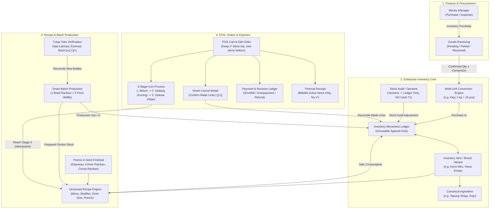
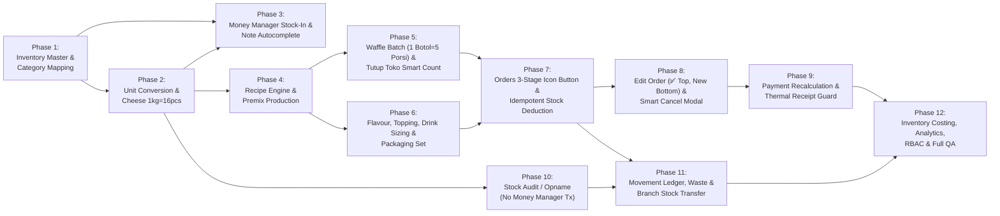
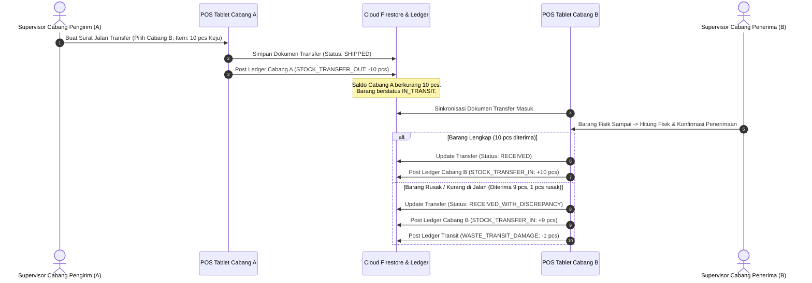
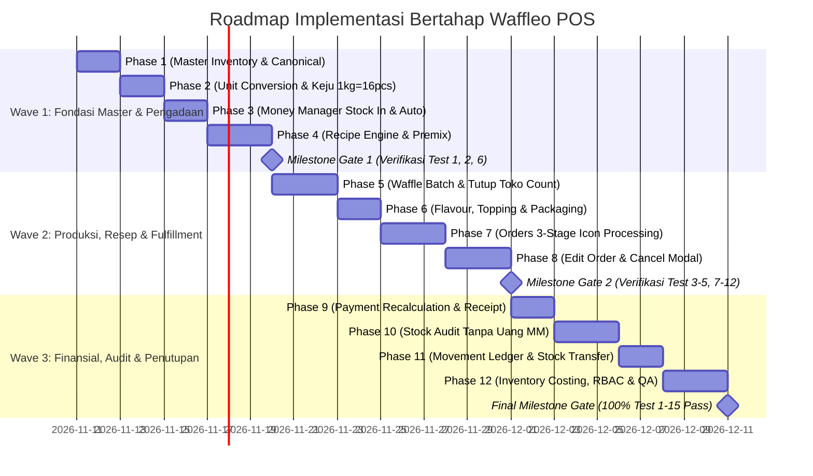

# COMPREHENSIVE AUDIT & IMPLEMENTATION PLAN — INTEGRATED F&B INVENTORY, RECIPE, PRODUCTION, ORDER FULFILLMENT, STOCK AUDIT & PAYMENT MANAGEMENT

> [!IMPORTANT]
> **STATUS: TAHAP 1 — AUDIT, ANALISIS & IMPLEMENTATION PLAN (MENUNGGU ACC)**
> Sesuai instruksi wajib **BAGIAN A**, **tidak ada satu baris pun source code, database, maupun aturan Firestore yang diubah pada tahap ini**. Dokumen ini menyajikan hasil audit menyeluruh berbasis bukti kode aktual pada repositori Waffleo POS serta rencana arsitektur & implementasi 12 fase untuk ditinjau dan disetujui (**ACC**) oleh Anda.

---

## 1. Executive Summary

Hasil audit menyeluruh terhadap kode sumber **Waffleo POS** (commit terakhir `d875760`) menunjukkan bahwa aplikasi telah memiliki fondasi UI/UX tablet landscape bergaya *Warm Espresso & Champagne Gold*, sinkronisasi offline-first berbasis `SharedPreferences` ([`WaffleoLocalStore.kt`](file:///c:/Users/USER/Documents/fdrmnn/WAFFLEO%20POS/Waffleo-POS/app/src/main/java/com/example/data/local/WaffleoLocalStore.kt#L1-L1069)) + `Cloud Firestore` ([`WaffleoRepository.kt`](file:///c:/Users/USER/Documents/fdrmnn/WAFFLEO%20POS/Waffleo-POS/app/src/main/java/com/example/data/repository/WaffleoRepository.kt#L1-L807)), sistem Promo, Multi-Payment Ledger dasar, serta rekapitulasi penjualan harian per kanal pembayaran ke **Money Manager**.

Namun, dari sudut pandang **Enterprise F&B Operations, Recipe Costing, Batch Production, Fulfillment & Inventory Control**, ditemukan **celah arsitektural kritis (`CONFIRMED`)** antara modul **Money Manager**, **Stok/Inventory**, **Menu & Modifier**, **Orders**, dan **Tutup Toko**:

1. **Pemotongan Stok Saat Ini Tidak Membaca Resep Aktual (`CONFIRMED`)**:
   Pada [`WaffleoViewModel.completeOrderAndDeductStock()`](file:///c:/Users/USER/Documents/fdrmnn/WAFFLEO%20POS/Waffleo-POS/app/src/main/java/com/example/ui/viewmodel/WaffleoViewModel.kt#L3745-L3762) dan [`syncPosSalesToMoneyManager()`](file:///c:/Users/USER/Documents/fdrmnn/WAFFLEO%20POS/Waffleo-POS/app/src/main/java/com/example/ui/viewmodel/WaffleoViewModel.kt#L5813-L5828), sistem sama sekali **tidak membaca resep menu maupun modifier**. Sistem hanya menghitung jumlah total item kategori `"Egg Waffle"` dan `"Drinks"`, lalu mencari field `usagePerWaffle` dan `usagePerDrink` pada `metadataJson` item `INGREDIENT`. Lebih parah lagi, pada [`WaffleoSeedData.kt`](file:///c:/Users/USER/Documents/fdrmnn/WAFFLEO%20POS/Waffleo-POS/app/src/main/java/com/example/data/model/WaffleoSeedData.kt#L451), daftar `INGREDIENT` dikosongkan sehingga **tidak ada bahan baku yang terpotong secara nyata**.
2. **Belum Ada Pemisahan Canonical Ingredient vs Brand/Variant & Multi-Unit Conversion (`CONFIRMED`)**:
   pembelian di **Money Manager** ([`MoneyTransactionRecord`](file:///c:/Users/USER/Documents/fdrmnn/WAFFLEO%20POS/Waffleo-POS/app/src/main/java/com/example/data/model/WaffleoModels.kt#L813-L842)) hanya menyimpan teks bebas `categoryName`, `subCategoryName`, `note` (merek seperti *"Kunci Biru"*), dan `description` (*"10 pcs"*), tanpa relasi ID ke master bahan baku, tanpa status penerimaan barang (*Goods Receiving*), dan tanpa tabel konversi satuan (termasuk aturan bisnis pasti **Keju `1 kg = 16 pcs`, `2 kg = 32 pcs`, `1 kotak = 2 kg = 32 pcs`**).
3. **Belum Ada Mesin Batch Production & Smart Count Botol Racikan pada Tutup Toko (`CONFIRMED`)**:
   Belum ada pengelolaan **1 Botol Racikan = 5 porsi Egg Waffle Original Polos**, belum ada *Prepared Portion Stock* yang bisa dibawa ke hari berikutnya (*carry-over*), dan pada modal **Tutup Toko** ([`WaffleoShellAndLoginScreen.kt`](file:///c:/Users/USER/Documents/fdrmnn/WAFFLEO%20POS/Waffleo-POS/app/src/main/java/com/example/ui/screens/WaffleoShellAndLoginScreen.kt#L1310-L1599)) belum terdapat seksi **"Data Lainnya"** maupun baris **`Estimasi Botol Racikan Terpakai : [ xx ] [−] [+]`**.
4. **Pemrosesan Pesanan Masih 1-Tahap di Level Order, Bukan 3-Tahap di Level Item/Unit (`CONFIRMED`)**:
   Tombol [`OrderPrepareButton`](file:///c:/Users/USER/Documents/fdrmnn/WAFFLEO%20POS/Waffleo-POS/app/src/main/java/com/example/ui/screens/OrdersAndHistoryScreen.kt#L842-L869) saat ini hanya mengubah boolean tunggal `order.isPrepared = true` (`Proses` -> `Siap`) dengan teks pada tombol. Belum ada tombol **khusus ikon 3 tahap** (`Belum Diproses` -> `Sedang Diproses` [kuning] -> `Selesai Diproses` [hijau]), belum ada pelacakan per item/unit (`✅`), belum ada penempatan item tambahan baru di bagian paling bawah saat **Edit Order**, dan belum ada **Popup Konfirmasi Item yang Sudah Dibuat** (`[−]` / `[+]`) saat pesanan dibatalkan.
5. **Belum Ada Sistem Stock Audit / Stock Opname & Inventory Movement Ledger (`CONFIRMED`)**:
   Tab **Settings > Stok** ([`DashboardAndSettingsScreen.kt`](file:///c:/Users/USER/Documents/fdrmnn/WAFFLEO%20POS/Waffleo-POS/app/src/main/java/com/example/ui/screens/DashboardAndSettingsScreen.kt#L1259-L1302)) hanya memiliki tombol `+1.000` (*Quick Restock*) yang langsung menimpa `stockQty` tanpa buku besar mutasi (*Inventory Movement Ledger*) dan tanpa sesi **Stock Opname** (*Blind Count*, *Variance*, *Approval*, serta jaminan **tidak membuat transaksi kas palsu di Money Manager**).

---

## 2. Architecture Assessment



### Evaluasi Mekanisme Produksi Botol Racikan (BAGIAN F): Pilihan 1 vs Pilihan 2
- **Pilihan 1 (Actual Batch Production Manual)**: Mengharuskan staf kasir/dapur menginput produksi setiap kali mengocok botol adonan di tengah jam sibuk. Risiko operasional: **sangat tinggi** (staf lupa input saat antrean ramai sehingga stok `Prepared Portion` menjadi minus atau tidak akurat).
- **Pilihan 2 (Smart / Automated Batch Production + Verifikasi Tutup Toko) — `[DIREKOMENDASIKAN SEBAGAI MEKANISME UTAMA]`**:
  - Selama jam operasional, setiap unit Egg Waffle yang mencapai tahap **Selesai Diproses** otomatis mencatat konsumsi **1 porsi adonan (`waffle_portion`)** beserta bahan Flavour, Topping, dan Add-on pada `Inventory Movement Ledger`.
  - Sistem melacak `Opening Prepared Portion` (sisa porsi layak pakai dari hari sebelumnya).
  - Saat **Tutup Toko**, sistem menghitung otomatis kebutuhan botol baru:
    $$\text{Required New Bottles} = \lceil \max(0, \text{Required Portions} - \text{Opening Prepared Portion}) / 5 \rceil$$
    dan menampilkannya pada bagian paling bawah **Data Lainnya**:
    `Estimasi Botol Racikan Terpakai : [ xx ] [−] [+]`
  - Staf cukup memverifikasi atau menyesuaikan dengan tombol `[−]` / `[+]` jika ada botol ekstra yang dikocok (atau tumpah), lalu sistem memotong bahan mentah adonan secara akurat untuk jumlah botol yang benar-benar diproduksi dan menyimpan sisa porsi (`Carry-Over Prepared Portion`) untuk besok pagi.
  - Tetap disediakan tombol opsional **"Catat Produksi Premix / Batch"** di halaman Stok untuk pembuatan *Krimer Racikan*, *Cocoa Powder Racikan*, atau *Botol Racikan* manual jika dibutuhkan.

---

## 3. Current Implementation Overview (Komponen yang Dipertahankan vs Diperbarui)

| Modul / File | Status Saat Ini | Keputusan Arsitektur |
| :--- | :--- | :--- |
| **UI Theme & Design System** ([`Color.kt`](file:///c:/Users/USER/Documents/fdrmnn/WAFFLEO%20POS/Waffleo-POS/app/src/main/java/com/example/ui/theme/Color.kt), [`WaffleoComponents.kt`](file:///c:/Users/USER/Documents/fdrmnn/WAFFLEO%20POS/Waffleo-POS/app/src/main/java/com/example/ui/components/WaffleoComponents.kt#L130-L586)) | Palet *Rich Espresso*, *Champagne Gold*, *Matcha Sage*, *Honey Amber*, *Terracotta*, serta komponen `WaffleoSingleSelectDropdown` & ilustrasi vektor produk sudah sangat rapi. | **Dipertahankan 100%** dan digunakan untuk seluruh UI baru (Data Konversi, Recipe Builder, Stock Opname, Cancel Modal). |
| **Struk Thermal / Printing** ([`ThermalReceiptDialog`](file:///c:/Users/USER/Documents/fdrmnn/WAFFLEO%20POS/Waffleo-POS/app/src/main/java/com/example/ui/components/WaffleoComponents.kt#L2520-L3006)) | Format struk 58mm monospace sudah disetujui dan mendukung rincian multi-payment ledger, diskon promo, dan kembalian. | **Dipertahankan penuh (BAGIAN P)**. Hanya dipastikan memfilter item aktif yang ditagihkan saja dan tidak pernah mencetak simbol `✅` internal dapur. |
| **Money Manager Core & POS Daily Sync** ([`MoneyManagerScreen.kt`](file:///c:/Users/USER/Documents/fdrmnn/WAFFLEO%20POS/Waffleo-POS/app/src/main/java/com/example/ui/screens/MoneyManagerScreen.kt#L154-L666), [`WaffleoSeedData.defaultMoneyCategories`](file:///c:/Users/USER/Documents/fdrmnn/WAFFLEO%20POS/Waffleo-POS/app/src/main/java/com/example/data/model/WaffleoSeedData.kt#L539-L605)) | Sudah memiliki kategori `"Bahan Pokok Waffle"`, `"Topping Waffle"`, `"Bahan Pokok Minuman"`, `"Packing"`, serta fitur Bookmarks dan kalkulator nominal. | **Diperluas tanpa merusak alur lama**: ditambahkan ID stabil untuk kategori/subkategori, toggle *Inventory Purchase* vs *Non-Inventory Expense*, field terstruktur `Quantity` + `Unit`, dan *Goods Receiving confirmation*. |
| **Offline-First Storage & Cloud Sync** ([`WaffleoLocalStore.kt`](file:///c:/Users/USER/Documents/fdrmnn/WAFFLEO%20POS/Waffleo-POS/app/src/main/java/com/example/data/local/WaffleoLocalStore.kt#L1-L1069), [`WaffleoRepository.kt`](file:///c:/Users/USER/Documents/fdrmnn/WAFFLEO%20POS/Waffleo-POS/app/src/main/java/com/example/data/repository/WaffleoRepository.kt#L1-L807)) | Menyimpan JSON di `SharedPreferences` dengan antrean `pendingSyncKeys` dan real-time listener Firestore per `branchId`. | **Diperluas**: ditambahkan penyimpanan lokal & koleksi Firestore untuk `inventory_movements`, `recipes`, `production_batches`, `stock_audits`, dan `closing_verifications` dengan `idempotencyKey`. |

---

## 4. Confirmed Bugs (`CONFIRMED`)

1. **`[CONFIRMED]` Pemotongan Stok Mengabaikan Resep Menu & Modifier**:
   - **Bukti Kode**: [`WaffleoViewModel.kt#L3745-L3762`](file:///c:/Users/USER/Documents/fdrmnn/WAFFLEO%20POS/Waffleo-POS/app/src/main/java/com/example/ui/viewmodel/WaffleoViewModel.kt#L3745-L3762) dan [`WaffleoViewModel.kt#L5813-L5828`](file:///c:/Users/USER/Documents/fdrmnn/WAFFLEO%20POS/Waffleo-POS/app/src/main/java/com/example/ui/viewmodel/WaffleoViewModel.kt#L5813-L5828).
   - **Dampak**: Meskipun `CatalogRecord` memiliki method [`getRecipeUsages()`](file:///c:/Users/USER/Documents/fdrmnn/WAFFLEO%20POS/Waffleo-POS/app/src/main/java/com/example/data/model/WaffleoModels.kt#L238-L259), fungsi tersebut tidak pernah dipanggil saat pesanan selesai. Semua varian waffle dianggap memakai bahan yang sama persis dan seluruh modifier/add-on (seperti Keju, Almond, Ice Cream) tidak pernah memotong stok.
2. **`[CONFIRMED]` Edit Pesanan Menimpa Status Pemenuhan & Kehilangan Jejak Item yang Sudah Dimasak**:
   - **Bukti Kode**: [`WaffleoViewModel.submitCartToOrders()`](file:///c:/Users/USER/Documents/fdrmnn/WAFFLEO%20POS/Waffleo-POS/app/src/main/java/com/example/ui/viewmodel/WaffleoViewModel.kt#L3174-L3264) dan [`CartLineItem`](file:///c:/Users/USER/Documents/fdrmnn/WAFFLEO%20POS/Waffleo-POS/app/src/main/java/com/example/data/model/WaffleoModels.kt#L1066-L1084).
   - **Dampak**: Saat pesanan diedit, `itemsPayload` langsung diganti dengan isi keranjang baru. Tidak ada penanda `✅` pada item yang sudah selesai dimasak, item baru tidak diletakkan di bagian bawah, dan jika item yang sudah dimasak dihapus saat edit, tidak ada catatan konsumsi historisnya.
3. **`[CONFIRMED]` Pembatalan Pesanan Tidak Memeriksa Item yang Sudah Terlanjur Dibuat**:
   - **Bukti Kode**: [`WaffleoViewModel.cancelOrderWithReason()`](file:///c:/Users/USER/Documents/fdrmnn/WAFFLEO%20POS/Waffleo-POS/app/src/main/java/com/example/ui/viewmodel/WaffleoViewModel.kt#L3795-L3886) dan [`CancelOrderDialog`](file:///c:/Users/USER/Documents/fdrmnn/WAFFLEO%20POS/Waffleo-POS/app/src/main/java/com/example/ui/components/WaffleoComponents.kt#L2373-L2514).
   - **Dampak**: Membatalkan pesanan yang sebagian atau seluruh itemnya sudah dimasak selalu mencatat `"(Stok bahan tidak dikurangi)"`, menyebabkan selisih stok fisik yang parah di dapur.
4. **`[CONFIRMED]` Edit Pesanan yang Menurunkan Total Tagihan di Bawah `paidAmount` Tidak Menghitung `overpaidAmount` / `Refund Required`**:
   - **Bukti Kode**: [`WaffleoViewModel.submitCartToOrders()`](file:///c:/Users/USER/Documents/fdrmnn/WAFFLEO%20POS/Waffleo-POS/app/src/main/java/com/example/ui/viewmodel/WaffleoViewModel.kt#L3181-L3191).
   - **Dampak**: Saat `wasAlreadyPaid == true` dan `finalTotal < previousPaid`, kode menghitung `newShortfall = (finalTotal - previousPaid).coerceAtLeast(0L)` (menjadi `0L`) dan membiarkan `isPaid = true` dengan `paidAmount = previousPaid` yang lebih besar dari `totalAmount` baru, tanpa status `Overpaid / Refund Required` dan tanpa pencatatan penyelesaian kelebihan bayar.
5. **`[CONFIRMED]` Tombol Quick Restock `+1.000` di Settings > Stok Menimpa `stockQty` secara Non-Atomik Tanpa Ledger**:
   - **Bukti Kode**: [`DashboardAndSettingsScreen.kt#L1291-L1297`](file:///c:/Users/USER/Documents/fdrmnn/WAFFLEO%20POS/Waffleo-POS/app/src/main/java/com/example/ui/screens/DashboardAndSettingsScreen.kt#L1291-L1297).
   - **Dampak**: Mengubah `stockQty` dengan `saveOrUpdateCatalogRecord(item.copy(stockQty = nextQty))` tanpa `InventoryMovement` dan berpotensi menimpa pengurangan stok dari perangkat kasir lain.

---

## 5. Likely Issues (`LIKELY`)

1. **`[LIKELY]` Ketidakkonsistenan Penamaan Kategori/Subkategori antara Money Manager dan Katalog Inventory**:
   - Di [`WaffleoSeedData.kt#L550-L598`](file:///c:/Users/USER/Documents/fdrmnn/WAFFLEO%20POS/Waffleo-POS/app/src/main/java/com/example/data/model/WaffleoSeedData.kt#L550-L598), Money Manager memakai kategori `"Bahan Pokok Waffle"`, `"Topping Waffle"`, `"Bahan Pokok Minuman"`, `"Packing"`, sedangkan `CatalogEditorDialog` ([`DashboardAndSettingsScreen.kt#L4858`](file:///c:/Users/USER/Documents/fdrmnn/WAFFLEO%20POS/Waffleo-POS/app/src/main/java/com/example/ui/screens/DashboardAndSettingsScreen.kt#L4858)) mengunci kategori `INGREDIENT` hanya pada `"RAW_MATERIAL"`.
2. **`[LIKELY]` Resep Bawaan pada `WaffleoSeedData.kt` Tidak Sesuai Standar Operasional Aktual**:
   - [`WaffleoSeedData.kt#L155-L310`](file:///c:/Users/USER/Documents/fdrmnn/WAFFLEO%20POS/Waffleo-POS/app/src/main/java/com/example/data/model/WaffleoSeedData.kt#L155-L310) masih menggunakan nama dummy `"Tepung Premix Waffleo (130 gram)"`, `"Telur Ayam Segar (1 butir)"`, `"Susu Fresh Milk (90 ml)"`, bukan resep bisnis aktual (`1 Botol Racikan = 5 porsi`, Flavour Toffieco 2–3g, Spread 50g, Crunchy 80g, Premium 80g, Keju pcs).

---

## 6. Potential Risks (`POTENTIAL RISK`)

1. **`[POTENTIAL RISK]` Penolakan Sinkronisasi oleh `firestore.rules` (`PERMISSION_DENIED`)**:
   - [`firestore.rules`](file:///c:/Users/USER/Documents/fdrmnn/WAFFLEO%20POS/Waffleo-POS/firestore.rules#L55-L263) menerapkan validasi skema ketat `data.keys().hasOnly([...])` pada setiap dokumen. Menambahkan field baru pada `OrderRecord`, `CatalogRecord`, atau `MoneyTransactionRecord` tanpa memperbarui `firestore.rules` secara serentak akan menyebabkan penolakan sinkronisasi ke Cloud.
2. **`[POTENTIAL RISK]` Double Deduction Saat Re-Sync Offline atau Klik Ganda**:
   - Jika pemotongan stok saat item mencapai `Selesai Diproses` tidak menggunakan `idempotencyKey` deterministik (`orderId + lineId + unitIndex + movementType`), klik berulang atau pemutaran ulang antrean offline dapat memotong stok dua kali.
3. **`[POTENTIAL RISK]` Selisih Stok Palsu Jika Stock Opname Dilakukan Saat Toko Masih Transaksi Aktif**:
   - Jika staf menghitung fisik barang pada pukul 14:00 namun baru menekan *Submit/Approve* pada pukul 14:30 setelah ada 5 pesanan selesai, perbandingan langsung terhadap `Current Stock` pukul 14:30 tanpa mengunci `System Quantity Snapshot at Count Time` akan menghasilkan selisih (*variance*) yang salah.

---

## 7. Missing Features (Fitur yang Belum Ada & Akan Dibangun)

1. **Integrasi Money Manager <-> Inventory** (ID mapping kategori/subkategori, *Canonical Ingredient* vs *Brand/Variant*, Autocomplete `Note` di Tambah Item, *Automatic Stock In* berbasis konfirmasi penerimaan barang).
2. **Master Data Konversi Multi-Satuan** (Base Unit, Purchase Unit, Consumption Unit, UI Data Konversi dengan preview & riwayat, serta aturan pasti **Keju 1 kg = 16 pcs**).
3. **Recipe Management Engine & Versioning** (Resep versi `Draft`, `Active`, `Archived`, *Incomplete Recipe Indicator*, kalkulasi HPP otomatis, *Recipe Snapshot* pada transaksi).
4. **Waffle Batch Production & Smart Count Botol Racikan pada Tutup Toko** (`1 Botol Racikan = 5 porsi`, carry-over porsi siap pakai, dan kontrol `Estimasi Botol Racikan Terpakai : [ xx ] [−] [+]` di bagian paling bawah **"Data Lainnya"**).
5. **Flavour, Cheese, Topping, Premix & Independent Drink Recipe Engine** (Template Spread 50g / Crunchy 80g / Premium 80g, Toffieco 2–3g, Espresso `18g -> 60g`, Krimer Racikan 50:50, Cocoa Powder Racikan 50:50, ukuran minuman `12 oz` / `16 oz`, dan **Packaging Set** `1 Cup + 1 Sedotan`).
6. **Redesign Tombol Proses 3 Tahap (Icon-Only) & Pelacakan Pemenuhan per Item/Unit (`✅`)** pada halaman Orders.
7. **Preservasi Riwayat Saat Edit Order & Smart Cancellation Modal (`[−]` / `[+]`)**.
8. **Smart Payment Recalculation & Revision History** (Penanganan *Shortfall*, *Overpayment / Refund*, dan pemisahan 4 layer: *Billable Order*, *Fulfillment History*, *Inventory Consumption*, *Payment Ledger*).
9. **Sistem Stock Audit / Stock Opname Terpadu** (Full/Cycle/Category/Item count, *Blind Count*, *Variance*, *Approval*, tanpa menyentuh kas Money Manager).
10. **Inventory Movement Ledger, Waste/Spoilage, Stock Transfer Antar-Cabang & Inventory Analytics**.

---

## 8. Recommended Improvements

1. **Single Source of Truth melalui `InventoryMovementLedger`**:
   Setiap perubahan angka stok wajib melewati satu fungsi transaksi terpusat `postInventoryMovement(entry: InventoryMovementRecord)` yang memvalidasi `idempotencyKey`, memperbarui proyeksi `stockQty` secara atomik, dan menyimpan jejak saldo sebelum (`qtyBefore`) dan sesudah (`qtyAfter`).
2. **Unit-Level Fulfillment State di Dalam `CartLineItem`**:
   Daripada hanya memiliki 1 boolean `isPrepared` di level `OrderRecord`, setiap `CartLineItem` menyimpan daftar status unit (`unitStates: List<UnitFulfillmentState>`) sehingga jika pelanggan memesan `2x Belgian Choco` dan baru `1x` yang selesai dimasak saat pelanggan mengedit pesanan, sistem tahu persis `1 unit` sudah `SELESAI_DIPROSES (✅)` dan `1 unit` masih `BELUM_DIPROSES`.
3. **Parser Cerdas untuk Transaksi Lama Money Manager**:
   Menyediakan asisten migrasi non-destruktif yang membaca `description` lama seperti `"10pcs"` atau `"2 kg"` menjadi saran `Quantity = 10`, `Unit = pcs` untuk dikonfirmasi pengguna tanpa mengubah angka secara diam-diam.

---

## 9. Things That Should Not Be Changed (Bagian yang Wajib Dijaga Tetap Utuh)

1. **Desain & Tata Letak Struk Thermal ([`ThermalReceiptDialog`](file:///c:/Users/USER/Documents/fdrmnn/WAFFLEO%20POS/Waffleo-POS/app/src/main/java/com/example/ui/components/WaffleoComponents.kt#L2520-L3006))**: Tidak boleh diubah desain visualnya, dan tidak boleh menampilkan ikon `✅` atau item yang sudah dihapus.
2. **Rekap Penjualan POS Harian ke Money Manager per Kanal ([`computeStoreCloseDailyRecap`](file:///c:/Users/USER/Documents/fdrmnn/WAFFLEO%20POS/Waffleo-POS/app/src/main/java/com/example/ui/viewmodel/WaffleoViewModel.kt#L5656-L5795))**: Tetap bekerja seperti saat ini saat Tutup Toko.
3. **Mesin Perhitungan Promo ([`WaffleoViewModel.kt`](file:///c:/Users/USER/Documents/fdrmnn/WAFFLEO%20POS/Waffleo-POS/app/src/main/java/com/example/ui/viewmodel/WaffleoViewModel.kt))**: Tetap dipertahankan dan diintegrasikan saat kalkulasi ulang total pesanan yang diedit.
4. **Identitas Visual & Navigasi Utama**: Sidebar kiri vertikal, header atas kolapsibel, dan palet warna *Warm Espresso & Gold* tetap dipertahankan.

---

## 10. Comprehensive Database Schema Plan

Seluruh model baru dirancang **backward-compatible** dengan data lokal `WaffleoLocalStore` dan koleksi `Cloud Firestore`:

### 10.1. Master Kategori Bersama & Canonical Ingredient (`CatalogRecord` Extension + Dedicated Models)
- **`InventoryCategoryMaster`**:
  - `categoryId: String` (stabil, mis. `"cat_bahan_pokok_waffle"`, `"cat_topping_waffle"`, `"cat_bahan_pokok_minuman"`, `"cat_packing"`)
  - `categoryName: String`
  - `subCategories: List<InventorySubCategoryMaster>` (`subCategoryId`, `subCategoryName`)
  - `linkedMoneyCategoryId: String` (terhubung 1:1 dengan `MoneyCategoryDef.id`)
- **`CanonicalIngredientRecord`**:
  - `canonicalId: String` (mis. `"can_tepung_terigu"`, `"can_keju_slice"`, `"can_krimer_bubuk"`)
  - `name: String` (mis. `"Tepung Terigu"`, `"Keju"`, `"Krimer"`)
  - `categoryId: String`, `subCategoryId: String`
  - `defaultBaseUnit: String` (`"gram"`, `"ml"`, `"pcs"`, `"porsi"`, `"set"`)
  - `allowBrandSubstitution: Boolean` (apakah varian merek boleh saling menggantikan secara otomatis/konfirmasi)
- **`InventoryItemRecord` (Brand / Variant & Semi-Finished / Packaging)**:
  - `itemId: String` (Primary Key unik, **bukan** teks Note)
  - `sku: String`
  - `name: String` (mis. `"Tepung Terigu Kunci Biru"`, `"Keju Prochiz 2kg"`)
  - `canonicalIngredientId: String`
  - `brandVariantName: String` (terhubung dengan `Note` Money Manager, mis. `"Kunci Biru"`, `"Hana Emas"`)
  - `categoryId: String`, `subCategoryId: String`
  - `itemType: String` (`"RAW_MATERIAL"`, `"SEMI_FINISHED"`, `"PREMIX"`, `"PACKAGING"`, `"FINISHED_PORTION"`)
  - `baseUnit: String` (`"gram"`, `"ml"`, `"pcs"`, `"porsi"`, `"set"`)
  - `purchaseUnit: String`, `consumptionUnit: String`
  - `minStock: Double`, `reorderPoint: Double`, `safetyStock: Double`
  - `preferredSupplier: String`
  - `costingMethod: String` (`"WEIGHTED_AVERAGE"`, `"FIFO"`, `"LATEST_COST"`)
  - `currentCostPerBaseUnit: Double`
  - `stockQtyBase: Double`, `reservedQtyBase: Double`, `damagedQtyBase: Double`
  - `lotTrackingEnabled: Boolean`, `expiryTrackingEnabled: Boolean`, `shelfLifeHours: Int`
  - `isActive: Boolean`, `branchId: String`

### 10.2. Tabel Konversi Multi-Satuan (`UnitConversionRuleRecord`)
- `conversionId: String`
- `targetScope: String` (`"GLOBAL"`, `"CANONICAL"`, `"ITEM_VARIANT"`)
- `targetReferenceId: String` (mis. `"can_keju_slice"` atau `itemId` spesifik)
- `fromUnit: String` (mis. `"kg"`, `"kotak"`, `"karung"`, `"pack"`, `"dus"`)
- `fromQty: Double` (mis. `1.0`)
- `toBaseUnit: String` (mis. `"pcs"`, `"gram"`, `"ml"`)
- `toBaseQty: Double` (mis. Keju: `1 kg = 16 pcs`, `1 kotak = 32 pcs`; Gula: `1 karung = 50000 gram`)
- `requiresDensityFactor: Boolean`, `densityGramPerMl: Double`
- `isActive: Boolean`, `version: Int`, `updatedAtMillis: Long`, `updatedBy: String`

### 10.3. Mesin Resep Ber-Versi (`RecipeRecord` & `RecipeComponentLine`)
- `recipeId: String`
- `targetType: String` (`"MENU_ITEM"`, `"MODIFIER"`, `"DRINK_SIZE"`, `"PREMIX"`, `"BATCH_BOTTLE"`, `"PACKAGING_SET"`)
- `targetId: String` (ID menu/modifier/premix, mis. `"waffle_polos"`, `"mod_flavour_pandan"`, `"drink_iced_latte_16oz"`, `"premix_botol_racikan"`)
- `sizeVariant: String` (`"STANDARD"`, `"12_OZ"`, `"16_OZ"`, `"HALF_PORTION"`, `"DOUBLE_PORTION"`)
- `versionNumber: Int`
- `status: String` (`"DRAFT"`, `"ACTIVE"`, `"ARCHIVED"`)
- `expectedYieldQty: Double`, `yieldUnit: String` (mis. Botol Racikan: `5.0`, `"porsi"`; Espresso: `60.0`, `"gram"`)
- `components: List<RecipeComponentLine>`:
  - `lineId: String`
  - `componentType: String` (`"CANONICAL_INGREDIENT"`, `"SPECIFIC_ITEM"`, `"PREMIX"`, `"PACKAGING_SET"`)
  - `referenceId: String`
  - `qtyRequired: Double`, `unit: String`
  - `wasteFactorPercent: Double`
  - `isOptional: Boolean`, `substitutionRule: String` (`"ADD"`, `"REPLACE_BASE"`, `"MULTIPLY"`)
- `estimatedCostTotal: Long`, `effectiveFromMillis: Long`, `createdBy: String`, `changeNote: String`

### 10.4. Buku Besar Pergerakan Stok (`InventoryMovementRecord` — Koleksi `inventory_movements`)
- `movementId: String`
- `idempotencyKey: String` (unik, mencegah duplikasi potongan/penambahan stok)
- `branchId: String`, `timestampMillis: Long`, `dateKey: String`
- `itemId: String`, `canonicalIngredientId: String`
- `movementType: String`:
  - `"PURCHASE_IN"`, `"PRODUCTION_OUT"`, `"PRODUCTION_IN"`, `"SALE_CONSUMPTION"`, `"ORDER_EDIT_ADJUSTMENT"`, `"CANCELLATION_CONFIRMATION"`, `"WASTE_SPOILAGE"`, `"STOCK_AUDIT_ADJUSTMENT"`, `"STOCK_TRANSFER_OUT"`, `"STOCK_TRANSFER_IN"`, `"OPENING_CARRY_OVER"`, `"CLOSING_BOTTLE_ADJUSTMENT"`
- `qtyDeltaBase: Double` (positif untuk masuk, negatif untuk keluar)
- `baseUnit: String`, `inputQty: Double`, `inputUnit: String`, `conversionFactorUsed: Double`
- `qtyBeforeBase: Double`, `qtyAfterBase: Double`
- `unitCostAtMovement: Double`, `totalCostImpact: Long`
- `referenceType: String` (`"MONEY_TX"`, `"ORDER"`, `"BATCH_PROD"`, `"STOCK_AUDIT"`, `"STORE_CLOSE"`, `"TRANSFER"`)
- `referenceId: String`, `recipeIdSnapshot: String`, `recipeVersionSnapshot: Int`
- `actorUsername: String`, `actorRole: String`, `reasonNote: String`

### 10.5. Perluasan `OrderRecord` & `CartLineItem` untuk 3-Stage Fulfillment, Edit & Cancel
- Pada **`CartLineItem`**:
  - `lineId: String` (UUID stabil per baris item)
  - `fulfillmentState: String` (`"BELUM_DIPROSES"`, `"SEDANG_DIPROSES"`, `"SELESAI_DIPROSES"`)
  - `completedUnitCount: Int` (jumlah unit pada baris ini yang sudah mencapai `SELESAI_DIPROSES`)
  - `isCompletedLockedBadge: Boolean` (menampilkan tanda `✅` pada item yang sudah dibuat)
  - `addedInRevision: Int` (revisi ke-0 untuk pesanan awal; `> 0` untuk item baru hasil edit agar ditempatkan di bagian paling bawah di bawah item `✅`)
  - `drinkSizeCode: String` (`"12_OZ"`, `"16_OZ"`, dll.)
  - `includeStraw: Boolean` (kebijakan sedotan opsional/wajib)
  - `recipeVersionSnapshotJson: String` (snapshot resep & konversi saat transaksi terjadi)
- Pada **`OrderRecord`**:
  - `processingStage: Int` (`0 = Belum Diproses`, `1 = Sedang Diproses`, `2 = Selesai Diproses`)
  - `historicalProducedItemsPayload: String` (menyimpan daftar item/unit yang **sudah terlanjur dibuat (`SELESAI_DIPROSES`) namun dihapus/dikurangi saat Edit Order atau Cancel Order**, sehingga stok tetap sah terpotong tetapi tidak ikut tercetak di struk tagihan pelanggan)
  - `revisionHistoryPayload: String` (daftar `OrderRevisionRecord`: nomor revisi, waktu, staf, alasan, ringkasan perubahan item, total sebelum & sesudah)
  - `overpaidAmount: Long` (jika setelah edit total baru < total yang sudah dibayar)
  - `settlementStatus: String` (`"UNPAID"`, `"PARTIALLY_PAID"`, `"PAID"`, `"OVERPAID_REFUND_REQUIRED"`, `"REFUNDED"`)

### 10.6. Perluasan `MoneyTransactionRecord` untuk Pembelian Bahan Baku
- `expenseClassification: String` (`"NON_INVENTORY"`, `"INVENTORY_PURCHASE"`)
- `categoryId: String`, `subCategoryId: String`
- `linkedCanonicalId: String`, `linkedInventoryItemId: String`
- `purchaseQty: Double`, `purchaseUnit: String`
- `receivedQty: Double`, `rejectedQty: Double`
- `receivingStatus: String` (`"NOT_APPLICABLE"`, `"PENDING_RECEIPT"`, `"PARTIALLY_RECEIVED"`, `"RECEIVED"`, `"CANCELLED"`)
- `linkedMovementIdsJson: String` (mencegah 1 transaksi menambah stok 2 kali)

### 10.7. Model Tutup Toko & Smart Bottle Count (`ClosingVerificationRecord` — Koleksi `closing_verifications`)
- `closingId: String`, `branchId: String`, `dateKey: String`, `shiftIndex: Int`
- `openingPreparedPortions: Double` (sisa porsi dari tutup toko sebelumnya)
- `totalWafflePortionsConsumed: Double` (total porsi Egg Waffle selesai dibuat hari ini)
- `systemEstimatedBottles: Int` ($\lceil \max(0, \text{Required} - \text{Opening}) / 5 \rceil$)
- `actualConfirmedBottles: Int` (nilai akhir setelah tombol `[−]` / `[+]`)
- `manualAdjustmentDelta: Int` (`actualConfirmedBottles - systemEstimatedBottles`)
- `closingCarryOverPortions: Double` ($\max(0, \text{Opening} + (\text{ActualBottles} \times 5) - \text{Required})$)
- `adjustmentReason: String`, `verifiedBy: String`, `verifiedAtMillis: Long`

### 10.8. Model Stock Audit / Stock Opname (`StockAuditSessionRecord` — Koleksi `stock_audits`)
- `auditId: String`, `branchId: String`, `auditType: String` (`"FULL"`, `"CYCLE"`, `"CATEGORY"`, `"ITEM"`)
- `isBlindCount: Boolean`
- `status: String` (`"DRAFT"`, `"SUBMITTED"`, `"RECOUNT_REQUESTED"`, `"APPROVED"`, `"CANCELLED"`)
- `snapshotTimestampMillis: Long` (waktu cutoff pengambilan angka `System Quantity`)
- `lines: List<StockAuditLine>`:
  - `itemId: String`, `itemName: String`, `baseUnit: String`
  - `systemQtyAtSnapshot: Double`
  - `movementsSinceSnapshot: Double` (jika ada transaksi selama opname berlangsung)
  - `physicalCountQty: Double`
  - `varianceQty: Double` (`Physical Count - Expected System Qty`)
  - `unitCostSnapshot: Double`, `varianceValueIdr: Long`
  - `reasonCode: String`, `notes: String`
- `createdBy: String`, `approvedBy: String`, `approvedAtMillis: Long`
- **Garansi Arsitektur**: Penyelesaian `StockAuditSessionRecord` **hanya** memposting `STOCK_AUDIT_ADJUSTMENT` ke `inventory_movements` dan **tidak pernah** memanggil `saveMoneyTransaction()`.

---

## 11. Complete Module Integration Plan

1. **Money Manager -> Inventory**:
   - Saat pengguna mencatat pengeluaran di **Money Manager** dengan kategori bahan baku (mis. `Bahan Pokok Waffle > Tepung Terigu`, Note: `Kunci Biru`, Qty: `10`, Unit: `pcs/kg`), sistem menautkan `categoryId`, `subCategoryId`, dan `linkedInventoryItemId`.
   - Jika status penerimaan barang dikonfirmasi **`Diterima (Received)`** (atau **`Diterima Sebagian`**), sistem menghitung konversi satuan ke `baseUnit`, membuat entri `PURCHASE_IN` pada `InventoryMovementLedger` (dengan `idempotencyKey = "mm_purchase_${tx.id}_${receivedSeq}"`), dan memperbarui stok tersedia serta HPP rata-rata tertimbang (*Weighted Average Cost*).
   - Jika status masih **`Belum Diterima (Pending)`**, stok hanya dicatat sebagai *Incoming Stock* dan belum menambah *Available Stock*.
2. **Inventory > Tambah Item (Autocomplete Note)**:
   - Kolom **Nama Item / Merek (Note)** di halaman `Settings > Stok > + Bahan` menampilkan saran autocomplete real-time dari riwayat `Note` Money Manager dan master varian (mis. mengetik `"Kunci "` menampilkan `"Kunci Biru"` dan `"Kunci Toko"` beserta konteks kategorinya; mengetik `"Kunci Bi"` menyaring hanya `"Kunci Biru"`).
   - Memilih saran otomatis mengisi Nama Item, Brand/Variant, Kategori Utama, dan Subkategori, serta menyediakan opsi jenis Note (`Bahan Baku / Varian`, ` Kemasan`, atau `Bukan Bahan Baku`).
3. **Menu, Modifier, Drink Size & Premix -> Recipe Engine**:
   - Setiap menu Egg Waffle otomatis memakai **Base Recipe** (`1 porsi adonan dar Botol Racikan`) untuk setiap 1 unit menu, ditambah resep **Flavour** (mis. Pandan/Vanilla/Matcha/Cokelat/Strawberry: Toffieco ±2–3g; Original: 0g), ditambah resep **Topping Utama** (Spread ±50g, Crunchy ±80g, Premium ±80g; jika mode `1/2 - 1/2` maka masing-masing 0.5x takaran; jika `Double Topping` maka 2x takaran), ditambah resep **Add-on** (mis. Keju `1 pcs` dari hasil konversi `1 kg = 16 pcs`).
   - Setiap menu **Minuman** menggunakan builder resep independen berbasis ukuran (`12 oz`, `16 oz`, dst.) yang menggabungkan bahan cair/bubuk, premix (*Espresso*, *Krimer Racikan*, *Cocoa Powder Racikan*), es batu, dan **1 Set Packaging Minuman** (`1 Cup + 1 Sedotan` sesuai ukuran).

---

## 12. Orders & Fulfillment Redesign Plan

### 12.1. Tombol Proses 3 Tahap (Icon-Only, Tanpa Teks Panjang)
Menggantikan `OrderPrepareButton` ([`OrdersAndHistoryScreen.kt#L842-L869`](file:///c:/Users/USER/Documents/fdrmnn/WAFFLEO%20POS/Waffleo-POS/app/src/main/java/com/example/ui/screens/OrdersAndHistoryScreen.kt#L842-L869)) dengan tombol khusus ikon yang memiliki `contentDescription` / tooltip aksesibilitas:
- **Kondisi 1 — `Belum Diproses` (Initial)**:
  - **Ikon**: Ikon bahan mentah (mis. mangkuk adonan/bahan baku `Icons.Default.Egg` / custom canvas raw ingredient icon).
  - **Warna Tombol**: Warna status awal (`RoastedMochaSecondary` / `SoftOatSurface`).
- **Klik ke-1 -> Kondisi 2 — `Sedang Diproses`**:
  - **Ikon**: Ikon panci di atas kompor yang sedang memasak (custom vector pot-on-stove with steam).
  - **Warna Tombol**: **Kuning** (`HoneyAmberWarning`).
  - **Efek Sistem**: Mencatat waktu mulai masak (`startedCookingAt`) dan mengubah status item aktif menjadi `SEDANG_DIPROSES`.
- **Klik ke-2 -> Kondisi 3 — `Selesai Diproses`**:
  - **Ikon**: Ikon makanan yang sudah jadi di atas piring (`Icons.Default.DinnerDining` / custom vector plated food).
  - **Warna Tombol**: **Hijau** (`MatchaSageSuccess`).
  - **Efek Sistem**:
    1. Menandai seluruh unit aktif pada pesanan tersebut sebagai `SELESAI_DIPROSES` (`completedUnitCount = qty`, `isCompletedLockedBadge = true` -> tampil tanda `✅`).
    2. Memicu pemotongan stok otomatis berdasarkan resep aktif (`SALE_CONSUMPTION`) melalui `InventoryMovementLedger` secara **idempoten** (hanya memotong unit yang belum pernah dipotong sebelumnya).

### 12.2. Aturan Edit Order & Penempatan Item Baru di Bawah Item `✅`
Ketika pesanan yang sudah mencapai `Selesai Diproses` (atau sebagian unitnya sudah `✅`) diedit melalui tombol **Edit**:
1. Semua unit yang sudah `Selesai Diproses` tetap ditandai dengan ikon **`✅`** pada kartu Orders dan **tidak pernah** menggunakan ikon silang (`❌`).
2. Jika pelanggan **menambahkan item baru** (atau menambah kuantitas), baris item baru diberikan `addedInRevision = currentRevision + 1` dan status `BELUM_DIPROSES`, serta **ditempatkan pada urutan paling bawah** di bawah seluruh item yang sudah memiliki tanda `✅`.
3. Status tombol proses pesanan otomatis kembali ke `Belum Diproses` (untuk memproses item tambahan baru tersebut). Saat tombol proses diklik hingga `Selesai Diproses` lagi, sistem **hanya memotong stok untuk item/unit baru** yang belum memiliki `idempotencyKey` pemotongan stok!
4. Jika saat edit pelanggan **menghapus atau mengurangi** item yang sebenarnya **sudah selesai dibuat (`✅`)**:
   - Item tersebut dikeluarkan dari daftar tagihan aktif (`itemsPayload`) agar tagihan & struk pelanggan mengikuti pesanan terbaru.
   - Namun unit yang sudah terlanjur dibuat tersebut **dipindahkan ke `historicalProducedItemsPayload`** sehingga konsumsi stoknya **tetap tercatat** dan tidak di-revert secara diam-diam (kecuali staf secara eksplisit melakukan tindakan terpisah dengan alasan audit).

### 12.3. Popup Konfirmasi Pembatalan Pesanan (`Smart Cancel Order Modal`)
Menggantikan [`CancelOrderDialog`](file:///c:/Users/USER/Documents/fdrmnn/WAFFLEO%20POS/Waffleo-POS/app/src/main/java/com/example/ui/components/WaffleoComponents.kt#L2373-L2514) dengan modal cerdas yang menampilkan:
1. Pilihan **Alasan Pembatalan** + **Catatan Tambahan**.
2. **Daftar Seluruh Item Pesanan** (termasuk item aktif maupun item historis yang sudah sempat dibuat sebelum edit):
   - Setiap baris memiliki **Checkbox** (`Sudah Dibuat?`) dan stepper kuantitas **`[−]` `[ x / total ]` `[+]`**.
   - **Default Cerdas**: Item/unit yang sudah berstatus `Selesai Diproses (✅)` otomatis **tercentang** sejumlah unit yang telah selesai; item yang masih `Belum Diproses` otomatis **tidak tercentang (`0`)**; item yang `Sedang Diproses` ditampilkan dengan highlight kuning agar kasir memilih apakah bahan sudah terpakai atau belum.
3. **Rekonsiliasi Stok Saat Konfirmasi Batal**:
   - Untuk setiap unit yang **dicentang (benar-benar sudah dibuat)**: jika belum pernah dipotong stoknya (mis. dibatalkan saat `Sedang Diproses`), sistem memotong stoknya (`CANCELLATION_CONFIRMATION`); jika sudah dipotong saat `Selesai Diproses`, potongan stoknya dipertahankan (tidak dipotong dua kali).
   - Untuk setiap unit yang **tidak dicentang (belum dibuat)**: tidak ada stok yang dipotong (atau jika sebelumnya terlanjur tercatat selesai karena salah pencet, dikoreksi dengan alasan audit).

---

## 13. Smart Bottle Count & Closing Plan (Tutup Toko)

Pada dialog verifikasi **Tutup Toko** di [`WaffleoShellAndLoginScreen.kt#L1376-L1542`](file:///c:/Users/USER/Documents/fdrmnn/WAFFLEO%20POS/Waffleo-POS/app/src/main/java/com/example/ui/screens/WaffleoShellAndLoginScreen.kt#L1376-L1542):
1. Di bawah kartu `"💰 Rekap Income Shift Ini → Money Manager"`, ditambahkan kartu/seksi **"📋 Data Lainnya"**.
2. Pada bagian **paling bawah** dari seksi **"Data Lainnya"**, ditampilkan komponen:
   ```
   Estimasi Botol Racikan Terpakai :   [ xx ]   [ − ]  [ + ]
   ```
   dilengkapi info ringkas di bawahnya:
   `Terjual: P porsi • Sisa Kemarin: O porsi • Sisa Carry-Over Besok: C porsi`
3. **Logika Perhitungan**:
   - $P = \text{Total porsi Egg Waffle yang mencapai Selesai Diproses hari ini}$ (termasuk unit yang sudah dibuat pada pesanan yang diedit/dibatalkan).
   - $O = \text{Opening Prepared Portion}$ (sisa porsi dari penutupan toko sebelumnya yang masih dalam batas *shelf life*).
   - $\text{Net Required Portions} = \max(0, P - O)$.
   - $\text{Estimasi Botol Baru (`xx`)} = \lceil \text{Net Required Portions} / 5.0 \rceil$.
   - Saat pengguna menekan `[−]` atau `[+]`, nilai `Actual Bottles` berubah (minimum `0`), dan sistem menghitung:
     - Pemotongan bahan mentah adonan (`Tepung Terigu 210g`, `Maizena 40g`, `Baking Powder 10g`, `Telur 6 butir`, `Minyak 25g`, `Perisa Vanilla 5g`, `Evaporasi 50g`, `Air 225ml`) dikalikan jumlah `Actual Bottles` yang belum dipotong hari itu.
     - Sisa porsi adonan siap pakai untuk hari berikutnya:
       $$\text{Carry-Over Portions} = \max(0, O + (\text{Actual Bottles} \times 5) - P)$$

---

## 14. Payment Recalculation Plan

Memisahkan secara tegas 4 lapisan data pada setiap pesanan:
1. **Layer 1 — Current Billable Order**: Item yang saat ini aktif ditagihkan kepada pelanggan (`itemsPayload`, `subtotalAmount`, `discountAmount`, `totalAmount`).
2. **Layer 2 — Fulfillment History**: Unit mana saja yang secara fisik telah dimasak (`completedUnitCount` + `historicalProducedItemsPayload`).
3. **Layer 3 — Inventory Consumption**: Mutasi bahan baku di `inventory_movements` yang terhubung ke pesanan tersebut.
4. **Layer 4 — Payment Ledger**: Riwayat pembayaran pelanggan yang bersifat **immutable** (`paymentLedgerPayload`).

**Skenario Rekalkulasi Saat Edit Order**:
- **Kasus A — Belum Dibayar (`paidAmount == 0`)**: `totalAmount` langsung diperbarui ke `New Total`.
- **Kasus B — Sudah Dibayar & `New Total > Paid Amount` (*Shortfall / Kurang Bayar*)**:
  - `isPaid` menjadi `false`, `shortfallAmount = New Total - Paid Amount`, `settlementStatus = "PARTIALLY_PAID"`.
  - Tombol `Bayar` aktif kembali di kartu Orders untuk menerima pembayaran selisihnya (`SHORTFALL_SETTLEMENT`) tanpa menghapus pembayaran pertama.
- **Kasus C — Sudah Dibayar & `New Total < Paid Amount` (*Overpayment / Lebih Bayar*)**:
  - `overpaidAmount = Paid Amount - New Total`, `settlementStatus = "OVERPAID_REFUND_REQUIRED"`.
  - Menampilkan badge peringatan **"Lebih Bayar: Rp xxx (Konfirmasi Refund)"** dan menyediakan dialog pencatatan pengembalian dana (`OVERPAYMENT_REFUND`) ke pelanggan beserta pencatatan kasnya.

---

## 15. Stock Audit / Stock Opname Plan

Dibangun langsung di dalam halaman **Settings > Stok (Inventory)** dengan sub-tab / mode:
1. **`Stok & Bahan Baku`** (Master bahan, filter kategori Money Manager, indikator *Low Stock*, tombol `+ Bahan`, tombol `Data Konversi`, tombol `Produksi Premix/Batch`).
2. **`Stock Opname (Audit Stok)`**:
   - **Mulai Sesi Audit Baru**: Pilih cakupan (`Full Audit`, `Per Kategori`, atau `Item Tertentu`) dan opsi **Blind Count** (sembunyikan angka sistem saat staf menghitung).
   - **Snapshot & Rekonsiliasi Jam Aktif**: Saat sesi dimulai, sistem mencatat `snapshotTimestampMillis` dan `systemQtyAtSnapshot`. Jika ada pesanan selesai saat staf sedang menghitung, sistem melacak `movementsSinceSnapshot` secara terpisah sehingga perbandingan fisik tetap akurat.
   - **Kalkulasi Selisih (*Variance*)**:
     $$\text{Variance} = \text{Physical Count} - \text{Expected System Quantity}$$
   - **Workflow Approval**: `Draft` -> `Submitted` -> `Approved` (oleh Owner/Supervisor/Developer) atau `Recount Requested`.
   - **Aturan Mutlak Keuangan**: Saat Stock Audit di-Approve, sistem memperbarui `stockQtyBase` melalui `InventoryMovementRecord` bertipe `STOCK_AUDIT_ADJUSTMENT` dan mencatat nilai selisih pada laporan *Inventory Shrinkage/Gain*, **TANPA PERNAH membuat transaksi pemasukan atau pengeluaran di Money Manager**.
3. **`Riwayat Mutasi (Movement Ledger)`**: Tabel kronologis seluruh keluar-masuk bahan baku beserta filter tipe mutasi, pencarian, dan penelusuran ke nomor Order atau transaksi Money Manager.

---

## 16. UI/UX Plan

1. **Halaman Inventory Management (`Settings > Stok`)**:
   - Sub-tab terstruktur: **`Bahan Baku & Varian`**, **`Data Konversi`**, **`Resep & Premix`**, **`Stock Opname`**, dan **`Mutasi Stok (Ledger)`**.
   - Filter chip kategori yang tersinkron langsung dengan kategori **Money Manager** (`Bahan Pokok Waffle`, `Topping Waffle`, `Bahan Pokok Minuman`, `Packing`).
   - Pada modal **Tambah/Edit Item Bahan Baku**: kolom **Nama Item / Merek (Note)** dilengkapi dropdown **Autocomplete Cerdas** yang menampilkan kecocokan awalan dari riwayat `Note` Money Manager beserta badge konteks kategorinya.
2. **Halaman Menu & Modifier (`Settings > Menu` & `Modifier`)**:
   - Badge indikator **`⚠ Resep Belum Lengkap`** (*Incomplete Recipe Indicator*) pada kartu menu/modifier yang belum memiliki resep aktif lengkap.
   - Panel **Recipe Builder** terintegrasi di dalam editor Menu/Modifier dengan pilihan template cepat (*Spread ±50g*, *Crunchy ±80g*, *Premium ±80g*, *Flavour Toffieco 2.5g*, atau *Custom Recipe*) dan kalkulasi HPP real-time.
   - Untuk kategori **Minuman**: tab ukuran (`12 oz`, `16 oz`, `+ Ukuran`) dengan komposisi bahan independen + tautan otomatis ke **Set Packaging Minuman**.
3. **Halaman Orders (`OrdersQueueScreen`)**:
   - Baris tombol aksi bawah kartu pesanan tetap proporsional; tombol **Proses** kini tampil **Icon-Only** 3 tahap (`Belum Diproses` -> `Sedang Diproses` [Kuning] -> `Selesai Diproses` [Hijau]) dengan animasi transisi halus.
   - Daftar item pesanan menampilkan badge **`✅`** hanya pada item/unit yang sudah selesai dimasak, dan menempatkan item tambahan hasil edit di bagian paling bawah dengan label halus `"Tambahan Edit"`.
4. **Dialog Tutup Toko (`WaffleoShellAndLoginScreen`)**:
   - Menambahkan kartu **"📋 Data Lainnya"** di bawah ringkasan Income, dengan kontrol **`Estimasi Botol Racikan Terpakai : [ xx ] [−] [+]`** tepat di bagian paling bawah.

---

## 17. Synchronization Plan (Offline-First & Multi-Device)

1. **Ledger-Driven Stock Projection**:
   - Alih-alih menyinkronkan angka `stockQty` mentah yang rawan *race condition* antar-tablet, setiap mutasi stok dikirim sebagai dokumen immutable di koleksi `inventory_movements` dengan `idempotencyKey` deterministik:
     - Pembelian Money Manager: `mm_in_{txId}_{itemId}`
     - Pemenuhan Pesanan: `ord_consume_{orderId}_{lineId}_unit_{unitIdx}`
     - Konfirmasi Batal: `ord_cancel_{orderId}_{lineId}_unit_{unitIdx}`
     - Tutup Toko Botol Racikan: `close_bottle_{branchId}_{dateKey}_{shiftIdx}`
     - Stock Audit: `audit_adj_{auditId}_{itemId}`
2. **Pembaruan `firestore.rules`**:
   - Menambahkan izin baca/tulis berbasis `branchId` dan validasi skema untuk koleksi baru (`inventory_movements`, `recipes`, `unit_conversions`, `production_batches`, `stock_audits`, `closing_verifications`) serta memperbarui daftar field yang diizinkan (`hasOnly`) pada koleksi `orders`, `catalog`, dan `money_transactions`.

---

## 18. Implementation Phases & Detailed Work Breakdown (12 Atribut Wajib BAGIAN A)

Berikut adalah rincian 12 fase pekerjaan sesuai urutan ketergantungan (**BAGIAN Y**) lengkap dengan 12 atribut wajib (**BAGIAN A**):

---

### PHASE 1 — Master Data Inventory, Kategori Bersama & Canonical Ingredient vs Brand/Variant
1. **Nama pekerjaan**: `PHASE-01: Master Data Inventory, Sinkronisasi Kategori Money Manager & Canonical Ingredient`
2. **Priority**: **P0 — Critical (Fondasi Utama)**
3. **Masalah atau kebutuhan yang ditemukan**:
   - Saat ini `INGREDIENT` di `CatalogRecord` hanya memiliki `name`, `stockQty`, `stockUnit`, dan `costPerUnit`, tanpa pemisahan *Canonical Ingredient* (mis. `Tepung Terigu`) dan *Brand/Variant* (mis. `Kunci Biru`, `Hana Emas`), serta kategorinya terkunci pada `"RAW_MATERIAL"` sehingga tidak terhubung dengan kategori Money Manager.
4. **Penjelasan teknis**:
   - Menambahkan struktur data `CanonicalIngredientRecord` dan memperluas metadata/skema `InventoryItemRecord` pada `CatalogRecord` (menyimpan `canonicalIngredientId`, `brandVariantName`, `categoryId`, `subCategoryId`, `itemType`, `baseUnit`, `purchaseUnit`, `consumptionUnit`, `minStock`, `reorderPoint`, `safetyStock`, `costingMethod`).
   - Menghubungkan ID kategori/subkategori Money Manager (`MoneyCategoryDef.id`) dengan kategori Inventory sehingga perubahan nama kategori tidak merusak transaksi historis.
5. **Penjelasan menggunakan bahasa sederhana / bahasa bayi**:
   - Bayangkan di dapur kita punya kotak besar bertuliskan **"Tepung Terigu"** (ini namanya *Canonical Ingredient* / bahan induk). Di dalam kotak itu bisa ada tepung merek **"Kunci Biru"** atau **"Hana Emas"** (ini namanya *Brand/Variant*). Sekarang sistem diajari supaya kenal bahwa "Kunci Biru" itu adalah merek dari "Tepung Terigu", dan lemari penyimpanannya di halaman Stok disamakan persis dengan nama kelompok belanja di Money Manager.
6. **Rencana perubahan database**:
   - Menambahkan field metadata terstruktur pada `CatalogRecord` + penyimpanan `canonical_ingredients` di `WaffleoLocalStore` & `workspace_settings` / `catalog` di Firestore.
7. **File atau modul yang terdampak**:
   - [`WaffleoModels.kt`](file:///c:/Users/USER/Documents/fdrmnn/WAFFLEO%20POS/Waffleo-POS/app/src/main/java/com/example/data/model/WaffleoModels.kt), [`WaffleoSeedData.kt`](file:///c:/Users/USER/Documents/fdrmnn/WAFFLEO%20POS/Waffleo-POS/app/src/main/java/com/example/data/model/WaffleoSeedData.kt), [`WaffleoLocalStore.kt`](file:///c:/Users/USER/Documents/fdrmnn/WAFFLEO%20POS/Waffleo-POS/app/src/main/java/com/example/data/local/WaffleoLocalStore.kt), [`WaffleoViewModel.kt`](file:///c:/Users/USER/Documents/fdrmnn/WAFFLEO%20POS/Waffleo-POS/app/src/main/java/com/example/ui/viewmodel/WaffleoViewModel.kt), [`DashboardAndSettingsScreen.kt`](file:///c:/Users/USER/Documents/fdrmnn/WAFFLEO%20POS/Waffleo-POS/app/src/main/java/com/example/ui/screens/DashboardAndSettingsScreen.kt).
8. **Relasi dengan modul lain**:
   - Menjadi fondasi bagi Money Manager (Phase 3), Unit Conversion (Phase 2), Recipe Engine (Phase 4), dan Stock Audit (Phase 10).
9. **Risiko perubahan**:
   - Rendah–Sedang: perlu memastikan item `INGREDIENT` lama tetap terbaca dengan nilai default yang aman.
10. **Testing plan**:
    - Buat Canonical Ingredient `"Tepung Terigu"` dengan 2 varian (`"Kunci Biru"`, `"Hana Emas"`), ubah nama kategori utama, dan pastikan relasi ID tetap utuh.
11. **Acceptance criteria**:
    - Setiap item inventory memiliki Unique ID, Canonical Ingredient, Brand/Variant, Base/Purchase/Consumption Unit, dan terhubung ke kategori/subkategori Money Manager menggunakan ID stabil.
12. **Rollback plan**:
    - Kembalikan pembacaan `CatalogRecord` ke field dasar (`name`, `stockQty`, `stockUnit`) tanpa menghapus data yang sudah tersimpan.

---

### PHASE 2 — Unit Conversion Engine & Ketentuan Khusus Keju (`1 kg = 16 pcs`)
1. **Nama pekerjaan**: `PHASE-02: Multi-Unit Conversion Engine & Aturan Konversi Keju Pasti (1 kg = 16 pcs)`
2. **Priority**: **P0 — Critical**
3. **Masalah atau kebutuhan yang ditemukan**:
   - Sistem belum bisa mengonversi satuan beli (seperti `kg`, `kotak`, `karung`, `dus`, `pack`) ke satuan dasar resep (`gram`, `ml`, `pcs`), termasuk aturan khusus bisnis **Keju: `1 kg = 16 pcs`, `2 kg = 32 pcs`, `1 kotak (2 kg) = 32 pcs`**.
4. **Penjelasan teknis**:
   - Membuat model `UnitConversionRuleRecord` dan layanan kalkulasi konversi `UnitConversionEngine` yang mendukung konversi bertingkat (`kotak -> kg -> pcs` atau langsung `kotak -> pcs`), validasi faktor positif, riwayat versi konversi, serta UI **Data Konversi** (Tambah, Edit, Nonaktifkan, Hapus jika belum dipakai, Preview konversi).
   - Menanamkan aturan awal pasti untuk Keju (`1 kg = 16 pcs`, `1 kotak = 2 kg = 32 pcs`).
5. **Penjelasan menggunakan bahasa sederhana / bahasa bayi**:
   - Kalau kita beli keju 1 kotak (isinya 2 kg), kasir atau koki tidak menimbang keju pakai gram waktu bikin waffle, tapi menghitung **lembar/potong (`pcs`)**. Sistem kita ajari rumus pasti: **1 kg keju = 16 potong (`pcs`)**, jadi kalau beli **2 kg (1 kotak) otomatis masuk stok 32 potong (`pcs`)**. Begitu juga beli 1 karung gula otomatis dihitung 50.000 gram.
6. **Rencana perubahan database**:
   - Menambahkan tabel/koleksi `unit_conversions` pada `WaffleoLocalStore` dan Firestore.
7. **File atau modul yang terdampak**:
   - [`WaffleoModels.kt`](file:///c:/Users/USER/Documents/fdrmnn/WAFFLEO%20POS/Waffleo-POS/app/src/main/java/com/example/data/model/WaffleoModels.kt), [`WaffleoSeedData.kt`](file:///c:/Users/USER/Documents/fdrmnn/WAFFLEO%20POS/Waffleo-POS/app/src/main/java/com/example/data/model/WaffleoSeedData.kt), [`WaffleoViewModel.kt`](file:///c:/Users/USER/Documents/fdrmnn/WAFFLEO%20POS/Waffleo-POS/app/src/main/java/com/example/ui/viewmodel/WaffleoViewModel.kt), [`DashboardAndSettingsScreen.kt`](file:///c:/Users/USER/Documents/fdrmnn/WAFFLEO%20POS/Waffleo-POS/app/src/main/java/com/example/ui/screens/DashboardAndSettingsScreen.kt).
8. **Relasi dengan modul lain**:
   - Digunakan oleh Goods Receiving Money Manager (Phase 3), Recipe Engine (Phase 4–6), dan Stock Audit (Phase 10).
9. **Risiko perubahan**:
   - Perubahan faktor konversi di masa depan tidak boleh mengubah angka mutasi historis -> diatasi dengan menyimpan `conversionFactorUsed` pada setiap `InventoryMovementRecord`.
10. **Testing plan**:
    - Uji skenario **BAGIAN Z — Test 2 (Konversi Keju)**: input `1 kg -> 16 pcs`, `2 kg -> 32 pcs`, `1 kotak (2 kg) -> 32 pcs`, dan `3 kg -> 48 pcs`.
11. **Acceptance criteria**:
    - UI Data Konversi berfungsi penuh dengan preview akurat; konversi Keju menghasilkan tepat `16 pcs/kg` tanpa asumsi variabel 31–32 pcs.
12. **Rollback plan**:
    - Nonaktifkan aturan konversi kustom dan gunakan rasio `1:1` terhadap `baseUnit`.

---

### PHASE 3 — Integrasi Money Manager, Autocomplete Note & Automatic Stock In
1. **Nama pekerjaan**: `PHASE-03: Integrasi Pembelian Money Manager, Autocomplete Note & Konfirmasi Penerimaan Barang`
2. **Priority**: **P0 — Critical**
3. **Masalah atau kebutuhan yang ditemukan**:
   - Belanja bahan di Money Manager belum menambah stok gudang secara terstruktur, belum membedakan *Inventory Purchase* vs *Non-Inventory Expense*, belum memisahkan status bayar vs status barang diterima, dan kolom tambah item di Inventory belum memiliki autocomplete dari `Note` Money Manager.
4. **Penjelasan teknis**:
   - Memperluas [`MoneyTransactionFormDialog`](file:///c:/Users/USER/Documents/fdrmnn/WAFFLEO%20POS/Waffleo-POS/app/src/main/java/com/example/ui/screens/MoneyManagerScreen.kt#L2097-L2300) ketika kategori pengeluaran merupakan kategori bahan/kemasan untuk menampilkan:
     - Pilihan klasifikasi (`Pembelian Bahan/Stok` vs `Biaya Non-Stok`),
     - Field terstruktur `Quantity` + `Unit` (dengan parser bantu untuk transaksi lama yang memiliki teks seperti `"10pcs"` di `description`),
     - Status Penerimaan (`Langsung Diterima`, `Belum Diterima / Pending`, `Diterima Sebagian`).
   - Menambahkan autocomplete `Note` pada modal Tambah Item di `Settings > Stok` yang mencocokkan awalan teks (`"Kunci "` -> `"Kunci Biru"`, `"Kunci Toko"`; `"Kunci Bi"` -> `"Kunci Biru"`) lengkap dengan konteks kategorinya.
5. **Penjelasan menggunakan bahasa sederhana / bahasa bayi**:
   - Waktu kita catat belanja `"Kunci Biru"` sebanyak `10 pcs` di Money Manager dan barangnya sudah sampai di toko, stok tepung `"Kunci Biru"` di gudang otomatis bertambah sesuai hasil konversinya! Kalau barangnya baru dipesan tapi belum sampai, stok belum bertambah sampai kita klik "Barang Diterima". Dan waktu kita mau tambah bahan baru di halaman Stok, begitu ketik `"Kunci "`, sistem langsung menebak `"Kunci Biru"` atau `"Kunci Toko"` dari catatan belanja kita.
6. **Rencana perubahan database**:
   - Menambahkan field `expenseClassification`, `categoryId`, `subCategoryId`, `linkedInventoryItemId`, `purchaseQty`, `purchaseUnit`, `receivedQty`, `receivingStatus`, dan `linkedMovementIdsJson` pada `MoneyTransactionRecord` serta memperbarui `firestore.rules`.
7. **File atau modul yang terdampak**:
   - [`WaffleoModels.kt`](file:///c:/Users/USER/Documents/fdrmnn/WAFFLEO%20POS/Waffleo-POS/app/src/main/java/com/example/data/model/WaffleoModels.kt), [`MoneyManagerScreen.kt`](file:///c:/Users/USER/Documents/fdrmnn/WAFFLEO%20POS/Waffleo-POS/app/src/main/java/com/example/ui/screens/MoneyManagerScreen.kt), [`DashboardAndSettingsScreen.kt`](file:///c:/Users/USER/Documents/fdrmnn/WAFFLEO%20POS/Waffleo-POS/app/src/main/java/com/example/ui/screens/DashboardAndSettingsScreen.kt), [`WaffleoViewModel.kt`](file:///c:/Users/USER/Documents/fdrmnn/WAFFLEO%20POS/Waffleo-POS/app/src/main/java/com/example/ui/viewmodel/WaffleoViewModel.kt), [`firestore.rules`](file:///c:/Users/USER/Documents/fdrmnn/WAFFLEO%20POS/Waffleo-POS/firestore.rules).
8. **Relasi dengan modul lain**:
   - Menghubungkan `MoneyManagerScreen` dengan `InventoryMovementLedger` dan `UnitConversionEngine`.
9. **Risiko perubahan**:
   - Transaksi pengeluaran biasa (seperti bayar listrik/gaji) tidak boleh dipaksa mengisi qty bahan -> diatasi dengan deteksi otomatis kategori + toggle `Biaya Non-Stok`.
10. **Testing plan**:
    - Uji **BAGIAN Z — Test 1 (Money Manager -> Inventory)**: ketik `"Kunci "` dan `"Kunci Bi"` pada autocomplete, catat pembelian `10 pcs`, konfirmasi penerimaan, pastikan stok bertambah tepat 1 kali dan tidak duplikat saat diedit.
11. **Acceptance criteria**:
    - Pembelian belum diterima tidak menambah *Available Stock*; penerimaan parsial hanya menambah jumlah yang diterima; satu transaksi tidak pernah menambah stok dua kali.
12. **Rollback plan**:
    - Transaksi Money Manager tetap tersimpan normal sebagai catatan keuangan meskipun fitur auto-stock-in dinonaktifkan.

---

### PHASE 4 — Recipe Engine, Versioning & Premix / Semi-Finished Items
1. **Nama pekerjaan**: `PHASE-04: Recipe Management Engine, Versioning & Premix (Espresso, Krimer Racikan, Cocoa Powder Racikan)`
2. **Priority**: **P0 — Critical**
3. **Masalah atau kebutuhan yang ditemukan**:
   - Belum ada sistem resep ber-versi (`Draft`, `Active`, `Archived`), belum ada pengelolaan bahan setengah jadi (*Premix*: **Espresso** `18g kopi -> 60g`, **Krimer Racikan** `50% Max Creamer + 50% Rich Creme`, **Cocoa Powder Racikan** `50% Van Houten + 50% Tulip Bordeaux`), dan perubahan resep saat ini langsung menimpa JSON di katalog.
4. **Penjelasan teknis**:
   - Membangun `RecipeRecord` dengan dukungan versi (`versionNumber`, `status`), komponen bahan (`CANONICAL_INGREDIENT`, `SPECIFIC_ITEM`, `PREMIX`, `PACKAGING_SET`), `expectedYieldQty`, kalkulasi HPP per porsi, dan *Incomplete Recipe Indicator*.
   - Menyediakan alur produksi *Premix / Semi-Finished Item* yang memotong stok bahan pembentuk (`PRODUCTION_OUT`) dan menambah stok premix (`PRODUCTION_IN`) beserta perhitungan HPP per gram/ml hasil produksi.
5. **Penjelasan menggunakan bahasa sederhana / bahasa bayi**:
   - Di toko, sebelum bikin minuman, kita sering mencampur dua merek bubuk jadi satu toples (misalnya **Krimer Racikan** dari separuh Max Creamer + separuh Rich Creme, atau **Cokelat Racikan** dari separuh Van Houten + separuh Tulip Bordeaux) dan mengekstrak **Espresso** dari 18 gram biji kopi menjadi 60 gram kopi cair. Sistem sekarang punya "Buku Resep Pintar" yang tahu cara membuat bahan racikan itu dan menyimpan riwayat versi resep supaya kalau bulan depan resep diubah, catatan pesanan bulan lalu tidak ikut berubah.
6. **Rencana perubahan database**:
   - Menambahkan koleksi/store `recipes` dan `production_batches` pada `WaffleoLocalStore`, `WaffleoRepository`, dan `firestore.rules`.
7. **File atau modul yang terdampak**:
   - [`WaffleoModels.kt`](file:///c:/Users/USER/Documents/fdrmnn/WAFFLEO%20POS/Waffleo-POS/app/src/main/java/com/example/data/model/WaffleoModels.kt), [`WaffleoSeedData.kt`](file:///c:/Users/USER/Documents/fdrmnn/WAFFLEO%20POS/Waffleo-POS/app/src/main/java/com/example/data/model/WaffleoSeedData.kt), [`WaffleoViewModel.kt`](file:///c:/Users/USER/Documents/fdrmnn/WAFFLEO%20POS/Waffleo-POS/app/src/main/java/com/example/ui/viewmodel/WaffleoViewModel.kt), [`DashboardAndSettingsScreen.kt`](file:///c:/Users/USER/Documents/fdrmnn/WAFFLEO%20POS/Waffleo-POS/app/src/main/java/com/example/ui/screens/DashboardAndSettingsScreen.kt).
8. **Relasi dengan modul lain**:
   - Menjadi mesin hitung bagi Waffle Batch Production (Phase 5), Menu & Modifier (Phase 6), dan Pemotongan Stok Orders (Phase 7).
9. **Risiko perubahan**:
   - Sedang: perlu migrasi otomatis resep lama di `CatalogRecord.metadataJson` menjadi `RecipeRecord` versi 1.
10. **Testing plan**:
    - Uji **BAGIAN Z — Test 6 (Premix & Espresso)**: buat batch Krimer Racikan 1.000g (potong 500g Max Creamer + 500g Rich Creme), buat batch Cocoa Powder Racikan, dan uji ekstraksi Espresso `18g -> 60g` untuk pemakaian `35g` pada Iced Latte.
11. **Acceptance criteria**:
    - Setiap resep memiliki versi, status `Draft/Active/Archived`, riwayat perubahan, dan *Incomplete Recipe Badge* tampil jika menu/modifier belum punya resep aktif.
12. **Rollback plan**:
    - Fallback ke pembacaan `CatalogRecord.getRecipeUsages()` jika tabel `recipes` kosong.

---

### PHASE 5 — Waffle Batch Production (`1 Botol Racikan = 5 Porsi`) & Smart Count Tutup Toko
1. **Nama pekerjaan**: `PHASE-05: Waffle Batch Production (1 Botol = 5 Porsi) & Smart Count Botol Racikan pada Tutup Toko`
2. **Priority**: **P0 — Critical**
3. **Masalah atau kebutuhan yang ditemukan**:
   - Adonan Egg Waffle dibuat menggunakan **Botol Racikan** (`Tepung Terigu 210g`, `Maizena 40g`, `Baking Powder 10g`, `Telur 6 butir`, `Minyak 25g`, `Perisa Vanilla 5g`, `Evaporasi 50g`, `Air 225ml`) yang menghasilkan **5 porsi Egg Waffle Original Polos**, namun sistem belum memiliki pelacakan porsi siap pakai (*Prepared Portion*), carry-over sisa porsi ke besok pagi, maupun verifikasi botol terpakai saat **Tutup Toko**.
4. **Penjelasan teknis**:
   - Mengimplementasikan resep standar `Botol Racikan Waffle` (Yield = `5.0 porsi`).
   - Saat pesanan Egg Waffle mencapai `Selesai Diproses`, sistem mencatat penggunaan `1.0 porsi` adonan waffle.
   - Pada dialog **Tutup Toko** ([`WaffleoShellAndLoginScreen.kt`](file:///c:/Users/USER/Documents/fdrmnn/WAFFLEO%20POS/Waffleo-POS/app/src/main/java/com/example/ui/screens/WaffleoShellAndLoginScreen.kt#L1376-L1542)), menambahkan seksi **"Data Lainnya"** dan di bagian paling bawahnya menempatkan kontrol:
     `Estimasi Botol Racikan Terpakai : [ xx ] [−] [+]`
   - Menghitung `xx` dengan rumus:
     $$\text{Required New Bottles} = \lceil \max(0, \text{Required Portions} - \text{Opening Prepared Portion}) / 5 \rceil$$
   - Saat Tutup Toko dikonfirmasi, memotong bahan mentah sesuai jumlah botol baru yang dikonfirmasi (`CLOSING_BOTTLE_ADJUSTMENT`), mencatat audit trail jika nilai disesuaikan dengan `[−]`/`[+]`, dan menyimpan `Carry-Over Prepared Portion` untuk pembukaan toko hari berikutnya.
5. **Penjelasan menggunakan bahasa sederhana / bahasa bayi**:
   - Satu botol adonan yang dikocok di dapur bisa dipakai untuk membuat **5 porsi waffle**. Kalau kemarin masih ada sisa adonan 2 porsi di kulkas, dan hari ini kita jualan 10 waffle, berarti 2 waffle pakai adonan sisa kemarin, dan 8 waffle sisanya butuh botol baru. Karena 1 botol isinya 5 porsi, untuk 8 waffle kita butuh **2 botol baru** (dapat 10 porsi, dipakai 8, sisa 2 porsi lagi buat besok). Saat mau klik **Tutup Toko**, di bagian paling bawah **Data Lainnya** akan muncul tulisan `Estimasi Botol Racikan Terpakai : [ 2 ] [−] [+]`. Kasir tinggal cek, kalau memang bikin 2 botol langsung klik Tutup Toko, atau klik `[+]`/`[−]` kalau jumlah botol yang dikocok berbeda!
6. **Rencana perubahan database**:
   - Menambahkan koleksi/store `closing_verifications` dan state `openingPreparedPortions` per cabang pada `WaffleoLocalStore` & Firestore.
7. **File atau modul yang terdampak**:
   - [`WaffleoShellAndLoginScreen.kt`](file:///c:/Users/USER/Documents/fdrmnn/WAFFLEO%20POS/Waffleo-POS/app/src/main/java/com/example/ui/screens/WaffleoShellAndLoginScreen.kt#L1310-L1599), [`WaffleoViewModel.kt`](file:///c:/Users/USER/Documents/fdrmnn/WAFFLEO%20POS/Waffleo-POS/app/src/main/java/com/example/ui/viewmodel/WaffleoViewModel.kt#L5656-L5860), [`WaffleoModels.kt`](file:///c:/Users/USER/Documents/fdrmnn/WAFFLEO%20POS/Waffleo-POS/app/src/main/java/com/example/data/model/WaffleoModels.kt).
8. **Relasi dengan modul lain**:
   - Terhubung dengan pemenuhan pesanan Waffle di Orders (Phase 7) dan `InventoryMovementLedger` (Phase 11).
9. **Risiko perubahan**:
   - Potensi pemotongan ganda jika toko ditutup-buka beberapa kali dalam sehari -> diatasi dengan melacak porsi yang sudah direkonsiliasi per shift (`shiftIndex` & `idempotencyKey`).
10. **Testing plan**:
    - Uji **BAGIAN Z — Test 3, Test 4 & Test 5**:
      - `10 waffle` terjual, opening `0` -> estimasi `2 botol`, sisa `0`.
      - `12 waffle` terjual, opening `0` -> estimasi `3 botol`, sisa `3 porsi`.
      - Hari 1 jual `12` (`3 botol`, sisa `3 porsi`) -> Hari 2 jual `10` -> dipakai `3 porsi` kemarin + kurang `7 porsi` -> estimasi `2 botol` baru (`10 porsi`), sisa akhir `3 porsi`.
      - Uji tombol `[−]` dan `[+]` pada Tutup Toko.
11. **Acceptance criteria**:
    - Komponen `Estimasi Botol Racikan Terpakai : [ xx ] [−] [+]` tampil di bagian paling bawah **Data Lainnya** pada verifikasi Tutup Toko dan rumus carry-over berjalan 100% akurat tanpa *double deduction*.
12. **Rollback plan**:
    - Jika fitur verifikasi botol dinonaktifkan, Tutup Toko tetap menjalankan rekap keuangan ke Money Manager seperti semula.

---

### PHASE 6 — Resep Flavour, Keju, Topping, Minuman Independen (Sizing) & Packaging Set
1. **Nama pekerjaan**: `PHASE-06: Konfigurasi Resep Flavour, Topping Template, Independent Drink Sizing & Packaging Set`
2. **Priority**: **P0 — Critical**
3. **Masalah atau kebutuhan yang ditemukan**:
   - Modifier Flavour (Pandan, Vanilla, Matcha, Cokelat, Strawberry, Taro, Red Velvet), Topping (Spread, Crunchy, Premium), Add-on Keju, serta Menu Minuman (`Iced Latte`, ukuran `12 oz` / `16 oz`) dan **Set Packaging Minuman** (`1 Cup + 1 Sedotan`) belum memiliki konfigurasi resep terstruktur di database.
4. **Penjelasan teknis**:
   - Menanamkan seed data & builder resep untuk:
     - **Flavour Waffle**: Original (`0g` perisa tambahan), Pandan/Vanilla/Matcha/Cokelat/Strawberry (`2.5g` perisa Toffieco terkait per porsi, dapat diedit 2–3g).
     - **Topping Waffle Templates**: kategori **Spread** (`±50g`), **Crunchy** (`±80g`), **Premium** (`±80g`), dengan dukungan *Half-Half* (`0.5x` per topping) dan *Double Topping* (`2.0x`), serta opsi *Custom Recipe* per item.
     - **Add-on / Topping Keju**: memotong `pcs` Keju dari stok hasil konversi `1 kg = 16 pcs`.
     - **Independent Drink Recipe & Sizing**: konfigurasi awal **Iced Latte** (`Krimer Racikan 30g`, `KKM 30g`, `Air pelarut 30ml`, `Evaporasi 20g`, `Freshmilk 30g`, `Espresso 35g`, `Batu es 160g`, `1 Set Packaging Minuman`) serta dukungan multi-ukuran (`12 oz`, `16 oz`).
     - **Packaging Set Management**: `1 Set Packaging Minuman = 1 Cup (sesuai ukuran) + 1 Sedotan` (dengan opsi kebijakan sedotan wajib/opsional).
5. **Penjelasan menggunakan bahasa sederhana / bahasa bayi**:
   - Setiap kali bikin waffle rasa Pandan dengan topping Choco Spread dan tambahan Keju, sistem otomatis tahu: ambil **1 porsi adonan botol**, tambah **2,5 gram perisa Pandan Toffieco**, oles **50 gram selai Choco Spread**, dan ambil **1 lembar Keju (dari stok 16 pcs/kg)**. Kalau bikin minuman **Iced Latte**, sistem otomatis menghitung takaran krimer racikan, susu, espresso, es batu, sekaligus mengurangi **1 gelas (Cup) + 1 sedotan** sesuai ukuran gelasnya!
6. **Rencana perubahan database**:
   - Menambahkan seed resep standar pada `WaffleoSeedData` & `RecipeRecord`, serta opsi ukuran minuman & kebijakan sedotan pada `CatalogRecord` / `CartLineItem`.
7. **File atau modul yang terdampak**:
   - [`WaffleoSeedData.kt`](file:///c:/Users/USER/Documents/fdrmnn/WAFFLEO%20POS/Waffleo-POS/app/src/main/java/com/example/data/model/WaffleoSeedData.kt), [`WaffleoComponents.kt`](file:///c:/Users/USER/Documents/fdrmnn/WAFFLEO%20POS/Waffleo-POS/app/src/main/java/com/example/ui/components/WaffleoComponents.kt), [`DashboardAndSettingsScreen.kt`](file:///c:/Users/USER/Documents/fdrmnn/WAFFLEO%20POS/Waffleo-POS/app/src/main/java/com/example/ui/screens/DashboardAndSettingsScreen.kt), [`WaffleoViewModel.kt`](file:///c:/Users/USER/Documents/fdrmnn/WAFFLEO%20POS/Waffleo-POS/app/src/main/java/com/example/ui/viewmodel/WaffleoViewModel.kt).
8. **Relasi dengan modul lain**:
   - Terintegrasi langsung dengan POS Cart, kalkulasi HPP, dan pemotongan stok saat pesanan mencapai `Selesai Diproses`.
9. **Risiko perubahan**:
   - Rendah: menu yang belum dikonfigurasi resep spesifiknya akan menampilkan badge *Incomplete Recipe* tanpa memblokir kasir berjualan (sesuai kebijakan fallback).
10. **Testing plan**:
    - Uji **BAGIAN Z — Test 7 (Iced Latte & Packaging)**: selesaikan 1 pesanan Iced Latte, verifikasi seluruh 7 bahan minuman + 1 Cup + 1 Sedotan terpotong tepat sesuai ukuran.
11. **Acceptance criteria**:
    - Resep base menu otomatis terpakai `1x` per unit menu, dikombinasikan dengan modifier Flavour, Topping (1/1, 1/2-1/2, Double), Add-on, dan Packaging Set minuman.
12. **Rollback plan**:
    - Kembalikan ke daftar menu standar tanpa memengaruhi harga jual di POS.

---

### PHASE 7 — Redesign Orders 3-Stage Processing (Icon-Only) & Item-Level Fulfillment
1. **Nama pekerjaan**: `PHASE-07: Redesign Tombol Proses 3 Tahap (Icon-Only) & Pemotongan Stok Idempoten Saat Selesai Diproses`
2. **Priority**: **P0 — Critical**
3. **Masalah atau kebutuhan yang ditemukan**:
   - Tombol proses di kartu Orders saat ini masih 1 klik (`Proses -> Siap`) menggunakan teks, dan pemotongan stok baru terjadi saat tombol `Selesai!` (Done) diklik, bukan saat makanan selesai dimasak di dapur.
4. **Penjelasan teknis**:
   - Mengubah [`OrderPrepareButton`](file:///c:/Users/USER/Documents/fdrmnn/WAFFLEO%20POS/Waffleo-POS/app/src/main/java/com/example/ui/screens/OrdersAndHistoryScreen.kt#L842-L869) menjadi komponen **Icon-Only 3 Tahap** dengan `contentDescription`/tooltip:
     - **Tahap 1 (`Belum Diproses`)**: Ikon bahan mentah, warna latar status awal.
     - **Klik 1 -> Tahap 2 (`Sedang Diproses`)**: Ikon panci di atas kompor memasak, warna tombol **Kuning (`HoneyAmberWarning`)**.
     - **Klik 2 -> Tahap 3 (`Selesai Diproses`)**: Ikon makanan jadi di atas piring, warna tombol **Hijau (`MatchaSageSuccess`)**.
   - Saat transisi ke **Tahap 3 (`Selesai Diproses`)**, memanggil `fulfillOrderItemsAndDeductInventory(orderId)` yang menandai setiap unit aktif dengan `✅` dan memposting `SALE_CONSUMPTION` ke `InventoryMovementLedger` secara idempoten.
   - Tombol `Selesai!` (`OrderDoneButton`) kini fokus menyelesaikan siklus administrasi pesanan ke `Order History` (memastikan pesanan sudah `Lunas` + `Selesai Diproses`) tanpa memotong stok dua kali.
5. **Penjelasan menggunakan bahasa sederhana / bahasa bayi**:
   - Di layar daftar pesanan (Orders), tombol proses sekarang tidak pakai tulisan panjang lagi supaya rapi, tapi pakai **3 gambar ikon**:
     1. Awalnya gambar **bahan mentah** (belum dimasak).
     2. Diklik sekali waktu mulai masak -> berubah jadi gambar **panci di atas kompor** dengan warna **kuning**.
     3. Diklik sekali lagi waktu matang -> berubah jadi gambar **makanan siap di piring** dengan warna **hijau**, lalu otomatis muncul tanda **`✅`** di samping nama makanannya dan stok bahan di gudang langsung dipotong saat itu juga!
6. **Rencana perubahan database**:
   - Menambahkan field `processingStage: Int` pada `OrderRecord` dan `fulfillmentState`, `completedUnitCount` pada `CartLineItem`, serta memperbarui `firestore.rules`.
7. **File atau modul yang terdampak**:
   - [`OrdersAndHistoryScreen.kt`](file:///c:/Users/USER/Documents/fdrmnn/WAFFLEO%20POS/Waffleo-POS/app/src/main/java/com/example/ui/screens/OrdersAndHistoryScreen.kt#L840-L917), [`WaffleoModels.kt`](file:///c:/Users/USER/Documents/fdrmnn/WAFFLEO%20POS/Waffleo-POS/app/src/main/java/com/example/data/model/WaffleoModels.kt), [`WaffleoViewModel.kt`](file:///c:/Users/USER/Documents/fdrmnn/WAFFLEO%20POS/Waffleo-POS/app/src/main/java/com/example/ui/viewmodel/WaffleoViewModel.kt#L3621-L3793), [`firestore.rules`](file:///c:/Users/USER/Documents/fdrmnn/WAFFLEO%20POS/Waffleo-POS/firestore.rules).
8. **Relasi dengan modul lain**:
   - Terhubung langsung dengan `RecipeEngine` (Phase 4–6), `Edit Order` (Phase 8), dan `Cancel Order` (Phase 8).
9. **Risiko perubahan**:
   - Perlu memastikan pesanan lama di database yang memiliki `isPrepared == true` otomatis dipetakan ke `processingStage = 2` (`Selesai Diproses`).
10. **Testing plan**:
    - Uji **BAGIAN Z — Test 8 (Three-Stage Order Processing)**: buat pesanan, verifikasi Kondisi 1 -> Klik 1 (Kuning, panci memasak) -> Klik 2 (Hijau, makanan di piring), dan cek mutasi stok tercatat tepat 1 kali.
11. **Acceptance criteria**:
    - Tombol hanya menampilkan ikon (tanpa teks panjang), berubah warna sesuai 3 tahap dengan 2 kali klik transisi, dan memotong stok secara idempoten saat mencapai `Selesai Diproses`.
12. **Rollback plan**:
    - Pemetaan mundur `processingStage == 2` ke boolean `isPrepared = true`.

---

### PHASE 8 — Edit Order Preservation (`✅` di Atas, Item Baru di Bawah) & Smart Cancellation Popup (`[−]`/`[+]`)
1. **Nama pekerjaan**: `PHASE-08: Preservasi Item Selesai (✅), Urutan Item Baru di Bawah & Smart Cancellation Confirmation Modal`
2. **Priority**: **P0 — Critical**
3. **Masalah atau kebutuhan yang ditemukan**:
   - Saat pesanan yang sudah dimasak diedit (tambah item baru atau hapus item lama), sistem saat ini menimpa seluruh item sehingga dapur bingung mana yang sudah dibuat dan mana yang baru ditambahkan. Selain itu, saat pesanan dibatalkan, belum ada popup untuk mengonfirmasi item mana yang sudah terlanjur dimasak.
4. **Penjelasan teknis**:
   - **Alur Edit Order**:
     - Saat `startEditingOrder(order)` dipanggil, setiap `CartLineItem` membawa `lineId` dan `completedUnitCount`.
     - Saat disimpan kembali di `submitCartToOrders()`:
       1. Unit yang sudah selesai dimasak tetap mempertahankan tanda **`✅`** (dan **tidak pernah** menampilkan tanda `❌` pada item yang belum selesai).
       2. Item yang baru ditambahkan (atau penambahan qty baru) ditempatkan pada **urutan paling bawah** di bawah seluruh item yang sudah memiliki tanda `✅`, dengan status `BELUM_DIPROSES`.
       3. Jika ada unit yang sudah `SELESAI_DIPROSES (✅)` namun dihapus/dikurangi oleh pelanggan saat edit, unit tersebut disimpan ke `historicalProducedItemsPayload` agar **konsumsi stoknya tetap tercatat** dan tidak di-revert diam-diam, sementara tagihan pelanggan dan struk hanya menghitung item aktif terbaru.
   - **Alur Smart Cancel Order Modal**:
     - Mengembangkan `CancelOrderDialog` agar menampilkan daftar seluruh item pesanan (termasuk item historis yang sudah sempat dibuat sebelum edit) lengkap dengan **Checkbox** dan tombol **`[−]` / `[+]`** per unit.
     - Default: unit yang sudah `Selesai Diproses (✅)` otomatis tercentang; unit yang `Belum Diproses` tidak tercentang.
     - Saat dikonfirmasi, sistem merekonsiliasi `InventoryMovementLedger` sehingga hanya unit yang benar-benar dibuat yang terpotong stoknya tepat satu kali.
5. **Penjelasan menggunakan bahasa sederhana / bahasa bayi**:
   - Kalau pelanggan pesan **Menu A**, dan koki sudah selesai memasaknya (muncul tanda **`✅`**), lalu pelanggan berubah pikiran minta tambah **Menu B**, maka di kartu pesanan **Menu A tetap ada tanda `✅` di bagian atas**, sedangkan **Menu B ditaruh di bagian paling bawah** tanpa tanda silang (`❌`) supaya koki langsung tahu cukup memasak Menu B saja! Kalau pelanggan minta **Menu A diganti Menu C** padahal Menu A sudah matang, tagihan pelanggan berubah jadi harga Menu C, tapi sistem tetap ingat bahwa bahan Menu A tadi sudah terpakai dimasak. Dan kalau pesanan dibatalkan, muncul kotak tanya-jawab: *"Makanan mana saja yang sudah terlanjur dibuat?"* lengkap dengan tombol **`[−]` / `[+]`** supaya stok gudang tetap jujur sesuai kenyataan di dapur.
6. **Rencana perubahan database**:
   - Menambahkan `historicalProducedItemsPayload: String` dan `revisionHistoryPayload: String` pada `OrderRecord`, serta atribut `lineId`, `completedUnitCount`, `addedInRevision` pada JSON `CartLineItem`.
7. **File atau modul yang terdampak**:
   - [`WaffleoViewModel.kt`](file:///c:/Users/USER/Documents/fdrmnn/WAFFLEO%20POS/Waffleo-POS/app/src/main/java/com/example/ui/viewmodel/WaffleoViewModel.kt#L3129-L3423), [`OrdersAndHistoryScreen.kt`](file:///c:/Users/USER/Documents/fdrmnn/WAFFLEO%20POS/Waffleo-POS/app/src/main/java/com/example/ui/screens/OrdersAndHistoryScreen.kt#L450-L790), [`WaffleoComponents.kt`](file:///c:/Users/USER/Documents/fdrmnn/WAFFLEO%20POS/Waffleo-POS/app/src/main/java/com/example/ui/components/WaffleoComponents.kt#L2373-L2514), [`firestore.rules`](file:///c:/Users/USER/Documents/fdrmnn/WAFFLEO%20POS/Waffleo-POS/firestore.rules).
8. **Relasi dengan modul lain**:
   - Terintegrasi dengan Payment Recalculation (Phase 9), Thermal Receipt (Phase 9), dan Inventory Movement Ledger (Phase 11).
9. **Risiko perubahan**:
   - Perlu memastikan struk thermal (`ThermalReceiptDialog`) hanya membaca `itemsPayload` (item tagihan aktif) dan tidak mencetak simbol `✅` ataupun `historicalProducedItemsPayload`.
10. **Testing plan**:
    - Uji **BAGIAN Z — Test 9 (Edit Order Tambah Item)**, **Test 10 (Edit Order Ganti Item yang Sudah Dibuat)**, **Test 11 (Cancel Order dengan Konfirmasi Item `[−]`/`[+]`)**, dan **Test 12 (Cancel Setelah Edit Order)**.
11. **Acceptance criteria**:
    - Hanya ikon `✅` yang digunakan (tidak ada `❌`); item tambahan baru selalu berada di bawah item `✅`; stok item yang sudah dibuat tidak hilang saat diedit; popup batal mendukung pemilihan per unit dengan `[−]`/`[+]`.
12. **Rollback plan**:
    - Tetap menyimpan `itemsPayload` dalam format JSON array standar sehingga kompatibel dengan pembaca pesanan versi sebelumnya.

---

### PHASE 9 — Smart Payment Recalculation, Order Revision History & Thermal Receipt Guard
1. **Nama pekerjaan**: `PHASE-09: Rekalkulasi Pembayaran Cerdas (Shortfall / Overpayment / Refund) & Pelindung Struk Thermal`
2. **Priority**: **P1 — High**
3. **Masalah atau kebutuhan yang ditemukan**:
   - Ketika pesanan yang sudah lunas (`isPaid == true`) diedit sehingga total harganya turun di bawah jumlah yang sudah dibayar, sistem belum mencatat `overpaidAmount` (`Overpaid / Refund Required`).
4. **Penjelasan teknis**:
   - Memperbarui logika keuangan di `submitCartToOrders()`:
     - Menghitung `New Subtotal`, menerapkan ulang aturan `Promo/Discount`, menghasilkan `New Total`.
     - Jika `New Total > Paid Amount`: menetapkan `shortfallAmount = New Total - Paid Amount`, `overpaidAmount = 0L`, `isPaid = false`, `settlementStatus = "PARTIALLY_PAID"`.
     - Jika `New Total < Paid Amount`: menetapkan `overpaidAmount = Paid Amount - New Total`, `shortfallAmount = 0L`, `settlementStatus = "OVERPAID_REFUND_REQUIRED"`, serta menyediakan aksi **Konfirmasi Refund Kelebihan Bayar** yang mencatat `OVERPAYMENT_REFUND` pada `paymentLedgerPayload`.
   - Mencatat setiap perubahan pesanan ke dalam `OrderRevisionRecord` (nomor revisi, waktu, staf, item sebelum/sesudah, total sebelum/sesudah).
   - Memastikan [`ThermalReceiptDialog`](file:///c:/Users/USER/Documents/fdrmnn/WAFFLEO%20POS/Waffleo-POS/app/src/main/java/com/example/ui/components/WaffleoComponents.kt#L2520-L3006) mempertahankan tata letak yang sudah disetujui dan hanya mencetak item aktif yang ditagihkan.
5. **Penjelasan menggunakan bahasa sederhana / bahasa bayi**:
   - Kalau pelanggan sudah bayar Rp 50.000, lalu mengubah pesanan jadi Rp 65.000, sistem otomatis menagih kekurangan **Rp 15.000** tanpa menghapus catatan Rp 50.000 yang tadi. Sebaliknya, kalau pesanan diubah jadi lebih murah (misalnya Rp 35.000), sistem otomatis memberi tahu kasir ada **Kelebihan Bayar Rp 15.000** supaya bisa dikembalikan (refund) ke pelanggan dengan rapi. Dan waktu cetak struk, yang tercetak hanya pesanan terakhir yang benar-benar dibeli pelanggan tanpa simbol centang dapur.
6. **Rencana perubahan database**:
   - Menambahkan `overpaidAmount: Long`, `settlementStatus: String`, dan `revisionHistoryPayload: String` pada `OrderRecord` serta memperbarui `firestore.rules`.
7. **File atau modul yang terdampak**:
   - [`WaffleoModels.kt`](file:///c:/Users/USER/Documents/fdrmnn/WAFFLEO%20POS/Waffleo-POS/app/src/main/java/com/example/data/model/WaffleoModels.kt), [`WaffleoViewModel.kt`](file:///c:/Users/USER/Documents/fdrmnn/WAFFLEO%20POS/Waffleo-POS/app/src/main/java/com/example/ui/viewmodel/WaffleoViewModel.kt), [`WaffleoComponents.kt`](file:///c:/Users/USER/Documents/fdrmnn/WAFFLEO%20POS/Waffleo-POS/app/src/main/java/com/example/ui/components/WaffleoComponents.kt), [`OrdersAndHistoryScreen.kt`](file:///c:/Users/USER/Documents/fdrmnn/WAFFLEO%20POS/Waffleo-POS/app/src/main/java/com/example/ui/screens/OrdersAndHistoryScreen.kt).
8. **Relasi dengan modul lain**:
   - Terhubung dengan Edit Order (Phase 8), Order History Detail, Dashboard, dan Rekap Money Manager saat Tutup Toko.
9. **Risiko perubahan**:
   - Rendah: seluruh field baru memiliki nilai default (`0L` / `""`) sehingga pesanan lama tetap tampil normal.
10. **Testing plan**:
    - Uji **BAGIAN Z — Test 13 (Payment Recalculation — Kurang Bayar & Lebih Bayar)** dan **Test 14 (Receipt Printing — Hanya Item Aktif Tanpa `✅`)**.
11. **Acceptance criteria**:
    - Riwayat pembayaran pertama tidak pernah terhapus; kurang bayar dan lebih bayar dihitung akurat; struk thermal tidak berubah tata letaknya dan bebas dari simbol internal `✅`.
12. **Rollback plan**:
    - Mengabaikan field `overpaidAmount` dan kembali ke perhitungan `shortfallAmount` dasar.

---

### PHASE 10 — Sistem Stock Audit / Stock Opname (Tanpa Transaksi Uang di Money Manager)
1. **Nama pekerjaan**: `PHASE-10: Sistem Stock Audit / Stock Opname Berbasis Sesi dengan Cutoff Snapshot & Blind Count`
2. **Priority**: **P0 — Critical**
3. **Masalah atau kebutuhan yang ditemukan**:
   - Belum ada fitur Stock Audit / Stock Opname di halaman Inventory untuk mencocokkan stok fisik gudang dengan stok sistem, melacak selisih (*Variance*), dan memperbarui stok tanpa mengacaukan saldo kas di Money Manager.
4. **Penjelasan teknis**:
   - Membangun modul **Stock Opname** di dalam `Settings > Stok`:
     - Pembuatan sesi (`Full Audit`, `Cycle Count`, `Per Kategori`, `Per Item`) dengan opsi **Blind Count** (menyembunyikan `System Quantity` saat penghitungan fisik).
     - Mengambil `systemQtyAtSnapshot` pada `snapshotTimestampMillis` dan memperhitungkan `movementsSinceSnapshot` jika audit dilakukan saat toko sedang buka.
     - Menghitung $\text{Variance} = \text{Physical Count} - \text{Expected System Quantity}$.
     - Saat sesi di-**Approve** (oleh Owner/Supervisor/Developer), sistem membuat `InventoryMovementRecord` bertipe `STOCK_AUDIT_ADJUSTMENT` untuk menyamakan `stockQtyBase` dengan hasil fisik dan mencatat nilai selisih di laporan *Inventory Shrinkage / Gain*.
     - **Penegakan Aturan Mutlak**: Fungsi `approveStockAuditSession()` **dilarang keras** memanggil `saveMoneyTransaction()` sehingga saldo kas/rekening di Money Manager 100% tidak tersentuh.
5. **Penjelasan menggunakan bahasa sederhana / bahasa bayi**:
   - Waktu kita menghitung jumlah barang asli di gudang (Stock Opname), misalnya di komputer tertulis keju ada **32 pcs** tapi pas dihitung di kulkas cuma ada **30 pcs** (selisih `-2 pcs`), atau tertulis tepung **5 kg** tapi ternyata masih ada **6 kg** (selisih `+1 kg`), sistem akan menyesuaikan angka stok di gudang menjadi angka yang benar dan mencatat laporannya di buku stok, **tapi TIDAK AKAN mengurangi atau menambah uang di Money Manager**, karena hitung stok itu cuma mencocokkan jumlah barang di gudang, bukan jual-beli pakai uang!
6. **Rencana perubahan database**:
   - Menambahkan koleksi/store `stock_audits` pada `WaffleoLocalStore`, `WaffleoRepository`, dan `firestore.rules`.
7. **File atau modul yang terdampak**:
   - [`WaffleoModels.kt`](file:///c:/Users/USER/Documents/fdrmnn/WAFFLEO%20POS/Waffleo-POS/app/src/main/java/com/example/data/model/WaffleoModels.kt), [`WaffleoLocalStore.kt`](file:///c:/Users/USER/Documents/fdrmnn/WAFFLEO%20POS/Waffleo-POS/app/src/main/java/com/example/data/local/WaffleoLocalStore.kt), [`WaffleoRepository.kt`](file:///c:/Users/USER/Documents/fdrmnn/WAFFLEO%20POS/Waffleo-POS/app/src/main/java/com/example/data/repository/WaffleoRepository.kt), [`WaffleoViewModel.kt`](file:///c:/Users/USER/Documents/fdrmnn/WAFFLEO%20POS/Waffleo-POS/app/src/main/java/com/example/ui/viewmodel/WaffleoViewModel.kt), [`DashboardAndSettingsScreen.kt`](file:///c:/Users/USER/Documents/fdrmnn/WAFFLEO%20POS/Waffleo-POS/app/src/main/java/com/example/ui/screens/DashboardAndSettingsScreen.kt), [`firestore.rules`](file:///c:/Users/USER/Documents/fdrmnn/WAFFLEO%20POS/Waffleo-POS/firestore.rules).
8. **Relasi dengan modul lain**:
   - Terhubung dengan `InventoryMovementLedger` (Phase 11) dan `AuditLogRecord`.
9. **Risiko perubahan**:
   - Rendah terhadap modul lain karena terisolasi di dalam layanan Inventory & Ledger.
10. **Testing plan**:
    - Uji **BAGIAN Z — Test 15 (Stock Audit Tanpa Transaksi Uang)**:
      - Skenario 1: Sistem `32 pcs`, fisik `30 pcs` -> Variance `-2 pcs`, stok baru `30 pcs`, transaksi Money Manager baru = `0`.
      - Skenario 2: Sistem `5 kg`, fisik `6 kg` -> Variance `+1 kg`, stok baru `6 kg`, transaksi Money Manager baru = `0`.
      - Skenario 3: Sistem `-3 pcs` (negatif), fisik `10 pcs` -> Variance `+13 pcs`, stok baru `10 pcs`, transaksi Money Manager baru = `0`.
11. **Acceptance criteria**:
    - Seluruh sesi Stock Audit memiliki riwayat detail (siapa yang menghitung, siapa yang menyetujui, waktu, selisih per item) dan **tidak pernah** membuat transaksi pemasukan/pengeluaran di Money Manager.
12. **Rollback plan**:
    - Sesi Stock Audit yang salah dapat dibatalkan melalui *Reversal Movement* oleh Owner/Developer dengan alasan tercatat.

---

### PHASE 11 — Inventory Movement Ledger, Waste/Spoilage & Stock Transfer Antar-Cabang
1. **Nama pekerjaan**: `PHASE-11: Buku Besar Pergerakan Stok (Movement Ledger), Pencatatan Waste/Spoilage & Transfer Stok Antar-Cabang`
2. **Priority**: **P1 — High**
3. **Masalah atau kebutuhan yang ditemukan**:
   - Belum ada buku besar mutasi stok (*Inventory Movement Ledger*), belum ada form pencatatan bahan rusak/tumpah/kedaluwarsa (*Waste / Spoilage / Complimentary / Staff Meal*), dan belum ada fitur kirim stok antar-cabang (*Stock Transfer Out / In*).
4. **Penjelasan teknis**:
   - Menyediakan tab **Mutasi Stok (Ledger)** di halaman `Settings > Stok` lengkap dengan aksi cepat:
     - **Catat Waste / Rusak / Kedaluwarsa / Staff Meal** (memotong stok dengan `movementType = "WASTE_SPOILAGE"` beserta alasan & foto/catatan opsional).
     - **Transfer Stok Antar-Cabang** (`Requested -> Approved -> Shipped [STOCK_TRANSFER_OUT] -> Received [STOCK_TRANSFER_IN]`).
5. **Penjelasan menggunakan bahasa sederhana / bahasa bayi**:
   - Seperti rekening bank yang punya mutasi uang masuk dan keluar, sekarang gudang bahan baku kita punya **"Buku Mutasi Barang"**. Jadi kita bisa lihat jelas jam berapa tepung masuk dari belanja, jam berapa terpakai buat pesanan `#12`, atau kalau ada susu yang tumpah/basi (*Waste*) maupun dikirim ke cabang lain, semuanya tercatat rapi beserta nama stafnya.
6. **Rencana perubahan database**:
   - Koleksi `inventory_movements` dan `stock_transfers` di `WaffleoLocalStore`, `WaffleoRepository`, dan `firestore.rules`.
7. **File atau modul yang terdampak**:
   - [`WaffleoModels.kt`](file:///c:/Users/USER/Documents/fdrmnn/WAFFLEO%20POS/Waffleo-POS/app/src/main/java/com/example/data/model/WaffleoModels.kt), [`WaffleoLocalStore.kt`](file:///c:/Users/USER/Documents/fdrmnn/WAFFLEO%20POS/Waffleo-POS/app/src/main/java/com/example/data/local/WaffleoLocalStore.kt), [`WaffleoRepository.kt`](file:///c:/Users/USER/Documents/fdrmnn/WAFFLEO%20POS/Waffleo-POS/app/src/main/java/com/example/data/repository/WaffleoRepository.kt), [`WaffleoViewModel.kt`](file:///c:/Users/USER/Documents/fdrmnn/WAFFLEO%20POS/Waffleo-POS/app/src/main/java/com/example/ui/viewmodel/WaffleoViewModel.kt), [`DashboardAndSettingsScreen.kt`](file:///c:/Users/USER/Documents/fdrmnn/WAFFLEO%20POS/Waffleo-POS/app/src/main/java/com/example/ui/screens/DashboardAndSettingsScreen.kt).
8. **Relasi dengan modul lain**:
   - Menerima mutasi dari seluruh modul (Money Manager, Orders, Batch Production, Stock Audit, Tutup Toko).
9. **Risiko perubahan**:
   - Pertumbuhan jumlah dokumen `inventory_movements` -> diatasi dengan indeks tanggal (`dateKey`) dan pemuatan terfilter per periode.
10. **Testing plan**:
    - Catat 1 kejadian Waste (`50g Choco Spread tumpah`) dan 1 Transfer Antar-Cabang, pastikan saldo sebelum & sesudah di Ledger akurat.
11. **Acceptance criteria**:
    - Setiap perubahan kuantitas stok menghasilkan tepat 1 baris `InventoryMovementRecord` yang dapat ditelusuri sumbernya.
12. **Rollback plan**:
    - Mutasi yang keliru dikoreksi menggunakan *Adjustment Movement* berlawanan arah (append-only ledger).

---

### PHASE 12 — Inventory Costing, COGS Analytics, RBAC Security & End-to-End QA
1. **Nama pekerjaan**: `PHASE-12: Inventory Costing (Weighted Average), Laporan HPP/COGS, RBAC Security & End-to-End QA`
2. **Priority**: **P1 — High**
3. **Masalah atau kebutuhan yang ditemukan**:
   - Perlu perhitungan HPP per resep secara otomatis (*Weighted Average Cost*), laporan analitik perbandingan **Theoretical Usage vs Actual Usage**, **Botol Racikan Usage Report**, serta pembatasan hak akses (*Role-Based Access Control*) untuk aksi sensitif.
4. **Penjelasan teknis**:
   - Menghitung pembaruan `currentCostPerBaseUnit` menggunakan metode rata-rata tertimbang (*Weighted Average*) setiap kali ada `PURCHASE_IN`:
     $$\text{New Cost} = \frac{(\text{Old Qty} \times \text{Old Cost}) + (\text{In Qty} \times \text{In Purchase Cost})}{\text{Old Qty} + \text{In Qty}}$$
   - Menambahkan ringkasan analitik HPP & Inventory Variance di halaman Inventory/Dashboard.
   - Menerapkan matriks izin `StaffRole` (`KASIR`, `SUPERVISOR`, `OWNER`, `DEVELOPER`) untuk *Approve Stock Audit*, *Edit Conversion*, *Edit Recipe*, dan *Adjust Closing Bottle Count*.
5. **Penjelasan menggunakan bahasa sederhana / bahasa bayi**:
   - Kalau minggu lalu kita beli tepung harganya Rp 12.000/kg, lalu minggu ini naik jadi Rp 14.000/kg, sistem otomatis menghitung harga modal rata-ratanya supaya kita tahu modal asli (HPP) dan keuntungan bersih dari setiap waffle dan minuman yang terjual. Selain itu, aturan kunci pengaman dipasang supaya hanya Owner/Supervisor yang bisa menyetujui perubahan stok hasil opname atau mengubah resep.
6. **Rencana perubahan database**:
   - Tidak ada koleksi baru tambahan; menggunakan agregasi dari `inventory_movements`, `recipes`, `stock_audits`, dan `closing_verifications`.
7. **File atau modul yang terdampak**:
   - [`WaffleoModels.kt`](file:///c:/Users/USER/Documents/fdrmnn/WAFFLEO%20POS/Waffleo-POS/app/src/main/java/com/example/data/model/WaffleoModels.kt), [`WaffleoViewModel.kt`](file:///c:/Users/USER/Documents/fdrmnn/WAFFLEO%20POS/Waffleo-POS/app/src/main/java/com/example/ui/viewmodel/WaffleoViewModel.kt), [`DashboardAndSettingsScreen.kt`](file:///c:/Users/USER/Documents/fdrmnn/WAFFLEO%20POS/Waffleo-POS/app/src/main/java/com/example/ui/screens/DashboardAndSettingsScreen.kt).
8. **Relasi dengan modul lain**:
   - Mengonsolidasikan data dari Phase 1 hingga Phase 11.
9. **Risiko perubahan**:
   - Rendah (bersifat pelaporan & pengamanan).
10. **Testing plan**:
    - Jalankan seluruh suite pengujian **Test 1 s/d Test 15 (BAGIAN Z)** serta verifikasi `./gradlew assembleDebug` dan unit test.
11. **Acceptance criteria**:
    - Seluruh 15 skenario wajib **BAGIAN Z** lulus 100% tanpa regresi pada fitur POS yang sudah ada.
12. **Rollback plan**:
    - Dapat dikembalikan per fase melalui Git commit atomik pada setiap fase.

---

## 19. Dependency Map



---

## 20. Testing & Acceptance Criteria (15 Skenario Wajib BAGIAN Z)

Setiap fase implementasi akan diverifikasi terhadap 15 skenario pengujian wajib berikut:

| ID | Skenario Pengujian Wajib (BAGIAN Z) | Kriteria Lulus (Acceptance Criteria) |
| :--- | :--- | :--- |
| **Test 1** | **Money Manager -> Inventory & Autocomplete** | Ketik `"Kunci "` menampilkan `"Kunci Biru"` & `"Kunci Toko"`; ketik `"Kunci Bi"` menampilkan `"Kunci Biru"`. Pembelian `10 pcs` yang dikonfirmasi diterima menambah stok sesuai konversi tepat 1 kali. |
| **Test 2** | **Konversi Keju Pasti** | `1 kg = 16 pcs`, `2 kg = 32 pcs`, `1 kotak (2 kg) = 32 pcs`, `3 kg = 48 pcs`. Pemakaian resep dalam `pcs` memotong stok keju dengan tepat. |
| **Test 3** | **Botol Racikan (1 Botol = 5 Porsi)** | `10` Egg Waffle selesai (`Opening = 0`) -> Estimasi Botol = `2`, sisa porsi = `0`. `12` Egg Waffle selesai (`Opening = 0`) -> Estimasi Botol = `3`, sisa porsi = `3 porsi`. |
| **Test 4** | **Carry-Over Porsi Antar-Hari** | Hari 1: `12` waffle (`3 botol`, sisa `3 porsi`). Hari 2: `10` waffle -> memakai `3 porsi` kemarin, kurang `7 porsi` -> Estimasi Botol Baru = `2 botol` (`10 porsi`), sisa akhir = `3 porsi`. |
| **Test 5** | **Smart Count pada Tutup Toko** | Pada bagian paling bawah **Data Lainnya** tampil `Estimasi Botol Racikan Terpakai : [ xx ] [−] [+]`. Tombol `[−]` dan `[+]` mengubah jumlah botol aktual dan merekonsiliasi bahan mentah tanpa pemotongan ganda. |
| **Test 6** | **Premix & Espresso** | Espresso (`18g kopi -> 60g espresso`, dipakai `35g` di Iced Latte), Krimer Racikan (`50:50` Max Creamer & Rich Creme), dan Cocoa Powder Racikan (`50:50` Van Houten & Tulip Bordeaux) memotong bahan pembentuk dan menghitung HPP dengan benar. |
| **Test 7** | **Iced Latte & Packaging Set** | Penjualan `1 Iced Latte` memotong `Krimer Racikan 30g`, `KKM 30g`, `Air 30ml`, `Evaporasi 20g`, `Freshmilk 30g`, `Espresso 35g`, `Batu es 160g`, serta `1 Cup + 1 Sedotan` sesuai ukuran. |
| **Test 8** | **Three-Stage Order Processing (Icon-Only)** | Kondisi 1: ikon bahan mentah -> Klik 1: ikon panci memasak (Kuning) -> Klik 2: ikon makanan di piring (Hijau) + stok terpotong otomatis 1 kali. |
| **Test 9** | **Edit Order — Tambah Item** | Order `A` selesai (`✅`) -> Edit tambah `B` -> `A` tetap bertanda `✅` di atas, `B` muncul di bagian paling bawah tanpa tanda `❌`. Saat selesai lagi, hanya stok `B` yang dipotong. |
| **Test 10** | **Edit Order — Ganti Item yang Sudah Dibuat** | Order `A` sudah `Selesai Diproses (✅)` -> Edit ganti jadi `B` -> Tagihan berubah ke `B`, konsumsi stok `A` tetap tercatat di riwayat produksi, dan saat `B` selesai dimasak stok `B` ikut terpotong. |
| **Test 11** | **Cancel Order dengan Konfirmasi Item** | Order `2x A + 1x B` dibatalkan -> Popup konfirmasi muncul dengan checkbox & `[−]`/`[+]`. Jika dikonfirmasi `1x A` sudah dibuat dan lainnya belum, hanya stok `1x A` yang terpotong. |
| **Test 12** | **Cancel Setelah Edit Order** | Order `A` sudah dibuat (`✅`), diedit menjadi `B`, lalu pesanan dibatalkan -> Popup konfirmasi tetap menampilkan `A` (tercentang default karena sudah dibuat) dan `B` (belum dibuat), sehingga stok `A` tidak hilang dari catatan konsumsi. |
| **Test 13** | **Payment Recalculation** | Sudah bayar `Rp 50.000`, edit jadi `Rp 65.000` -> `Kurang Bayar Rp 15.000`. Sudah bayar `Rp 50.000`, edit jadi `Rp 35.000` -> `Lebih Bayar / Refund Rp 15.000`. Riwayat pembayaran pertama tetap utuh. |
| **Test 14** | **Receipt Printing Preservation** | Struk thermal hanya mencetak item aktif yang ditagihkan, tidak mencetak ikon internal `✅`, tidak mencetak item yang sudah dihapus, dan desain struk tidak berubah. |
| **Test 15** | **Stock Audit Tanpa Transaksi Uang** | Skenario kurang (`32 -> 30 pcs`), lebih (`5 -> 6 kg`), dan stok negatif (`-3 -> 10 pcs`) memperbarui kuantitas stok dan mencatat `STOCK_AUDIT_ADJUSTMENT` di Ledger, serta **0 transaksi baru di Money Manager**. |

---

## 21. Risk Assessment

| Risiko | Tingkat | Mitigasi Teknis |
| :--- | :---: | :--- |
| Penolakan Cloud Sync akibat validasi ketat `firestore.rules` | **Tinggi** | Memperbarui `firestore.rules` secara atomik bersama penambahan field/koleksi baru dan menjaga kompatibilitas mundur untuk dokumen lama. |
| Pemotongan stok ganda saat jaringan tidak stabil / klik berulang | **Tinggi** | Menggunakan `idempotencyKey` unik per unit pemenuhan (`orderId + lineId + unitIdx`) yang diperiksa di `WaffleoLocalStore` dan Firestore sebelum mutasi diterapkan. |
| Kebingungan staf saat stok bahan belum diinput di awal penggunaan | **Sedang** | Menyediakan mode kebijakan *Allow with Low/Negative Stock Warning* (default operasional) atau *Strict Block* yang dapat diatur oleh Owner di Pengaturan, serta fitur *Seed Master Bahan Baku Standar Waffleo* 1-klik. |

---

## 22. Rollback Strategy

1. **Kompatibilitas Skema Non-Destruktif**: Seluruh field baru pada `OrderRecord`, `CatalogRecord`, dan `MoneyTransactionRecord` bersifat aditif dengan nilai default aman, sehingga data lama tetap terbaca utuh.
2. **Modular Commits per Fase**: Setiap fase (Phase 1 s/d Phase 12) akan dikerjakan secara berurutan dan diuji kompilasinya (`./gradlew assembleDebug`), sehingga apabila diperlukan rollback parsial pada satu fase, fase sebelumnya tetap berjalan stabil.
3. **Append-Only Ledger Reversal**: Setiap koreksi stok atau pembatalan sesi menggunakan entri mutasi pembalik (*reversal entry*), sehingga tidak pernah ada penghapusan destruktif atas riwayat transaksi.

---

## 23. UI/UX & Workflow Standards (Wireframes & Screen Layout Specs — BAGIAN R)

Desain antarmuka baru mematuhi sistem desain Waffleo POS: palet *Rich Espresso*, *Champagne Gold*, *Matcha Sage*, *Honey Amber*, *Terracotta*, dengan sudut membulat (*RoundedCornerShape* 12–16.dp), borderless pill selector, dan touch target kasir minimum 48.dp.

### 23.1 Halaman Inventory Management (`Settings > Stok`)
Halaman Pengaturan Stok ditata ulang menggunakan sistem 5 sub-tab navigasi horizontal:
```
+-----------------------------------------------------------------------------------------------------------------+
| [<- Kembali]   MANAJEMEN STOK & INVENTARIS                           [Cabang: Waffleo Pusat] [Sync Online: OK]  |
+-----------------------------------------------------------------------------------------------------------------+
|  ( Bahan Baku & Varian )  ( Data Konversi )  ( Resep & Premix )  ( Stock Opname )  ( Mutasi Stok / Ledger )     |
+-----------------------------------------------------------------------------------------------------------------+
| Filter Kategori: [ Semua ] [ Bahan Pokok Waffle ] [ Topping Waffle ] [ Bahan Minuman ] [ Packing ]              |
| Pencarian: [ Cari nama bahan, varian merek, SKU...             ]       [+ Bahan Baku]  [+ Catat Produksi Premix]|
+-----------------------------------------------------------------------------------------------------------------+
| Nama Bahan / Merek       | Kategori        | Stok Tersedia  | Base Unit | Min. Stok | Status    | Aksi          |
+--------------------------+-----------------+----------------+-----------+-----------+-----------+---------------+
| Tepung Terigu Kunci Biru | Bahan Pokok     | 25.000         | gram      | 5.000     | [AMAN]    | [Edit] [Audit]|
| Keju Prochiz 2kg         | Topping Waffle  | 64             | pcs       | 16        | [AMAN]    | [Edit] [Audit]|
| Max Creamer Racikan      | Bahan Minuman   | 1.850          | gram      | 500       | [AMAN]    | [Edit] [Audit]|
| Cup Dingin 16 oz         | Packing         | 12             | pcs       | 50        | [MENIPIS] | [Edit] [Restok]|
+-----------------------------------------------------------------------------------------------------------------+
```

### 23.2 Dialog Tambah/Edit Item & Autocomplete Note Cerdas
Kolom input nama bahan baku dilengkapi dropdown autocomplete real-time berbasis riwayat `Note` Money Manager:
```
+-------------------------------------------------------------+
| TAMBAH BAHAN BAKU / VARIAN BARU                             |
+-------------------------------------------------------------+
| Kategori Utama : [ Bahan Pokok Waffle               v ]     |
| Subkategori    : [ Tepung Terigu                    v ]     |
|                                                             |
| Nama Bahan / Merek (Note Money Manager):                    |
| [ Kunci Bi_______________________________________________ ] |
| +---------------------------------------------------------+ |
| | * Kunci Biru       (Bahan Pokok Waffle > Tepung Terigu) | |
| |   (Ketik "Kunci " menampilkan: Kunci Biru, Kunci Toko)  | |
| +---------------------------------------------------------+ |
|                                                             |
| Satuan Dasar Resep (Base Unit) : [ gram                 v ] |
| Satuan Pembelian (Beli di MM)  : [ kg                   v ] |
| Aturan Konversi Otomatis       : [ 1 kg = 1.000 gram    v ] |
| Batas Minimum Stok (Alert)     : [ 5.000                  ] |
| Metode Biaya (Costing)         : [ Rata-Rata Tertimbang v ] |
|                                                             |
|                    [ Batal ]   [ Simpan Bahan Baku ]        |
+-------------------------------------------------------------+
```

### 23.3 Dialog Data Konversi Multi-Satuan
Tabel kelola konversi satuan dengan pratinjau kalkulasi instan:
```
+-------------------------------------------------------------------------+
| DATA KONVERSI SATUAN                                                    |
+-------------------------------------------------------------------------+
| Kelola aturan perubahan satuan beli ke satuan dasar resep dapur.        |
|                                                                         |
| Aturan Konversi Aktif:                                                  |
| 1. Keju Batangan (Prochiz)  : 1 kg      = 16 pcs     (Pasti)   [Edit]   |
| 2. Keju Kotak 2 kg          : 1 kotak   = 32 pcs     (Pasti)   [Edit]   |
| 3. Gula Pasir Karung        : 1 karung  = 50.000 gram          [Edit]   |
| 4. Susu Kental Manis Kaleng : 1 kaleng  = 490 gram             [Edit]   |
|                                                                         |
| + TAMBAH ATURAN KONVERSI:                                               |
| Bahan Terkait : [ Keju Prochiz                              v ]         |
| Dari Satuan   : [ 1.0  ] [ kg     v ]                                   |
| Ke Satuan     : [ 16.0 ] [ pcs    v ]                                   |
|                                                                         |
| Kalkulator Preview:                                                     |
| [ 2.0  ] kg Keju  ===>  HASIL: 32.0 pcs Keju Siap Resep                |
| [ 3.0  ] kg Keju  ===>  HASIL: 48.0 pcs Keju Siap Resep                |
|                                                                         |
|                    [ Tutup ]   [ Simpan Aturan Konversi ]               |
+-------------------------------------------------------------------------+
```

### 23.4 Dialog Recipe Builder & Incomplete Recipe Indicator
Panel penyusunan resep terintegrasi di dalam editor Menu/Modifier:
```
+-------------------------------------------------------------------------+
| RECIPE BUILDER: Iced Latte (Ukuran 16 oz)                [Status: ACTIVE]|
+-------------------------------------------------------------------------+
| Target: Menu Minuman | Varian Ukuran: 16 oz | HPP Estimasi: Rp 6.450    |
+-------------------------------------------------------------------------+
| Komposisi Bahan:                                                        |
| 1. [Premix] Krimer Racikan (50:50)    | Takaran: 30 gram    | [ - ]     |
| 2. [Bahan]  Susu Kental Manis         | Takaran: 30 gram    | [ - ]     |
| 3. [Bahan]  Air Hangat Pelarut        | Takaran: 30 ml      | [ - ]     |
| 4. [Bahan]  Susu Evaporasi            | Takaran: 20 gram    | [ - ]     |
| 5. [Bahan]  Fresh Milk                | Takaran: 30 gram    | [ - ]     |
| 6. [Premix] Espresso Shot (Ekstraksi) | Takaran: 35 gram    | [ - ]     |
| 7. [Bahan]  Es Batu Kristal           | Takaran: 160 gram   | [ - ]     |
| 8. [Kemasan] 1 Set Packaging Minuman  | Takaran: 1 set      | [ - ]     |
|    (Otomatis memotong: 1 Cup 16 oz + 1 Sedotan steril)                  |
+-------------------------------------------------------------------------+
| [+ Tambah Komponen Bahan]    [Gunakan Template Cepat: Minuman Dingin v] |
|                                                                         |
|                    [ Batal ]   [ Simpan Versi Resep Baru ]              |
+-------------------------------------------------------------------------+
```

### 23.5 Orders Screen: Tombol Proses 3-Tahap (Icon-Only)
Tombol proses pada kartu pesanan antrean tampil bersih tanpa teks panjang:
```
+-------------------------------------------------------------+
| ORDER #14           Meja: Take Away             14:20       |
| Pelanggan: Budi                              Total: 35.000  |
+-------------------------------------------------------------+
| • 1x Egg Waffle Pandan Keju (Original)                      |
| • 1x Iced Latte (16 oz)                                     |
+-------------------------------------------------------------+
| TOMBOL PROSES KHUSUS IKON:                                  |
|                                                             |
|   [ (o) Belum ]     ====>     [ {Panci} Sedang ]    ====>   [ {Piring} Selesai ]
| (Latar Abu-abu/Netral)     (Kuning Honey Amber)          (Hijau Matcha Sage)
|   Belum Dimasak              Sedang Dimasak                Pesanan Matang
|                                                            Stok Terpotong!
+-------------------------------------------------------------+
| [ Batal ]   [ Edit ]   [ Bayar (Lunas) ]   [ Selesai! (Done) ]      |
+-------------------------------------------------------------+
```

### 23.6 Edit Order Preservation View
Saat pesanan diedit, item matang tetap bertanda `✅` di atas, dan item baru diletakkan di bawah:
```
+-------------------------------------------------------------+
| ORDER #14 (REVISI 1)                                        |
+-------------------------------------------------------------+
| ITEM SELESAI DIMASAK (TETAP DI ATAS):                       |
| [v] 1x Egg Waffle Pandan Keju ................... Rp 20.000 |
|                                                             |
| ITEM TAMBAHAN BARU HASIL EDIT (DI BAWAH):                   |
| [ ] 1x Iced Latte (16 oz) [Tambahan Edit] ....... Rp 15.000 |
|                                                             |
| (Catatan: Tidak ada simbol silang [x]. Dapur fokus masak    |
|  item tambahan di bawah).                                   |
+-------------------------------------------------------------+
| Total Baru: Rp 35.000 | Sudah Dibayar: Rp 20.000            |
| Status Finansial: Kurang Bayar Rp 15.000   [ Pelunasan ]    |
+-------------------------------------------------------------+
```

### 23.7 Smart Cancel Order Modal
Modal konfirmasi pembatalan pesanan yang menanyakan unit yang sudah dibuat:
```
+-------------------------------------------------------------+
| KONFIRMASI PEMBATALAN PESANAN #14                           |
+-------------------------------------------------------------+
| Alasan Pembatalan: [ Pelanggan Terburu-buru / Batal     v ] |
| Catatan Tambahan : [ Pelanggan harus segera ke bandara    ] |
|                                                             |
| KONFIRMASI MAKANAN YANG SUDAH TERLANJUR DIBUAT DI DAPUR:    |
| (Centang unit yang sudah matang/terlanjur dipanggang)       |
|                                                             |
| [X] 1x Egg Waffle Pandan Keju        Jumlah Dibuat: [ 1 / 1 ]
|     (Sudah matang di loyang -> Bahan tetap terpotong)       |
|                                                             |
| [ ] 1x Iced Latte (16 oz)            Jumlah Dibuat: [ 0 / 1 ]
|     (Belum dibuat -> Bahan tidak dipotong)                  |
|                                                             |
|              [ Batal Kembali ]   [ Konfirmasi Batal Pesanan ]
+-------------------------------------------------------------+
```

### 23.8 Dialog Tutup Toko: Seksi "Data Lainnya" & Stepper Botol Racikan
Dialog verifikasi penutupan toko menampilkan estimasi botol racikan di bagian paling bawah:
```
+-------------------------------------------------------------+
| TUTUP TOKO / CLOSING SHIFT                      10 Nov 2026 |
+-------------------------------------------------------------+
| [v] Rekapitulasi Kas & Finansial -> Money Manager           |
|     Total Omzet Kasir : Rp 2.450.000                        |
|     Uang Fisik Kasir  : Rp 1.850.000                        |
|                                                             |
| [v] DATA LAINNYA & VERIFIKASI OPERASIONAL DAPUR:            |
|     • Total Waffle Terjual Hari Ini : 12 porsi              |
|     • Sisa Adonan Kemarin (Opening) : 0 porsi               |
|     • Kebutuhan Adonan Hari Ini     : 12 porsi              |
|                                                             |
|     Estimasi Botol Racikan Terpakai :   [ 3 ]   [ - ]  [ + ]|
|                                                             |
|     (Info: 3 botol = 15 porsi adonan. Dipakai 12 porsi.    |
|      Sisa Carry-Over untuk besok pagi: 3 porsi adonan).     |
|                                                             |
|              [ Batal ]   [ Konfirmasi Tutup Toko Sekarang ] |
+-------------------------------------------------------------+
```

---

## 24. Role-Based Access Control (RBAC) & Security Policy (BAGIAN U)

### 24.1 Matriks Otorisasi Peran (`StaffRole`)
Aplikasi membatasi aksi-aksi sensitif berdasarkan peran staf:

| Modul & Aksi Operasional | KASIR | SUPERVISOR | OWNER | DEVELOPER |
| :--- | :---: | :---: | :---: | :---: |
| **Transaksi POS & Buat Pesanan Baru** | Ya | Ya | Ya | Ya |
| **Operasi Tombol Proses 3-Tahap (Dapur)** | Ya | Ya | Ya | Ya |
| **Edit Pesanan Aktif (Tambah/Ganti Item)** | Ya | Ya | Ya | Ya |
| **Batalkan Pesanan (Smart Cancel Modal)** | Ya (dengan alasan) | Ya | Ya | Ya |
| **Pelunasan Shortfall & Input Uang Fisik Kasir** | Ya | Ya | Ya | Ya |
| **Konfirmasi Refund Kelebihan Bayar Pelanggan** | Butuh PIN SPV | Ya | Ya | Ya |
| **Input Pengeluaran / Pembelian Money Manager** | Ya | Ya | Ya | Ya |
| **Konfirmasi Penerimaan Barang (Goods Receiving)** | Ya | Ya | Ya | Ya |
| **Tutup Toko: Penyesuaian Stepper Botol Racikan** | Ya (tercatat audit) | Ya | Ya | Ya |
| **Stock Opname: Input Hitungan Fisik (Blind Count)** | Ya | Ya | Ya | Ya |
| **Stock Opname: Menyetujui Selisih (Approval)** | Dilarang | Ya | Ya | Ya |
| **Pencatatan Waste / Basi / Spoilage** | Dilarang | Ya | Ya | Ya |
| **Transfer Stok Antar-Cabang (Kirim/Terima)** | Dilarang | Ya | Ya | Ya |
| **Tambah / Edit Bahan Baku & Brand Variant** | Dilarang | Ya | Ya | Ya |
| **Ubah Rumus Aturan Konversi Multi-Satuan** | Dilarang | Dilarang | Ya | Ya |
| **Ubah / Publikasikan Versi Resep Baru** | Dilarang | Dilarang | Ya | Ya |
| **Hapus Riwayat Pesanan Permanen (`ERASED`)** | Dilarang | Dilarang | Ya (PIN Owner) | Ya |
| **Kelola Akun Staf & Hak Akses** | Dilarang | Terbatas | Ya | Ya |

### 24.2 Silent Firebase Anonymous Authentication
Untuk mengamankan database Firestore dari akses publik (`request.auth != null`) tanpa merepotkan kasir dengan login Google:
1. Saat aplikasi pertama kali dibuka di tablet kasir, [`MainActivity.kt`](file:///c:/Users/USER/Documents/fdrmnn/WAFFLEO%20POS/Waffleo-POS/app/src/main/java/com/example/MainActivity.kt) memicu `Firebase.auth.signInAnonymously()`.
2. Token autentikasi anonim Firebase tersimpan di tingkat SDK internal Android, sehingga seluruh koneksi ke Firestore membawa kredensial sah (`request.auth.uid != null`).
3. Di tingkat antarmuka, staf kasir/supervisor cukup memilih profil dan memasukkan **Username & Password** lokal yang cepat dan andal.

### 24.3 Skema Kriptografi Password Staf
Password staf tidak lagi disimpan dalam bentuk teks biasa (plaintext):
$$\text{StoredHash} = \text{SHA-256}(\text{Salt}_{\text{workspace}} + \text{Salt}_{\text{account}} + \text{PlainPassword})$$
Kompatibilitas mundur didukung: jika akun lama masih memiliki password plaintext di Firestore, sistem melakukan verifikasi plaintext pada login pertama dan otomatis mengonversinya menjadi hash SHA-256 saat berhasil masuk.

### 24.4 Firestore Security Rules Blueprint
Aturan keamanan diperbarui untuk mengizinkan koleksi baru dengan validasi kepemilikan workspace:
```javascript
// Firestore Rules Extension Blueprint
match /users/{userId} {
  function isAuthenticated() {
    return request.auth != null;
  }
  function isMasterWorkspace() {
    return userId == 'waffleo_master_workspace';
  }
  
  match /inventory_movements/{movementId} {
    allow read, write: if isAuthenticated() && isMasterWorkspace();
  }
  match /recipes/{recipeId} {
    allow read: if isAuthenticated() && isMasterWorkspace();
    allow write: if isAuthenticated() && isMasterWorkspace();
  }
  match /unit_conversions/{conversionId} {
    allow read, write: if isAuthenticated() && isMasterWorkspace();
  }
  match /production_batches/{batchId} {
    allow read, write: if isAuthenticated() && isMasterWorkspace();
  }
  match /closing_verifications/{closingId} {
    allow read, write: if isAuthenticated() && isMasterWorkspace();
  }
  match /stock_audits/{auditId} {
    allow read, write: if isAuthenticated() && isMasterWorkspace();
  }
  match /stock_transfers/{transferId} {
    allow read, write: if isAuthenticated() && isMasterWorkspace();
  }
}
```

---

## 25. Inter-Branch Stock Transfer Workflow & Documentation (BAGIAN P)

Sistem mengelola pergerakan barang antar-cabang secara akuntabel agar tidak ada barang yang hilang di perjalanan:



---

## 26. Offline-First Synchronization & Conflict Resolution Protocol (BAGIAN S)

Sistem menjamin keandalan 100% ketika koneksi internet terputus di tengah operasional kafe:

### 26.1 Mekanisme Antrean Mutasi Lokal (`WaffleoLocalStore`)
1. Setiap perubahan (pesanan selesai, penerimaan barang, penutupan toko) selalu ditulis seketika ke `WaffleoLocalStore` (penyimpanan lokal berkecepatan tinggi) di thread background (`Dispatchers.IO`).
2. Kunci transaksi ditambahkan ke antrean `KEY_PENDING_SYNC_KEYS`.
3. UI diperbarui secara instan tanpa menunggu respons jaringan (responsifitas < 16ms).

### 26.2 Format Kunci Idempotensi Deterministik (`idempotencyKey`)
Mencegah pemotongan/penambahan stok ganda saat antrean diputar ulang setelah koneksi pulih:
- **Penerimaan Pembelian MM**: `mm_purchase_${transactionId}_${receivingSequence}`
- **Konsumsi Pesanan POS**: `ord_consume_${orderId}_${lineId}_unit_${unitIndex}`
- **Konfirmasi Pembatalan**: `ord_cancel_${orderId}_${lineId}_unit_${unitIndex}`
- **Botol Racikan Tutup Toko**: `close_bottle_${branchId}_${dateKey}_shift_${shiftIndex}`
- **Penyesuaian Stock Opname**: `stock_audit_${auditId}_${itemId}`
- **Transfer Stok Antar-Cabang**: `transfer_${transferId}_${itemId}`

### 26.3 Protokol Resolusi Konflik Multi-Perangkat
- **Buku Besar Mutasi (Ledger)**: Bersifat *Append-Only*. Tablet A dan Tablet B tidak saling menimpa; mutasi dari kedua tablet digabungkan secara aditif (*commutative merge*).
- **Saldo Stok**: Dihitung dari saldo awal ditambah seluruh mutasi yang telah diverifikasi idempotensinya.
- **Pengaturan Workspace**: Menggunakan strategi *Field-Level Additive Merge* sehingga pembaruan rekening bank oleh Owner tidak menghapus daftar kategori baru yang dibuat oleh Supervisor.

---

## 27. Deliverables Checklist Lengkap (BAGIAN W)

Daftar seluruh komponen deliverables yang akan diselesaikan pada tahap implementasi:

- [ ] **Data Models (`WaffleoModels.kt`)**:
  - `InventoryCategoryMaster` & `InventorySubCategoryMaster`
  - `CanonicalIngredientRecord`
  - `InventoryItemRecord` (Brand/Variant, Unit, Costing, Reorder Point)
  - `UnitConversionRuleRecord`
  - `RecipeRecord` & `RecipeComponentLine`
  - `InventoryMovementRecord` (Immutable Ledger)
  - `ClosingVerificationRecord`
  - `StockAuditSessionRecord` & `StockAuditLine`
  - `StockTransferRecord` & `StockTransferLine`
  - Field pelengkap pada `OrderRecord`, `CartLineItem`, dan `MoneyTransactionRecord`.
- [ ] **Data Awal Baku (`WaffleoSeedData.kt`)**:
  - Seed Master Bahan Baku Standar Waffleo (bersih dari dummy lama).
  - Seed Aturan Konversi Keju Pasti (1 kg = 16 pcs, 2 kg = 32 pcs).
  - Seed Resep Botol Racikan Waffle (1 Botol = 5 Porsi).
  - Seed Resep Flavour Toffieco (2.5g) & Template Topping (Spread 50g, Crunchy 80g, Premium 80g).
  - Seed Resep Minuman Iced Latte & Set Kemasan (1 Cup + 1 Sedotan).
  - Seed Resep Premix (Espresso 18g:60g, Krimer Racikan 50:50, Cocoa Racikan 50:50).
- [ ] **Persistence Layer (`WaffleoLocalStore.kt` & `WaffleoRepository.kt`)**:
  - Penyimpanan & pemulihan lokal untuk seluruh model baru.
  - Snapshot listeners Firestore dan operasi batch commit.
  - Pembaruan aturan keamanan `firestore.rules`.
- [ ] **State & Business Logic (`WaffleoViewModel.kt`)**:
  - `UnitConversionEngine` service.
  - `RecipeCostingEngine` service.
  - `postInventoryMovement()` fungsi transaksi terpusat idempoten.
  - `fulfillOrderStageTransition()` (transisi 3 tahap icon-only).
  - `reconcileClosingBottles()` (Smart Count Tutup Toko).
  - `recalculateOrderFinancials()` (Shortfall vs Overpaid Refund).
  - `processStockAuditApproval()` (Stock Opname bebas transaksi kas Money Manager).
- [ ] **User Interface (`Compose Screens & Dialogs`)**:
  - Tab Manajemen Stok 5 sub-tab di `DashboardAndSettingsScreen.kt`.
  - Autocomplete Note Cerdas di dialog tambah bahan baku.
  - UI Pengelolaan Data Konversi Satuan.
  - UI Recipe Builder & Incomplete Recipe Indicator.
  - Tombol Proses 3-Tahap Icon-Only di `OrdersAndHistoryScreen.kt`.
  - Preservasi Item Selesai `✅` di atas dan item baru di bawah pada kartu pesanan.
  - Modal Cerdas Pembatalan Pesanan (`Smart Cancel Order Modal`) dengan `[−]`/`[+]`.
  - Komponen Stepper `Estimasi Botol Racikan Terpakai : [ xx ] [−] [+]` di Tutup Toko.
  - Modul Sesi Stock Opname (Blind Count & Variance Report).
  - Pratinjau Struk Thermal terlindungi (hanya item aktif, tanpa `✅`).

---

## 28. Phased Implementation Timeline, Milestones & Execution Gates (BAGIAN X & Y)

Implementasi dibagi menjadi **3 Gelombang Pekerjaan (Wave)** dengan pintu evaluasi (*Execution Gate*) yang ketat:



---

## 29. Final Readiness Sign-Off & Verification Protocol

Seluruh rencana perbaikan, pemodelan data, logika bisnis F&B, dan mitigasi risiko telah selesai dirancang secara tuntas dan terdokumentasi lengkap. 

Sistem siap dieksekusi secara bertahap dimulai dari **Wave 1 (Phase 1 s/d Phase 4)** segera setelah Anda memberikan persetujuan (**ACC**).

> [!IMPORTANT]
> **MENUNGGU PERSETUJUAN (ACC) ANDA**  
> Sesuai instruksi wajib pada **BAGIAN A**, saya **BERHENTI DI SINI DAN BELUM MENGUBAH KODE SUMBER APA PUN**.  
> Silakan tinjau kelanjutan dokumen perencanaan ini pada file [`implementation.md`](file:///c:/Users/USER/Documents/fdrmnn/WAFFLEO%20POS/Waffleo-POS/implementation.md). Berikan instruksi **"ACC"** jika Anda menyetujui cetak biru arsitektur ini agar tahap eksekusi dapat dimulai!
